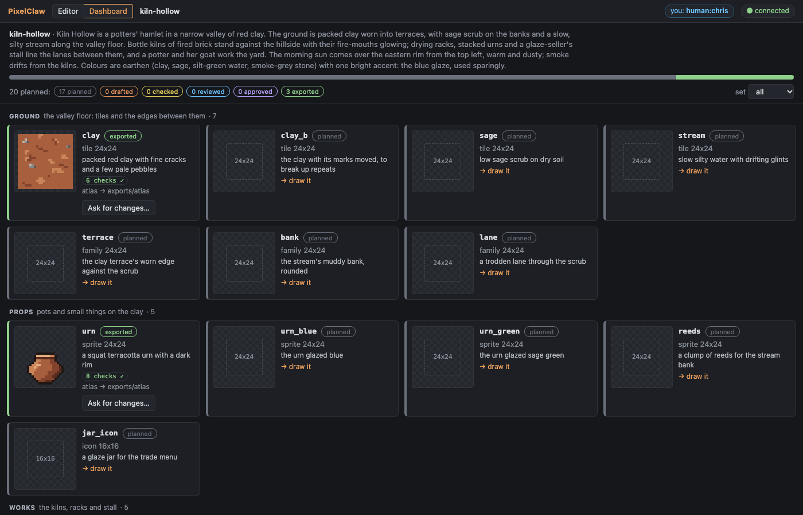

# PixelClaw

A pixel art editor built for an AI agent to drive by command. The agent draws with exact
commands, sees exact feedback, and checks its own work. People watch and edit in a live browser
view, and every human edit is written down as a command, so the agent reads what changed and
carries on from there. All art is indexed colour.

Every edit is a line of a small command language. A document *is* its tape of commands replayed,
and replay is deterministic (integer maths, seeded randomness), so the same tape always gives the
same pixels.

**Status: step G11 (the last builder step; the acceptance project A1 is next).** The core library and CLI; the MCP server and the live watch view;
editing in the browser, every action a command on the tape, and the agent's `changes` tool;
the drawing toolkit; checks and in-context previews against the project's style guide, with
flagged pixels circled, and a blind review bundle; animation and sprites; autotile
schemes as data and family documents built live from a band profile and a few pieces; map
documents, terrain painting, oversized objects and the map checks; export profiles, import
and densities; and the project pipeline: a manifest of the assets a game needs, each
asset's status worked out from the project (planned, drafted, checked, reviewed, approved,
exported), style-guide defaults, the `consistency` check across a set, flat templates (a mockup
screen and coverage maps) from the plan, a dashboard where a person approves work, the MCP `plan`
tool, a state cache, and a Claude Code skill; and G11: AI image underlays (an OpenAI provider with
the key from the environment, a cost cap and a cost log; any PNG imported) and `snap`, which fits
an underlay's pixel grid and quantises it into a draft layer; glyph-sheet fonts exported as a glyph
strip and BMFont; icon export modes and the icon-set checks. See [PROGRESS.md](PROGRESS.md).



## Use it from Claude Code

Build once (Node 22.18 or later, pnpm):

```sh
pnpm install
pnpm build
```

Register the MCP server with Claude Code, pointing at a project folder (created if missing):

```sh
claude mcp add pixelclaw -- node /path/to/pixelclaw/cli/dist/pixelclaw.js serve --project ~/art/mossy-ruins.pclaw --port 7417
```

Once the package is published to npm, the same thing is
`claude mcp add pixelclaw -- npx -y pixelclaw serve --project ~/art/mossy-ruins.pclaw --port 7417`
(until then, `npx -y --package /path/to/pixelclaw-0.2.0.tgz pixelclaw serve …` works from a tarball
made with `cd cli && pnpm pack`).

Install the skill, which teaches Claude Code the workflows, the house rules and the blind-review
hand-off ([docs/pipeline.md](docs/pipeline.md#the-skill)):

```sh
node /path/to/pixelclaw/cli/dist/pixelclaw.js skill install     # into ~/.claude/skills/pixelclaw
```

Start `claude` and ask for the watch link: the `project` tool returns
`http://127.0.0.1:7417/?token=…`. Open it, then ask Claude to draw. Draw in the page too, or pin a
note on a pixel, and tell Claude: its `changes` tool returns your lines, your notes and a diff
image. Give it a theme and it plans a whole set: a manifest you follow on the page's Dashboard tab.
The tools are `project`, `run`, `view`, `check`, `changes`, `history`, `plan`, `review`, `export`
and `import`; see [docs/mcp.md](docs/mcp.md). [examples/demo-g2.md](examples/demo-g2.md),
[examples/demo-g3.md](examples/demo-g3.md) and [examples/demo-g4.md](examples/demo-g4.md) walk
through sessions, with scripts that stand in for the agent.

## Quick start (CLI)

The TypeScript sources run directly under Node 22.18+; `pnpm build` is only needed for the watch
view and the packaged `pixelclaw`.

```sh
pnpm install
pnpm test        # builds, then runs vitest and the Playwright browser tests

# make a project with a palette, then a 16x16 tile
node cli/bin/pixelclaw.js new my-art.pclaw --palette examples/src/mossy-ruins.json
node cli/bin/pixelclaw.js new my-art.pclaw tile slab 16x16 bg=stone1

# draw, then look
node cli/bin/pixelclaw.js run my-art.pclaw --asset slab -e "rect 1,1 14x14 c=stone3 fill
line 1,1 14,1 c=stone4 ; line 1,14 14,14 c=stone2"
node cli/bin/pixelclaw.js view my-art.pclaw slab all

# replay every tape and check it against the saved state
node cli/bin/pixelclaw.js verify my-art.pclaw
```

`pnpm pixelclaw <args>` is the same as `node cli/bin/pixelclaw.js <args>`.

## The CLI

| Command | Does |
|---|---|
| `pixelclaw new <project> [--palette <file>]...` | Create a project folder. Palettes can be `.json`, Lospec `.json`, `.hex` or `.gpl`. |
| `pixelclaw new <project> <kind> <name> <W>x<H> [opts]` | Create an asset (a `new` command). |
| `pixelclaw run <project> <script.pclaw>\|-\|-e "..." [--asset <name>] [--replace] [--by <who>] [--view <mode>] [--dry]` | Apply commands as one undo group. Any error applies nothing. `underlay generate`/`underlay import` lines are resolved first (an image provider or a file; the key from `OPENAI_API_KEY`). `--dry` applies to a copy, prints the checks and keeps nothing. |
| `pixelclaw seeds <project> <asset> <generator line> [--count N] [--from N] [--checks a,b] [--apply]` | Try the line with each seed as a dry run and rank the seeds by the checks; `--apply` runs the best. |
| `pixelclaw view <project> <asset> [render\|grid\|tile3x3\|diff\|game\|recolour\|anim\|map\|family\|density\|all] [--scale N] [--region x,y,WxH] [--frame N] [--marks failing] [--theme t]` | Write views and print the text grid (or the diff's list of changes). |
| `pixelclaw check <project> [<asset>...] [--checks a,b] [--marks]` | Run the quality checks against the style guide; exits 1 if any fails. See [docs/checks.md](docs/checks.md). |
| `pixelclaw export <project> [<asset>...] [--profile <name>] [--out <dir>]` | Write assets through an export profile (built-in `png`, `atlas`, `tiled`, `godot`, `aseprite-json`, `aseprite`, or the project's own). Refused while a server owns the project (export through its MCP `export`). See [docs/profiles.md](docs/profiles.md). |
| `pixelclaw export <project> <asset> --format split\|png\|strip\|bmfont [--out <dir>]` | One asset on its own: one-cell pieces, a PNG, or a font as a glyph strip or BMFont. |
| `pixelclaw import <project> <file.png\|file.aseprite\|folder> [--profile <name>] [--as <name>] [--grid WxH] [--slice WxH] [--set s] [--palette <p>\|--build]` | Make new assets from an image (quantised; a grid of frames, or `--slice` into one asset per cell, with manifest entries and checks), a folder of images or an `.aseprite` file, or read a profile's export back and compare. |
| `pixelclaw review <project> [<asset>...] [--set s] [--name n]` | Write a blind review bundle (images, palette, style guide, brief, rubric). |
| `pixelclaw plan <project> [--set s] [--order set\|scene] [--json] [--manifest <file>] [--templates]` | Requests from the dashboard first, then the asset plan and each asset's status, by set or scene by scene; write a manifest (checked first); draw the flat templates. See [docs/pipeline.md](docs/pipeline.md). |
| `pixelclaw request <project> [draw <asset> \| change <asset> --note "…" \| add <name> --kind k --size WxH …]`, `pixelclaw reply <project> <id> "<answer>"`, `pixelclaw cancel <project> <id>` | File, answer or withdraw requests as the dashboard does (validated the same way); without a kind, list what is open. See [docs/pipeline.md](docs/pipeline.md#requests-from-the-cli-and-mcp). |
| `pixelclaw work <project> [--port N]` | Work the request queue with a headless Claude Code session that has only PixelClaw's tools (no shell, files or web), up to the project's budget cap; only when the project enables it. See [docs/worker.md](docs/worker.md). |
| `pixelclaw skill install [--dest <dir> \| --project <dir>]` | Install the Claude Code skill (default `~/.claude/skills/pixelclaw`). |
| `pixelclaw verify <project> [<asset>...]` | Replay every tape and compare it with the saved state, the preview, the checkpoints and the state cache. |
| `pixelclaw upgrade <project> [<asset>...]` | Rewrite tapes from tape language 1 in language 2 (the palette in the `new` line); written only if the replay gives the same pixels, then verified. |
| `pixelclaw serve --project <project> [--port 7417] [--no-mcp]` | Own the project: MCP on stdin/stdout and the live watch view on localhost (the link, with its token, is printed to stderr). See [docs/mcp.md](docs/mcp.md). |

The command language is described in [docs/commands.md](docs/commands.md).

## A project folder

```
my-art.pclaw/
  project.json              name, tick rate, default palette, the style guide's check settings, preview themes
  style.md                  the style guide in words
  manifest.json             the asset plan (docs/pipeline.md)
  exported.json             each asset's last export (profile, folder, art hash), for its status
  templates/                flat templates drawn from the manifest: mockup screen, coverage maps
  palettes/<name>.json      entries (key, name, hex or role) and ramps
  assets/<name>/
    asset.json              kind, size, cell grid, wrap, palette, layers, frames, stamps, macros, open notes, fork link, state hash
    tape.jsonl              the history: one command per line, with its author
    preview.png             the current image at 1x (frame 1)
    checkpoints/            the state every 200 commands (NNNNNN.gwc): fast loading, checked by verify
  views/                    renders written by 'pixelclaw view' and the MCP 'view' and 'changes' tools
  reviews/<date>-<set>/     blind review bundles (and the findings brought back)
  reads.json                how far each agent has read each tape (for 'changes')
  .pixelclaw.lock           present while a server owns the project (not for git)
  .cache/state/<asset>.gwc  each asset's state after its tape, keyed by the tape (never committed)
```

## The demo

[`examples/mossy-ruins.pclaw`](examples/mossy-ruins.pclaw) uses an original 16-colour "mossy
ruins" palette and a style guide. Its seamless 24x24 stone floor tile is drawn by
[`examples/scripts/stone_floor.pclaw`](examples/scripts/stone_floor.pclaw); a seamless grass tile
with two variants and a treasure chest sprite by the G4 scripts beside it; a test sprite, the
glowcap, by G5's. G5's `*_fix.pclaw` and `*_review.pclaw` scripts fix what the checks and a blind
reviewer found, and G6's [`stone_floor_redraw.pclaw`](examples/scripts/stone_floor_redraw.pclaw)
lays the floor again as flagstones. G6 adds a walking figure in four directions
([`walker.pclaw`](examples/scripts/walker.pclaw)) and a shimmering water tile
([`water.pclaw`](examples/scripts/water.pclaw)). Every check passes on every asset. The views are
checked in:

- the stone floor: [8x render](examples/mossy-ruins.pclaw/views/stone_floor.render.png),
  [index grid](examples/mossy-ruins.pclaw/views/stone_floor.grid.txt),
  [3x3 preview](examples/mossy-ruins.pclaw/views/stone_floor.tile3x3.png)
- the grass: [3x3 preview](examples/mossy-ruins.pclaw/views/grass.tile3x3.png) (and
  [grass_b](examples/mossy-ruins.pclaw/views/grass_b.tile3x3.png),
  [grass_c](examples/mossy-ruins.pclaw/views/grass_c.tile3x3.png)),
  [index grid](examples/mossy-ruins.pclaw/views/grass.grid.txt)
- the chest: [8x render](examples/mossy-ruins.pclaw/views/chest.render.png),
  [game view](examples/mossy-ruins.pclaw/views/chest.game.png),
  [index grid](examples/mossy-ruins.pclaw/views/chest.grid.txt)
- the glowcap: [8x render](examples/mossy-ruins.pclaw/views/glowcap.render.png),
  [game view](examples/mossy-ruins.pclaw/views/glowcap.game.png)
- the walker: [anim sheet](examples/mossy-ruins.pclaw/views/walker.anim.png),
  [GIF](examples/mossy-ruins.pclaw/views/walker.anim.gif),
  [game view](examples/mossy-ruins.pclaw/views/walker.game.png)
- the water: [anim sheet](examples/mossy-ruins.pclaw/views/water.anim.png),
  [GIF](examples/mossy-ruins.pclaw/views/water.anim.gif),
  [3x3 preview](examples/mossy-ruins.pclaw/views/water.tile3x3.png)
- the shore (a blob47 family of 47 variants, sand meeting the shimmering water):
  [on an island](docs/screenshots/g7-shore-map.png), [playing with glints](docs/screenshots/g7-shore-map.gif),
  [every variant among its neighbours](docs/screenshots/g7-shore-family.png)
- the village (a 40x30 map: the shore, a meadow and lanes, four 48x48 houses, 24x48 trees and a
  well): [whole at 1x](docs/screenshots/g8-village.png), [a screen at game scale](docs/screenshots/g8-village-camera.png),
  [the hot spots before the variants](docs/screenshots/g8-hotspots.png), [in Tiled's format](examples/mossy-ruins.pclaw/exports/tiled/village.tmx);
  since G9 with rounder corners and its notes closed: [whole](docs/screenshots/g9-village.png), [a screen on the beach](docs/screenshots/g9-village-camera.png)
- the house at 2x, a density copy: [the levels and the reduction](docs/screenshots/g9-house-density.png); the walker,
  house and glints through the sample profile: [atlas page and CSV](examples/mossy-ruins.pclaw/exports/bramble/)

**At 48 px**: [`examples/ember-moor.pclaw`](examples/ember-moor.pclaw), an original heather
moor with its own palette ([`examples/ember-moor/`](examples/ember-moor/): theme, palette and the
scripts that build it), its project grid set to 48: a moor ground and two texture variants forked
from it, bog water, a blob47 bog pool, a waystone two cells tall, and a 20x12 map whose floor is a
`fill mix=` of the moor's looks ([the map](docs/screenshots/g14-moor-map.png)). The skill's
*Per-size defaults* table says what changes with the tile size.

The G2 demo ([examples/demo-g2.md](examples/demo-g2.md)) draws the same tile through MCP while you
watch. In the G3 demo ([examples/demo-g3.md](examples/demo-g3.md)) you fix three pixels and leave a
note, and the agent reads them with `changes` and carries on. The G4 demo
([examples/demo-g4.md](examples/demo-g4.md)) draws the grass, its variants and the chest. The G5
demo ([examples/demo-g5.md](examples/demo-g5.md)) checks them, fixes them by coordinates, and runs
a blind review. The G6 demo ([examples/demo-g6.md](examples/demo-g6.md)) animates the walker and
the water and plays them in the watch view at the game's speed. The G7 demo
([examples/demo-g7.md](examples/demo-g7.md)) builds a shore family of 47 variants from a band
profile and three hand-drawn pieces, puts it on a random island with the seam score over it, and
runs a blind review on the island. The G8 demo ([examples/demo-g8.md](examples/demo-g8.md)) builds
a coastal village map from those families plus a house, a tree and a well bigger than a cell,
finds where it repeats with the map checks and fixes it with texture variants; you move the well
in the watch view and the agent reads the move; then a blind review of the village at game scale.
The G9 demo ([examples/demo-g9.md](examples/demo-g9.md)) exports the G6-G8 art through a sample
export profile into a scratch game folder and reads it back exactly, writes the village for Tiled,
re-imports a sheet and edits it, and shows the village with its review notes closed and the house
at twice the density. Export profiles, import and densities: [docs/profiles.md](docs/profiles.md).
The G10 demo ([examples/demo-g10.md](examples/demo-g10.md)) starts a new game, *Kiln Hollow*
([`examples/kiln-hollow.pclaw`](examples/kiln-hollow.pclaw)), from a one-paragraph theme: a
palette, a style guide and a manifest of 20 assets, flat templates, then the clay tile, an urn and
a bottle kiln taken end to end (drawn, checked, reviewed blind, approved in the dashboard,
exported). The pipeline: [docs/pipeline.md](docs/pipeline.md).
The G11 demo ([examples/demo-g11.md](examples/demo-g11.md)) carries Kiln Hollow on: a mockup of a
6x4-tile yard (made offline, no key) as an **underlay**, **snapped** into a draft layer and three
tiles cut from it and cleaned by coordinates; a 5x7 **font** exported as a glyph strip and BMFont;
four HUD **icons** held to each other by the icon-set check. It also says how to run a live
underlay with your own OpenAI key ([how](examples/demo-g11.md#a-live-underlay-with-your-own-key)).
Screenshots: [the underlay](docs/screenshots/g11-yard-underlay.png), [the snapped draft](docs/screenshots/g11-yard-draft.png),
[the font](docs/screenshots/g11-font-editor.png), [its strip](docs/screenshots/g11-font-strip.png).
The G12 demo ([examples/demo-g12.md](examples/demo-g12.md)) is the work queue: a person imports
a sheet of pot shards into the **gallery** through the slice dialog, asks Claude for two planned
assets and a change from the **dashboard**, and the agent takes them with `plan` and `work`:
one done, one blocked on a question, one in progress. Scenes show what each place still needs.
To let Claude work the queue headless (it spends money), see [docs/worker.md](docs/worker.md).
Screenshots: [the request states](docs/screenshots/g12-states.png), [the gallery](docs/screenshots/g12-gallery.png),
[the slice dialog](docs/screenshots/g12-import-dialog.png), [scenes](docs/screenshots/g12-scenes.png).
The G13 demo ([examples/demo-g13.md](examples/demo-g13.md)) shows the fixes from the acceptance
run on a small set, Fern Ledge: a **seed search** on a calm tile and a pebble tried with a **dry
run**, a cliff family with **faces** and a **jittered** edge, a texture variant that **inherits the
band**, a map whose floor is **filled** in one line and whose ground is **walkable**, an underlay
**in the shape of its area** snapped on the **placement's grid**, and an export through a profile
with a **corner order**, **path shapes** and a **per-colour output map** (five tones).
Screenshots: [the map](docs/screenshots/g13-fern-ledge-map.png), [the fill tool](docs/screenshots/g13-map-fill.png),
[walkable](docs/screenshots/g13-map-walkable.png), [the tones](docs/screenshots/g13-export-tones.png).

The G14 demo ([examples/demo-g14.md](examples/demo-g14.md)) fixes what that map showed: Fern
Ledge's floor passes every per-tile check but shows a lattice of pebbles; the map-scale **lattice**
check fails it, and two more looks of the bed laid with **`fill mix=`** pass it. Then the **48 px**
example, Ember Moor, its project grid 48. Screenshots: [before](docs/screenshots/g14-fern-before.png)
and [after](docs/screenshots/g14-fern-after.png), [the fill tool's mix](docs/screenshots/g14-map-fill-mix.png),
[Ember Moor](docs/screenshots/g14-moor-map.png).

The G15 demo ([examples/demo-g15.md](examples/demo-g15.md)): requests **filed from the CLI**; the
worker run with the real Claude Code and a **stand-in model** that has `done` **refused while a check
fails**, fixes it and finishes, and finds it has **no shell and no files** (only PixelClaw's tools,
fenced to the project; see [docs/worker.md](docs/worker.md)); a terrain map with **no band along the
map's border** and its **inside a mix** of tiles. Screenshots: [before](docs/screenshots/g15-hollow-before.png)
and [after](docs/screenshots/g15-hollow-after.png), [the terrain tools](docs/screenshots/g15-map-terrain-tools.png),
[the worker's log](docs/screenshots/g15-worker-log.png).

The G16 demo ([examples/demo-g16.md](examples/demo-g16.md)): art help on a 48 px heath. A shingle and
a grass floor from the new **`pebbles`** and **`tufts`** generators (each a base and two looks
sharing `edges=`, seeds ranked by the checks), a **cliff plateau with side faces, corners and inner
corners**, a **lane** that widens with a plain middle and **turns diagonally**, standing stones that
**cast shadows**, and the new checks catching a **floating part** (`pieces`), **art on the canvas
edge** (`margin`) and a **reserved colour** misused. Screenshots: [the heath](docs/screenshots/g16-heath.png),
[the map editor](docs/screenshots/g16-map-editor.png), [the cliff](docs/screenshots/g16-cliff-map.png),
[pieces](docs/screenshots/g16-check-pieces.png).

## Packages

- `core`: the document (layers, frames, each author's context), palettes, command parser and
  normaliser, raster operations, helpers and generators, tape and replay, a PCG random generator,
  the checks, renders and previews, autotile schemes (data in `core/schemes`), families, maps and
  overlays, and PNG and GIF encoders. It uses no DOM or Node APIs, so it
  runs anywhere.
- `server`: the project folder, the single writer (one queue for every command), views, the MCP
  server (stdio) and the HTTP + WebSocket server for the watch view.
- `ui`: the watch view and editor (Vite + React + canvas 2D). It replays the tape with `core`
  itself, and its tools write commands that `core` previews before they are sent.
- `skill/`: the Claude Code skill (`pixelclaw skill install`).
- `cli`: the `pixelclaw` command. `pnpm build` bundles it with `core`, `server` and the built UI
  into `cli/dist` (no runtime dependencies), which is what `pnpm pack` ships.

## Licence

MIT. See [LICENSE](LICENSE). The built package bundles a few permissively licensed packages (the
MCP SDK, zod, React); their licences are written to `cli/dist/THIRD_PARTY_LICENSES.txt`.
