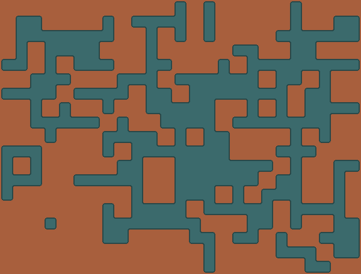
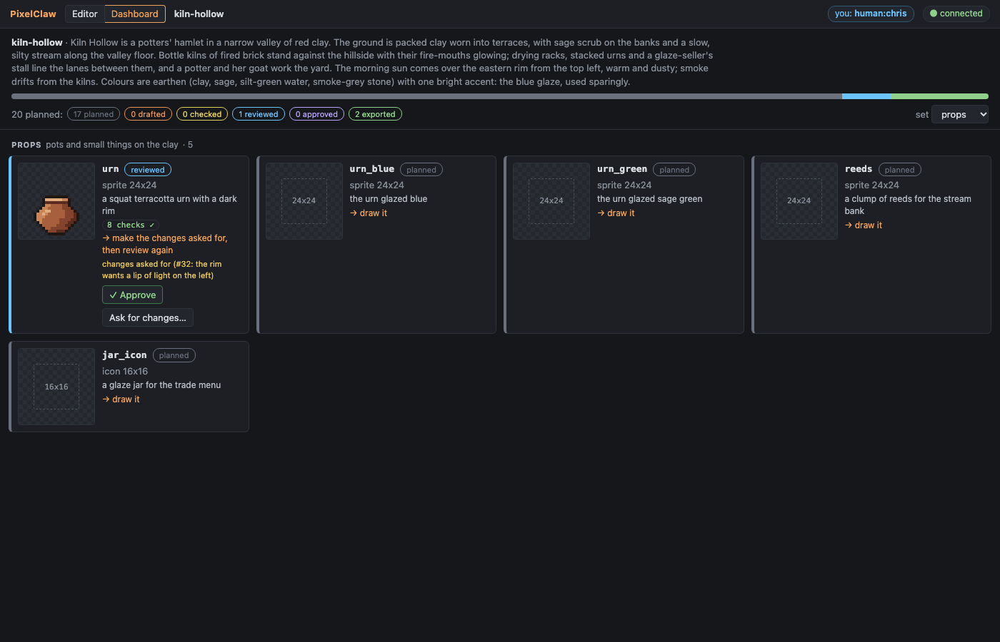

# The project pipeline: manifest, statuses, review and the skill

From a game's theme to exported art (plan §7.3). The agent writes a style guide and a **manifest**
(the asset plan); the tool works out where every planned asset stands, draws **flat templates**
from the plan, writes **blind review** bundles, and shows it all in the watch view's
**dashboard**. The **skill** teaches Claude Code the workflow.


## The manifest

`<project>/manifest.json`. Write it through the MCP `plan` tool (`plan(manifest=…)`) or
`pixelclaw plan <project> --manifest <file.json>`: it is checked against its schema and against
the project (palettes, schemes, profiles) first, and nothing is written when it has problems, each
reported with its path:

```
the manifest was not written; 2 problems:
  assets[20].name: 'kiln' is already assets[12]
  assets[20].size: pixels like "24x24"
```

```json
{
  "format": "pixelclaw-manifest",
  "version": 1,
  "theme": "One paragraph: the game's place, mood, light and materials.",
  "sets": { "ground": { "description": "the valley floor" }, "props": { "description": "pots and small things" } },
  "export": { "profile": "atlas" },
  "assets": [
    { "name": "clay", "kind": "tile", "size": "24x24", "set": "ground", "description": "packed red clay", "flat": "clay2" },
    { "name": "bank", "kind": "family", "size": "24x24", "set": "ground", "scheme": "blob47-round", "inside": "stream", "outside": "clay", "band": "2:outside 1:clay0 1:stream3 radius=3" },
    { "name": "urn", "kind": "sprite", "size": "24x24", "set": "props", "height": 14, "description": "a squat terracotta urn" },
    { "name": "urn_blue", "kind": "sprite", "size": "24x24", "set": "props", "recolourOf": "urn", "height": 14 },
    { "name": "potter", "kind": "sprite", "size": "24x24", "set": "folk", "frames": 2, "ticks": 12, "views": ["S", "N", "E", "W"], "mirror": { "W": "E" }, "height": 21 },
    { "name": "kiln", "kind": "object", "size": "24x48", "set": "works", "cells": "1x1", "height": 44 },
    { "name": "hollow", "kind": "map", "size": "32x24", "set": "scenes", "uses": ["bank", "kiln", "urn"] }
  ]
}
```

| Field | For | Meaning |
|---|---|---|
| `name` | all | a-z, 0-9, `_`, `-`; unique |
| `kind` | all | tile, sprite, sheet, icon, family, overlay, object, map |
| `size` | all | pixels `WxH` (a family: its tile, square and even; a map: cells `CxR`) |
| `set` | all | the group it is judged, reviewed and shown with (default: its kind); one of `sets` when `sets` is given |
| `description` | all | what it is meant to read as (the review's brief shows it) |
| `palette` | all | a project palette (default: the project's default) |
| `scheme`, `inside`, `outside`, `band` | family | the scheme (built in or `schemes/*.json`), the tiles on either side, the band profile |
| `frames`, `ticks` | animated | frames (per view), ticks per frame |
| `views`, `mirror` | sprite, object, sheet | directions (S, N, E, W), each once, and mirrors (`{ "W": "E" }`, both views listed) |
| `cells` | object | the footprint in cells |
| `height` | props, figures | the drawn shape's height in pixels; `consistency` holds the art to it (± 2) |
| `variantOf`, `recolourOf` | all | a texture variant or a palette-swap recolour of another planned asset of the same kind |
| `uses` | map | the planned assets it is built from |
| `flat` | all | its colour in the flat templates: a palette entry name or `#rrggbb` |

Top level: `format` and `version` (required), `theme` (a paragraph, required), `sets`
(`{ "<set>": { "description": "…" } }`), `export` (`{ "profile": "<name>", "dest": "<folder>" }`),
`assets`. Unknown fields are errors.

**What it gives the tools.** A planned asset's `new` line may leave out its size, palette and (a
family) scheme: `new sprite urn` becomes `new sprite urn 24x24 palette=… …` on the tape, so replay
never reads the manifest. Without a manifest entry the style guide's size for the kind
(`style.sizes`, the first of `a|b`) fills in. `consistency` compares an asset with the rest of its
set and with its planned `height`; `review(set=…)` reviews a set; templates come from it.

## Style-guide defaults and thresholds

The style guide is `style.md` in words and `project.json` `style` as settings
([checks.md](checks.md#the-style-guide)). G10 adds:

- `light` (`n` … `nw`): `shade` without `light=` uses it, and `consistency` holds the art to it.
- `outline` (already the outline colours): `outline` without `c=` draws in the first one the
  document's palette has.
- `sets`: thresholds per manifest set, between the style guide's and the asset's own
  (`"sets": { "props": { "checks": { "orphans": { "max": 1.5 } } } }`).

Defaults are filled in when a command is first run and written into its line.

## Statuses

Worked out from the project every time, never set by hand. Each stage needs the ones before it:

| Status | When |
|---|---|
| `planned` | in the manifest, not drawn |
| `drafted` | the asset exists (its checks are failing, or not run) |
| `checked` | every check passes |
| `reviewed` | a `mark reviewed` on its tape, and the art unchanged since |
| `approved` | a later `mark approved` (a person, in the dashboard), the art unchanged since |
| `exported` | its last export (`exported.json`) has the art as it is now |

**Marks** (plan §7.2) are tape commands: `mark <name> ["text"]`. Each keeps a hash of the art
(its frames as they look: not notes, marks or selections), so a later change to the pixels makes
it stale and the asset falls back to `checked`; `plan` says why (*the art changed since it was
reviewed (#30)*). `mark rejected "…"` (the dashboard's *Ask for changes*) after an approval sends
the asset back to `reviewed` with the reason; undoing the group takes a mark away. Any other name
is a free label (`mark first_pass "the outline is done"`).

**Exports** through a profile (MCP `export`, `pixelclaw export --profile`) record each asset in
`<project>/exported.json`: the profile, the folder, the time and the art's hash.

`plan` (MCP) and `pixelclaw plan <project> [--set s] [--json]` report by set:

```
20 planned: 17 planned · 0 drafted · 0 checked · 0 reviewed · 0 approved · 3 exported

ground (the valley floor: tiles and the edges between them):
  exported clay (tile 24x24) → atlas in exports/atlas
  planned  clay_b (tile 24x24) → draw it
  …
props (pots and small things on the clay):
  reviewed urn (sprite 24x24) → make the changes asked for, then review again  [changes asked for (#32: the rim wants a lip of light on the left)]
```

Assets the manifest does not plan are listed under `unplanned`; a drawn asset that differs from
its plan (kind, size) is flagged.

## Flat templates

`plan(templates=true)` or `pixelclaw plan <project> --templates [--seed N]` draws, from the
manifest alone (no art needed), into `<project>/templates/`:

- `mockup.png` (1x), `mockup@2x.png` (labelled) and `mockup.txt`: one game screen
  (`style.camera`, default 16x9 cells) in flat colours: the first plain tile as the ground, each
  family's terrain over it (a road for path schemes, a blob for the others, with the band's shape),
  then the objects and figures standing on free ground, each its planned size and height.
- `<family>.coverage.png` and `.txt`: a coverage map per planned family, every variant its scheme
  can produce laid out (by `coverageTerrain`) in flat colours through the scheme's own geometry
  and the band profile: `blob47-round` included (176 variants on 25x19 tiles). The `.txt` names the
  variant in every cell. Paint over it to cut a family from it (route 3).

 

## The dashboard

The watch view's second tab (`…/?token=…&tab=dashboard`): the theme, a bar of the planned assets
by status, filters by status and set (only for looking), and a card per asset by set: its preview
(click to open it in the editor), status, kind and size, description, failing checks, what it
needs next and any flags. A person approves a `reviewed` asset (**✓ Approve**: `mark approved` on
its tape, by them) or asks for changes on a reviewed, approved or exported one (**Ask for
changes…**: `mark rejected "<reason>"`). The agent reads both with `changes`. The dashboard reloads
the plan after every batch and when the agent writes a manifest or exports.



## The review hand-off

`review(set=<set>)` (or `assets=[…]`; CLI `pixelclaw review <project> --set <set>`) writes
`reviews/<date>-<set>/` ([checks.md](checks.md#the-review-bundle)), now with `brief.md`: the
manifest's theme and each reviewed piece's description and planned size. The bundle names no
author and no method (a test holds every text file to that and every PNG to having no text
chunks). The tool calls no model: the agent starts a fresh-context agent with only *"Review the
pixel art in <folder> by following rubric.md in it"*, saves the answer as `findings.md`, pins each
finding with `note`, fixes by coordinates, closes the notes, and writes `mark reviewed "…"`.

## The skill

`skill/` holds a Claude Code skill: `SKILL.md` (the session routine, house rules, workflows for a
theme to a whole set, tiles, sprites, families and maps, and the blind-review hand-off) and
`manifest.md` (the manifest reference); the command reference is copied beside them. Install it:

```sh
pixelclaw skill install                    # ~/.claude/skills/pixelclaw (every project)
pixelclaw skill install --project .        # ./.claude/skills/pixelclaw (this project only)
pixelclaw skill install --dest <dir>       # anywhere
```

From the repo, `node cli/bin/pixelclaw.js skill install`; the built package carries the skill in
`cli/dist/skill`. Claude Code then offers it as `/pixelclaw` and uses it when asked to make pixel
art. The MCP server must be connected too (`claude mcp add pixelclaw -- … serve --project …`, see
the README).

## The state cache

Every call used to replay every asset's tape (a CLI call on the mossy-ruins example took 1.6 s).
Each asset's state after its whole tape is now kept in `<project>/.cache/state/<asset>.gwc`, keyed
by the SHA-256 of its tape file, of the engine (core's sources, or the bundle) and, for a language
1 tape, of the project's palettes. A writer reads it when the key matches and replays (then
rewrites it) otherwise; every save writes it. `.cache/` carries its own `.gitignore` and is never
committed. `pixelclaw verify` replays every tape and fails if a cache file with the current key
differs from the replay. On the mossy-ruins example: every asset's state 1018 ms → 75 ms, a CLI
`run` 1.55 s → 0.62 s (0.5 s of it Node starting), the example test 49 s → 10 s, the unit suite
58 s → 20 s.
