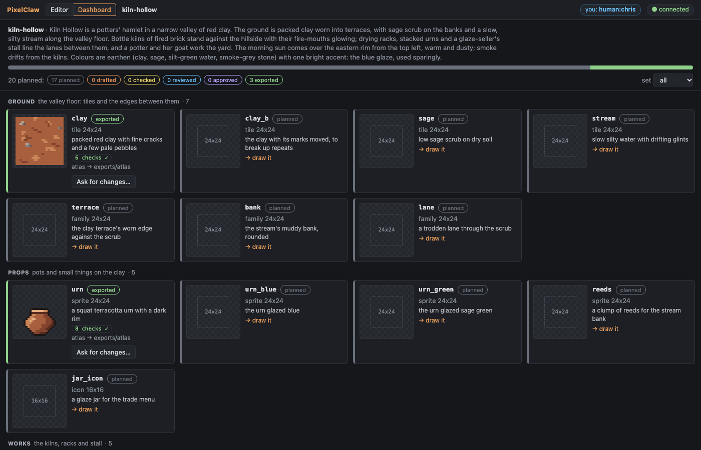
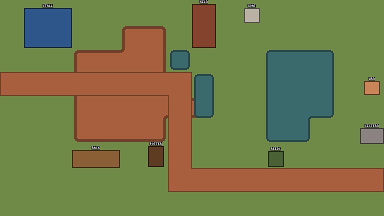
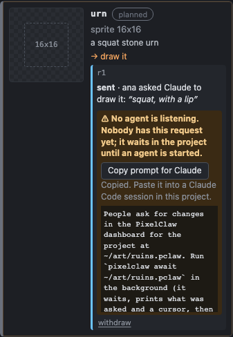
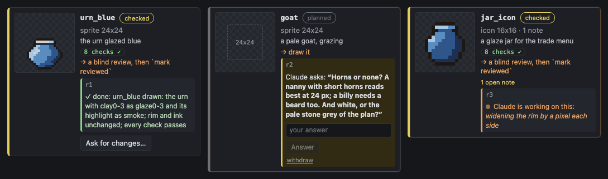
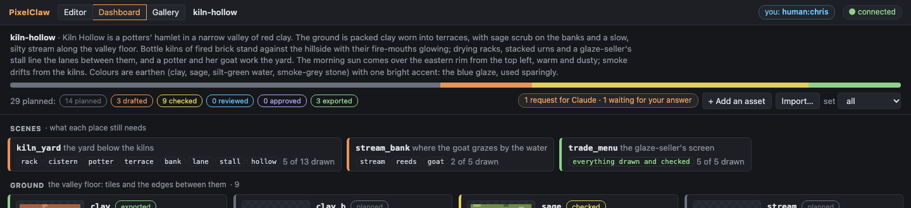
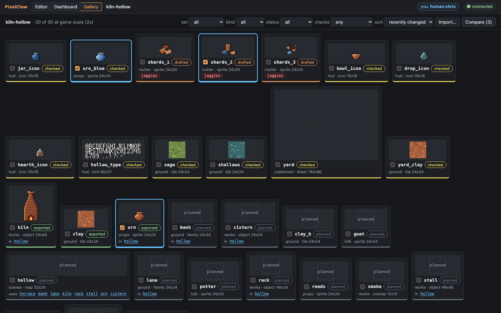
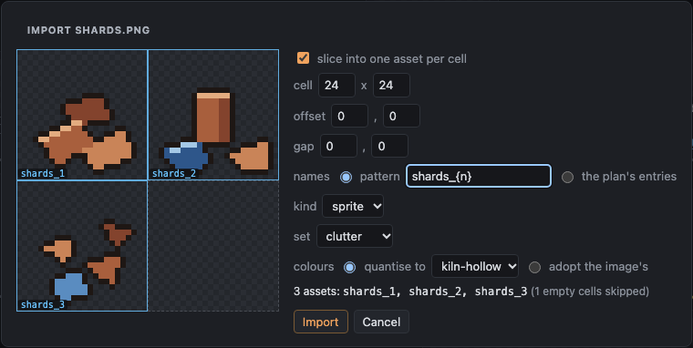

# The project pipeline: manifest, statuses, review and the skill

From a game's theme to exported art. The agent writes a style guide and a **manifest**
(the asset plan); the tool works out where every planned asset stands, draws **flat templates**
from the plan, writes **blind review** bundles, and shows it all in the watch view's
**dashboard**. The **skill** teaches Claude Code the workflow.



## The manifest

`<project>/manifest.json`. Write it through the MCP `plan` tool (`plan(manifest=…)`) or
`pixelclaw plan <project> --manifest <file.json>`: it is checked against its schema and against
the project (palettes, schemes, profiles) first, and nothing is written when it has problems, each
reported with its path:

```
the manifest was not written; 2 problems:
  assets[20].name: 'kiln' is already assets[12]
  assets[20].size: pixels like "24x24"
```

```json
{
  "format": "pixelclaw-manifest",
  "version": 1,
  "theme": "One paragraph: the game's place, mood, light and materials.",
  "sets": { "ground": { "description": "the valley floor" }, "props": { "description": "pots and small things" } },
  "export": { "profile": "atlas" },
  "assets": [
    { "name": "clay", "kind": "tile", "size": "24x24", "set": "ground", "description": "packed red clay", "flat": "clay2" },
    { "name": "bank", "kind": "family", "size": "24x24", "set": "ground", "scheme": "blob47-round", "inside": "stream", "outside": "clay", "band": "2:outside 1:clay0 1:stream3 radius=3" },
    { "name": "urn", "kind": "sprite", "size": "24x24", "set": "props", "height": 14, "description": "a squat terracotta urn" },
    { "name": "urn_blue", "kind": "sprite", "size": "24x24", "set": "props", "recolourOf": "urn", "height": 14 },
    { "name": "potter", "kind": "sprite", "size": "24x24", "set": "folk", "frames": 2, "ticks": 12, "views": ["S", "N", "E", "W"], "mirror": { "W": "E" }, "height": 21 },
    { "name": "kiln", "kind": "object", "size": "24x48", "set": "works", "cells": "1x1", "height": 44 },
    { "name": "hollow", "kind": "map", "size": "32x24", "set": "scenes", "uses": ["bank", "kiln", "urn"] }
  ]
}
```

| Field | For | Meaning |
|---|---|---|
| `name` | all | a-z, 0-9, `_`, `-`; unique |
| `kind` | all | tile, sprite, sheet, icon, family, overlay, object, map, font |
| `size` | all | pixels `WxH` (a family: its tile, square and even; a map: cells `CxR`; a font: a glyph cell) |
| `set` | all | the group it is judged, reviewed and shown with (default: its kind); one of `sets` when `sets` is given |
| `description` | all | what it is meant to read as (the review's brief shows it) |
| `palette` | all | a project palette (default: the project's default) |
| `scheme`, `inside`, `outside`, `band` | family | the scheme (built in or `schemes/*.json`), the tiles on either side, the band profile |
| `frames`, `ticks` | animated | frames (per view), ticks per frame |
| `views`, `mirror` | sprite, object, sheet | directions (S, N, E, W), each once, and mirrors (`{ "W": "E" }`, both views listed) |
| `cells` | object | the footprint in cells |
| `height` | props, figures | the drawn shape's height in pixels; `consistency` holds the art to it (± 2) |
| `variantOf`, `recolourOf` | all | a texture variant or a palette-swap recolour of another planned asset of the same kind |
| `uses` | map | the planned assets it is built from |
| `flat` | all | its colour in the flat templates: a palette entry name or `#rrggbb` |
| `chars` | font | the characters, as `new font … chars=` takes them: the characters themselves, or code points and ranges (`"32-126"`, `"U+0041-U+005A"`) |

Top level: `format` and `version` (required), `theme` (a paragraph, required), `sets`
(`{ "<set>": { "description": "…" } }`), `export` (`{ "profile": "<name>", "dest": "<folder>" }`),
`assets`. Unknown fields are errors.

**What it gives the tools.** A planned asset's `new` line may leave out its size, palette and (a
family) scheme: `new sprite urn` becomes `new sprite urn 24x24 palette=… …` on the tape, so replay
never reads the manifest. Without a manifest entry the style guide's size for the kind
(`style.sizes`, the first of `a|b`) fills in. `consistency` compares an asset with the rest of its
set and with its planned `height` (only like with like: ground tiles, figures, icons; a font is
never a peer); `review(set=…)` reviews a set; templates come from it. `new font <name>` takes the
cell size and `chars` from its entry.

**Mockup first**. The flat templates are the layout an image provider follows:
`underlay generate "<prompt>" layout=templates/mockup.png` on a sheet the size of the scene puts
a generated mockup under it; a person approves the look in the watch view; `snap` reads it into a
draft layer (block R² and the material match against the layout say whether to reroll); tiles
are cut from the draft with `import 0,0 asset=<sheet> region=… layer=draft` and cleaned with
commands until their checks pass. Or skip the snap and trace over the underlay at 24 px. See
[commands.md](commands.md#underlays-and-snap) and [examples/theme-to-set.md](../examples/theme-to-set.md).

## Style-guide defaults and thresholds

The style guide is `style.md` in words and `project.json` `style` as settings
([checks.md](checks.md#the-style-guide)). The pipeline adds:

- `light` (`n` … `nw`): `shade` without `light=` uses it, and `consistency` holds the art to it.
- `outline` (already the outline colours): `outline` without `c=` draws in the first one the
  document's palette has.
- `sets`: thresholds per manifest set, between the style guide's and the asset's own
  (`"sets": { "props": { "checks": { "orphans": { "max": 1.5 } } } }`).

Defaults are filled in when a command is first run and written into its line.

## Statuses

Worked out from the project every time, never set by hand. Each stage needs the ones before it:

| Status | When |
|---|---|
| `planned` | in the manifest, not drawn |
| `drafted` | the asset exists (its checks are failing, or not run) |
| `checked` | every check passes |
| `reviewed` | a `mark reviewed` on its tape, and the art unchanged since |
| `approved` | a later `mark approved` (a person, in the dashboard), the art unchanged since |
| `exported` | its last export (`exported.json`) has the art as it is now |

**Marks** are tape commands: `mark <name> ["text"]`. Each keeps a hash of the art
(its frames as they look: not notes, marks or selections), so a later change to the pixels makes
it stale and the asset falls back to `checked`; `plan` says why (*the art changed since it was
reviewed (#30)*). `mark rejected "…"` (the dashboard's *Ask for changes*) after an approval sends
the asset back to `reviewed` with the reason; undoing the group takes a mark away. Any other name
is a free label (`mark first_pass "the outline is done"`).

**Exports** through a profile (MCP `export`, `pixelclaw export --profile`) record each asset in
`<project>/exported.json`: the profile, the folder, the time and the art's hash.

`plan` (MCP) and `pixelclaw plan <project> [--set s] [--json]` report by set:

```
20 planned: 17 planned · 0 drafted · 0 checked · 0 reviewed · 0 approved · 3 exported

ground (the valley floor: tiles and the edges between them):
  exported clay (tile 24x24) → atlas in exports/atlas
  planned  clay_b (tile 24x24) → draw it
  …
props (pots and small things on the clay):
  reviewed urn (sprite 24x24) → make the changes asked for, then review again  [changes asked for (#32: the rim wants a lip of light on the left)]
```

Assets the manifest does not plan are listed under `unplanned`; a drawn asset that differs from
its plan (kind, size) is flagged.

## Flat templates

`plan(templates=true)` or `pixelclaw plan <project> --templates [--seed N]` draws, from the
manifest alone (no art needed), into `<project>/templates/`:

- `mockup.png` (1x), `mockup@2x.png` (labelled) and `mockup.txt`: one game screen
  (`style.camera`, default 16x9 cells) in flat colours: the first plain tile as the ground, each
  family's terrain over it (a road for path schemes, a blob for the others, with the band's shape),
  then the objects and figures standing on free ground, each its planned size and height.
- `<family>.coverage.png` and `.txt`: a coverage map per planned family, every variant its scheme
  can produce laid out (by `coverageTerrain`) in flat colours through the scheme's own geometry
  and the band profile: `blob47-round` included (176 variants on 25x19 tiles). The `.txt` names the
  variant in every cell. Paint over it to cut a family from it (route 3).

 

## The dashboard

The watch view's second tab (`…/?token=…&tab=dashboard`): the theme, a bar of the planned assets
by status, filters by status and set (only for looking), the **scenes** with what each still
needs, and a card per asset by set: its preview (click to open it in the editor), status, kind and
size, description, failing checks, what it needs next and any flags. A person approves a
`reviewed` asset (**✓ Approve**: `mark approved` on its tape, by them). The dashboard reloads the
plan after every batch and when the agent writes a manifest, exports or imports.


## Requests from the dashboard

People ask Claude for work without a chat:

- **Draw this…** on a planned card (an optional note): a `draw` request.
- **Ask for changes…** on any drawn card (what should change): a `change` request, and the same
  `mark rejected "<reason>"` on the asset's tape, by the person, as before.
- **+ Add an asset** (name, kind, size, set, height, what it is, a note): a new manifest entry,
  validated with the whole manifest first (nothing is written if it would have problems), and a
  `new` request to draw it.

Requests are records in `<project>/requests.jsonl`, one JSON object a line, only ever appended:

```json
{"type":"request","id":"r1","asset":"urn_blue","kind":"draw","note":"the deep blue glaze; keep the rim dark","by":"human:chris","at":"…"}
{"type":"claim","id":"r1","by":"claude","at":"…"}
{"type":"progress","id":"r1","by":"claude","at":"…","text":"swapping the clay ramp for the glaze ramp"}
{"type":"done","id":"r1","by":"claude","at":"…","text":"urn_blue drawn: …"}
{"type":"request","id":"r3","asset":"jar_icon","kind":"change","note":"a wider mouth","by":"human:chris","at":"…","mark":9}
```

A request's state is worked out from its records (core's `foldRequests`), and a record that does
not fit is refused before it is written:

| state | from | by |
|---|---|---|
| open | `request`, or `reply` to a blocked one | a person |
| claimed | `claim` (open only; the claimer may claim again); `progress` posts a note | the agent |
| done | `done` with what changed (claimed, by the claimer; refused while the asset fails a check or is not drawn) | the agent |
| blocked | `blocked` with a question (claimed, by the claimer) | the agent |
| cancelled | `cancel` (open, claimed or blocked) | a person |

The cards show each request live, in the order it really happens: **sent** (written to the
project, no agent has it); **seen by claude** (an agent was handed it by `await`, `plan` or
`work`: a `{"type":"seen","id":"r1","by":"claude","at":"…"}` record, once per agent; an answer
to a blocked request clears it, since the answer has not been seen yet); **Claude is working on
this** (with its latest progress note) while the claimer's batches arrive on the asset; Claude's
question with an answer box when blocked; ✓ done with what changed. Files with no `seen` records
read as before.

**Nobody listening.** A server knows an agent is listening when an `await` is waiting, an MCP
session called `work`, `plan` or `await_requests` in the last five minutes, or the worker is
running. With none, or when a request is still unseen after two minutes, its card and the header
say so plainly, with *Copy prompt for Claude* (a ready prompt that tells a Claude Code session to
run `pixelclaw await <this project>` in the background and work each request as it arrives) and,
when `project.json` enables the worker, *Start the worker*. Filing a request with nobody
listening says so at once.



### Hearing about requests: `await`

```
pixelclaw await <project-folder | watch-url> [--timeout <seconds>, default 600] [--since <cursor>] [--as <name>] [--json]
```

Blocks on the running server until a person files a request, answers a blocked one, withdraws one,
or writes an approval, rejection or review mark in the dashboard; then prints and **exits**:

```
2 events:
  request r4 (urn) from human:ana at 2026-11-05T12:00:00Z: "make it taller"
    next: work (claim it: work id=r4)
  approved turf from human:ana at 2026-11-05T12:01:10Z: "good"
    next: changes (read what the person did to turf)
next cursor: 3fa91c:7
```

Exit 0 with events, **3** on timeout (`no new events` and the cursor), 1 if no server can be
reached. The exit is the design: an agent (Claude Code) runs it as a background command, and the
process ending is what returns control to the model; a notification over MCP does not wake a
model. Run it again with `--since <cursor>` after every exit, so nothing is missed or repeated;
with no cursor, requests that are still open and unseen are the events, so a freshly started
listener picks up what is waiting. The agent's own `claim`, `progress` and `done` are not events.
`next: work` means claim the request with the MCP `work` tool; `next: changes` means read what the
person did (the `changes` tool). `--as` names the listener (default `claude`); the requests it is
handed are recorded as seen by that name.

It works while `serve` holds the project (also with `--no-mcp`): the target is the project folder
(found through the lock file and a token file that only the user can read: mode 0600 in a 0700
folder outside the project, removed when the server stops) or the watch URL with its token. The
MCP tool `await_requests` (`timeout` seconds, at most 120; `cursor`) is the same wait for an agent
that stays in a tool call. `plan`, on the CLI and over MCP, says when there are open requests and
nothing is waiting for them.



### Requests from the CLI and MCP

The same requests, checked the same way for an agent or a script that
plans the work and leaves the drawing to the worker:

```sh
pixelclaw request harbour.pclaw draw crab_pot --note "rope handles"
pixelclaw request harbour.pclaw change shingle --note "fewer white pebbles"     # also: mark rejected "…" on its tape
pixelclaw request harbour.pclaw add buoy --kind sprite --size 24x24 --set props --description "a red float" --height 18
pixelclaw request harbour.pclaw                     # what is still open, claimed or blocked
pixelclaw reply harbour.pclaw r4 "Rope, brown."    # answer a blocked request: it opens again
pixelclaw cancel harbour.pclaw r5 "not needed"
```

The author is `claude` unless `--by human:<name>` says otherwise. While a server owns the
project these are sent to it (through its writer, so the dashboard shows them at once). MCP's `request` tool takes `kind` draw, change or add (with
`entry`, the manifest entry), or `action` reply or cancel with `id` and `text`. The worker's own
connection does not offer it: the worker takes requests, it does not file or answer them.

### Working requests without MCP

A Claude Code session with no PixelClaw MCP tools (a project served with `serve --no-mcp`, or
an agent that only has a shell) works requests with `pixelclaw work`, which does what the MCP
`work` tool does:

```sh
pixelclaw await ruins.pclaw &                          # wait in the background; its exit wakes you
pixelclaw work ruins.pclaw list                        # the open requests (the cards say seen by claude)
pixelclaw work ruins.pclaw claim                       # take the next open one (or: claim r3); prints what is asked
pixelclaw work ruins.pclaw progress "blocking in the body"
pixelclaw work ruins.pclaw done "drew the urn: squat, a dark lip"
pixelclaw work ruins.pclaw block r3 "Glazed or bare clay?"
```

After `claim` the id may be left out (it is the request you hold). `done` is refused, and
nothing is written, while the asset fails a check or is not drawn yet: the error lists the
checks, so fix them (`pixelclaw check` shows the pixels) or `block` with a question. `--by`
names the agent (default `claude`). While a server runs these go through it, so the card moves
from sent to seen by claude, working and done as you go, and calling them counts as listening
for five minutes, as MCP calls do. `pixelclaw work <project> start` (or the older
`pixelclaw work <project>`) is the headless worker below.

```
$ pixelclaw work ruins.pclaw claim
claimed r1
r1 draw urn: "squat" (from human:ana at 2026-11-05T20:30:21Z; claimed by claude)
plan: urn is a sprite 16x16 in set props: a squat stone urn (drawn height 12 px)
status: planned → draw it
Draw it: run with `new sprite urn` (the manifest fills in its size and palette), look, check, fix; then `pixelclaw work ruins.pclaw done r1 "<what you drew>"`.
If you cannot go on without the person, `pixelclaw work ruins.pclaw block r1 "<one clear question>"`.
```

### Claude without a session: the worker

MCP cannot wake a Claude session, so `pixelclaw work <project> start` (or **▶ Start Claude** on the
dashboard) starts one: Claude Code headless (`claude -p`) with the PixelClaw MCP server and the
skill, working the queue until it is empty or the budget cap is reached. Off by default (it
spends money); see [worker.md](worker.md) for how to turn it on, the command line, the cap and the
log.

## Scenes

`scenes` in the manifest (optional): the places the game shows, the assets each needs, and the
map document that builds it, if any (its own `uses` count too):

```json
"scenes": [
  { "name": "kiln_yard", "description": "the yard below the kilns", "uses": ["clay", "kiln", "rack", "urn", "cistern", "potter"], "map": "hollow" }
]
```

The dashboard lists each scene's missing assets (dashed: not drawn) and unfinished ones (red:
drawn, checks failing); `plan(order="scene")` (CLI `pixelclaw plan --order scene`) lists the
work scene by scene. `map gen` on a planned map stands the drawn objects its `uses` lists on the
ground it lays ([commands.md](commands.md)).



## The gallery

The third tab (`&tab=gallery`): every asset at game scale (the style guide's `drawScale`),
animated ones playing at the game's tick rate, maps composed from what they use, planned ones as
dashed boxes. Filters by set, kind, status and failing check; a sort (by set, name, kind, status,
recently changed, size); tick the box on several and **Compare** shows them side by side at the
same scale (×2, ×4 to look closer). A map lists the assets it uses, and an asset the maps that
use it; click one to show just those. Click an asset to open it in the editor. Nothing here writes.



## Importing into the gallery

Drop a PNG sheet, a folder of PNGs or an `.aseprite` file on the dashboard or the gallery (or
**Import…**). A sheet gets the slice dialog: the cell size, the offset to the first cell and the
gap between cells, drawn over the image; names from a pattern (`{name}_{n}`, `{name}_{col}_{row}`)
or from the plan's undrawn entries of the chosen set, in reading order; the kind and set; quantise
to a project palette or adopt the image's. Empty cells are skipped. Each new asset's tape starts
with `import` (the file kept under `blobs/`), the manifest gets an entry for each it does not plan
yet, and every check is run; the result says what each found (an imported asset is `drafted`
until its checks pass, like any other). MCP `import(slice=…, set=…)` and `pixelclaw import
--slice 24x24 --set …` reach the same import.



## The review hand-off

`review(set=<set>)` (or `assets=[…]`; CLI `pixelclaw review <project> --set <set>`) writes
`reviews/<date>-<set>/` ([checks.md](checks.md#the-review-bundle)), now with `brief.md`: the
manifest's theme and each reviewed piece's description and planned size. The bundle names no
author and no method (a test holds every text file to that and every PNG to having no text
chunks). The tool calls no model: the agent starts a fresh-context agent with only *"Review the
pixel art in <folder> by following rubric.md in it"*, saves the answer as `findings.md`, pins each
finding with `note`, fixes by coordinates, closes the notes, and writes `mark reviewed "…"`.

## The skill

`skill/` holds a Claude Code skill: `SKILL.md` (the session routine, house rules, workflows for a
theme to a whole set, tiles, sprites, families and maps, and the blind-review hand-off) and
`manifest.md` (the manifest reference); the command reference is copied beside them. Install it:

```sh
pixelclaw skill install                    # ~/.claude/skills/pixelclaw (every project)
pixelclaw skill install --project .        # ./.claude/skills/pixelclaw (this project only)
pixelclaw skill install --dest <dir>       # anywhere
```

From the repo, `node cli/bin/pixelclaw.js skill install`; the built package carries the skill in
`cli/dist/skill`. Claude Code then offers it as `/pixelclaw` and uses it when asked to make pixel
art. The MCP server must be connected too (`claude mcp add pixelclaw -- … serve --project …`, see
the README).

## The state cache

Every call used to replay every asset's tape (a CLI call on the mossy-ruins example took 1.6 s).
Each asset's state after its whole tape is now kept in `<project>/.cache/state/<asset>.gwc`, keyed
by the SHA-256 of its tape file, of the engine (core's sources, or the bundle) and, for a language
1 tape, of the project's palettes. A writer reads it when the key matches and replays (then
rewrites it) otherwise; every save writes it. `.cache/` carries its own `.gitignore` and is never
committed. `pixelclaw verify` replays every tape and fails if a cache file with the current key
differs from the replay. On the mossy-ruins example: every asset's state 1018 ms → 75 ms, a CLI
`run` 1.55 s → 0.62 s (0.5 s of it Node starting), the example test 49 s → 10 s, the unit suite
58 s → 20 s.
