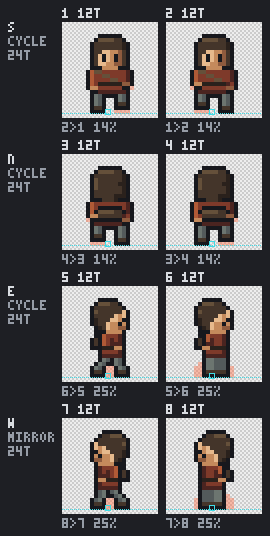
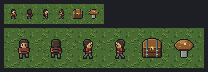
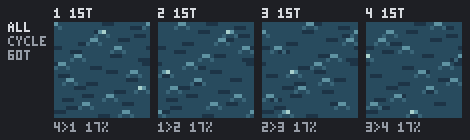
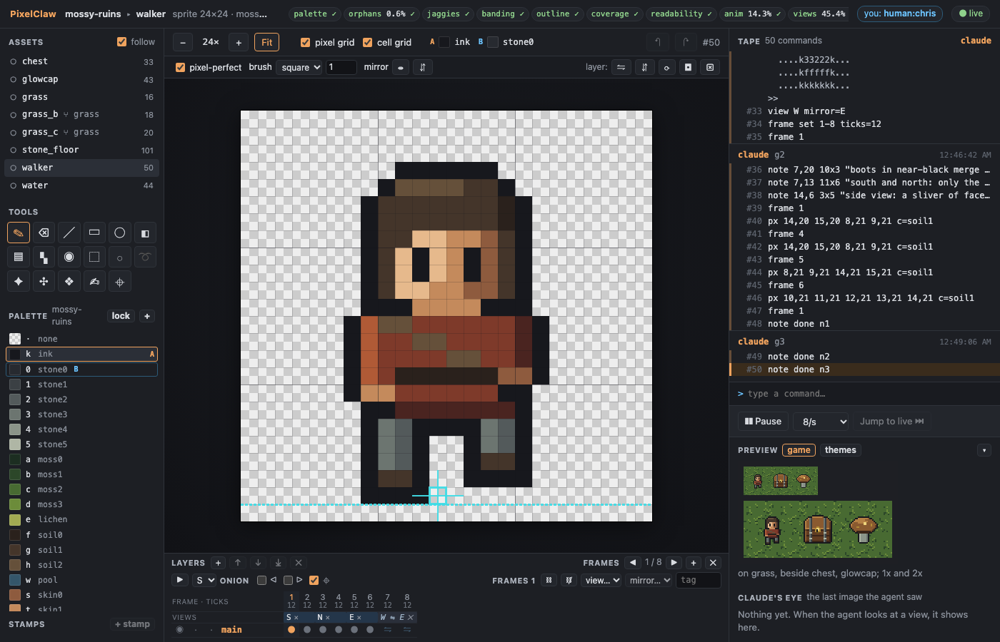
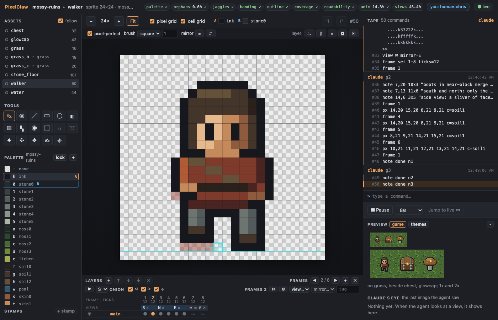
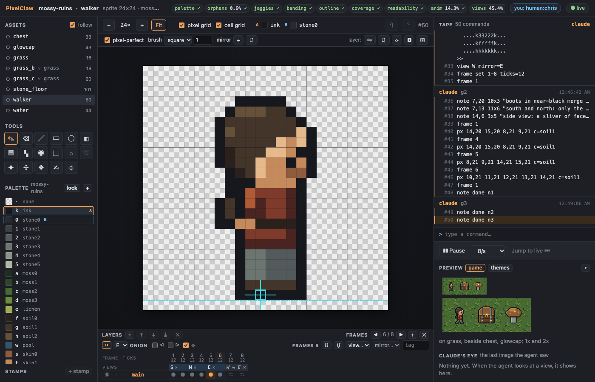
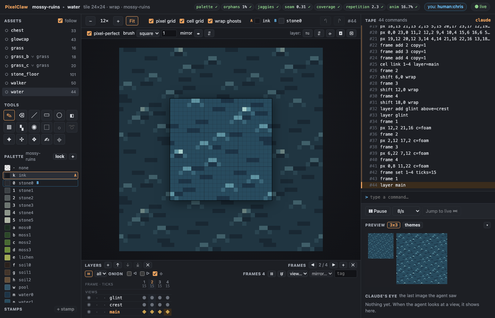
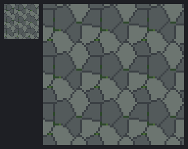

# Animation and sprites

The agent animates: a walking figure in four directions with two frames each (south, north and
east drawn; west a live mirror of east), and a water tile that shimmers in four frames. Each frame
has its duration in game ticks; the anim checks (frame diff share, pivot and ground drift, loop
seam) and the view distinctness check run over every frame, with every other check, after every
batch. The agent looks at the `anim` contact sheet (onion skin, ticks, pivot and ground line,
the change from frame to frame) and saves a GIF for you; you play both in the watch view at the
game's speed. The stone floor is redrawn as flagstones (the reviewer found it read as a wall),
and a blind reviewer judges the new art.

You need Node 22.18 or later and pnpm. Build once, from the repo:

```sh
pnpm install
pnpm build
```

## With Claude Code

Register the server and open the watch link as in [watch-and-edit.md](watch-and-edit.md) (steps 1 and 2), then
ask, for example: *Draw a 24x24 walking figure for the mossy ruins: four directions, two walk
frames each, west mirroring east, feet on row 22, 12 ticks a frame. Then a 24x24 water tile that
shimmers in four frames and loops without a seam. Keep every check green, look at the anim views,
and tell me when I can play them.*

## With the stand-in agent

```sh
node examples/animation-agent.ts            # --pause <ms> between batches (default 1500), --linger <s> (default 600)
```

It starts `pixelclaw serve` on `out/animation.pclaw` exactly as Claude Code would, prints the watch
link, rebuilds the earlier art from its scripts, and then draws from
[walker.pclaw](scripts/walker.pclaw), [water.pclaw](scripts/water.pclaw) and
[stone_floor_redraw.pclaw](scripts/stone_floor_redraw.pclaw), batch by batch, printing the check
summary after each. Then it writes a review bundle, applies the review round
([walker_review.pclaw](scripts/walker_review.pclaw),
[stone_floor_flagreview.pclaw](scripts/stone_floor_flagreview.pclaw)), and lingers so you can play
the animations. Stop it with Ctrl-C.

## 1. The walking figure

The script adds the figure's colours to the document's palette (skin and cloth ramps) and saves
them as the project palette `ruins-folk`, makes eight frames, and names the directions:

```
view S frames=1-2
view N frames=3-4
view E frames=5-6
pivot 11,22
ground 22
```

Then each frame is a paint block, and at the end:

```
view W mirror=E          # frames 7-8: east flipped, kept up to date
frame set all ticks=12   # 5 frames a second at 60 ticks a second
```

Drawing on frame 7 is refused (`frame 7 is in view W, a live mirror of E: draw on E (frame 5), or
view W mirror=off`); drawing on frame 5 changes frame 7 too. The run summary checks every frame:

```
checks: palette 0 ✓ · orphans 0.6% ✓ · jaggies 0 ✓ · banding 0 ✓ · outline 1 ✓ · coverage 0 ✓ · readability 1 ✓ · anim 14.3% ✓ · views 45.4% ✓
```

On the way there the checks found what was wrong by frame and pixel: a lone skin pixel for a
hand, a hair highlight that made doubled L-corners, a 1-px notch between the legs in the side
view, the boots' two tones as lone pixels; each was fixed in the script. The anim check holds the
walk to 8-35 % of the figure changing per frame (it changes 14 % facing south and north, 25 %
facing east), no sliding (pivot drift 0.2 px) and both feet's lowest row on the ground line in
every frame; the views check finds the four directions distinct (south and north differ by 45 %).

`view(mode="anim")` returns the contact sheet ([walker.anim.png](mossy-ruins.pclaw/views/walker.anim.png)),
the numbers, and a GIF ([walker.anim.gif](mossy-ruins.pclaw/views/walker.anim.gif)):

```
walker: 8 frames at 60 ticks/s; pivot 11,22; ground 22
  S: cycle, frames 1,2, ticks 12,12 (a loop is 24 ticks, 400 ms); changed 1→2 14%, 2→1 14%
  N: cycle, frames 3,4, ticks 12,12 (a loop is 24 ticks, 400 ms); changed 3→4 14%, 4→3 14%
  E: cycle, frames 5,6, ticks 12,12 (a loop is 24 ticks, 400 ms); changed 5→6 25%, 6→5 25%
  W: mirror of E, cycle, frames 7,8, ticks 12,12 (a loop is 24 ticks, 400 ms); changed 7→8 25%, 8→7 25%
```



The game view shows every direction on the grass at 1x and 2x:



## 2. The water

[water.pclaw](scripts/water.pclaw) adds a water ramp (saved as `ruins-water`) and draws three
layers: the body (dark troughs, one in every row, starting in a shuffled order of columns so no
row or column is darker than the rest), crests (an arc every other row), and glints. Four frames:
the body's cels are **linked** (`cel link 1-4 layer=main`, one shared cel), the crests move a
quarter of the tile each frame (`shift 6,0 wrap`, so after four frames they are back where they
started and the loop has no seam), and the glints move to other crests. 15 ticks a frame.

```
checks: palette 0 ✓ · orphans 1% ✓ · jaggies 1 ✓ · seam 0.31 ✓ · coverage 0 ✓ · repetition 2.3 ✓ · anim 16.7% ✓
```

Every pair changes 17 %, the loop seam (4→1) included. The first try used `noise` for the body:
it looked like a maze, not water, and the repetition check found its rows; the generator above is
what came out of that, with the seed picked from a few by the checks.



## 3. Watch it play

In the watch view, choose `walker`: the timeline shows each frame's number and ticks, the views
(`S`, `N`, `E`, and `W ⇋ E` for the mirror) and, for the water, linked cels as ◆. ▶ (or Enter)
plays the chosen sequence at the game's speed (60 ticks a second); the onion skin shows the frame
before (red) and after (blue) yours in its view; ⌖ shows the pivot and ground line.






Everything you change in the timeline is a command on the tape with your name: double-click a
frame number to set its ticks (`frame set 1-2 ticks=9`), Shift+click frame numbers to choose a
run of them and tag it (`tag add walk 1-2 loop=cycle`), make it a direction (`view E
frames=1-2`) or add a mirror (`view W mirror=E`), link or unlink its cels (`cel link 3-4
layer=main`); the ⌖ tool (P) sets the pivot (`pivot 11,22`) and, with Shift, the ground line.
Playing and the onion skin only change what you see.

## 4. The stone floor, as a floor

the blind reviewer said the floor (three courses of bevelled stones) read as a wall more than a
floor. [stone_floor_redraw.pclaw](scripts/stone_floor_redraw.pclaw) lays it again as flagstones
seen from above with `voronoi` (seven slabs of three tones, wrapping, dark joints, no bevel), and
a little moss in the joints:



Its checks pass except `repetition`, which no jointed floor tried passed (about thirty layouts of
slabs: the joints themselves make rows and columns darker than the rest), so the style guide's
exception for this tile stays, with its reason changed (`style.md`: "its joints are its pattern").

## 5. The blind review

`review` writes a bundle with the new anim contact sheets and GIFs and every direction in the
scenes, and a sixth question in the rubric (does the motion read, slide, float or hitch at the
loop?). A fresh agent judged it blind: the floor now reads as
flagstones; the walker reads at 1x in all four directions; the water loops with no hitch. Its
defects on the new art came back as notes on the pixels; the floor's soil dash and thin moss and
the walker's near-black boots were fixed by coordinates and their notes closed. The rest (the
south and north walk could swing the arms, the side view's face is a sliver, the water's marks
are all one size, the chest is as tall as the figure) are polish beyond this walkthrough, left as
open notes and listed in the findings.

## In the CLI

```sh
node cli/bin/pixelclaw.js view examples/mossy-ruins.pclaw walker anim    # the sheet, the numbers, the GIF
node cli/bin/pixelclaw.js check examples/mossy-ruins.pclaw walker water   # every frame
node cli/bin/pixelclaw.js upgrade my-old.pclaw                            # language 1 tapes to language 2
```
