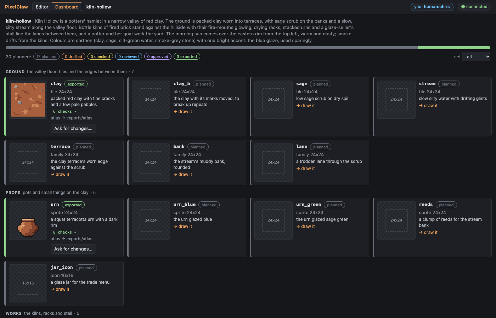
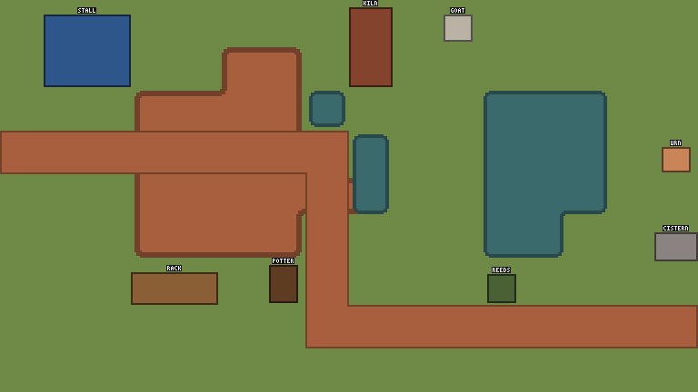
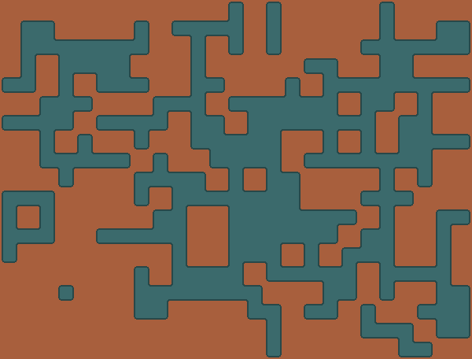
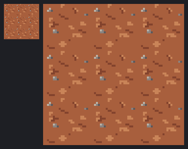
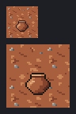
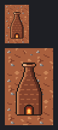
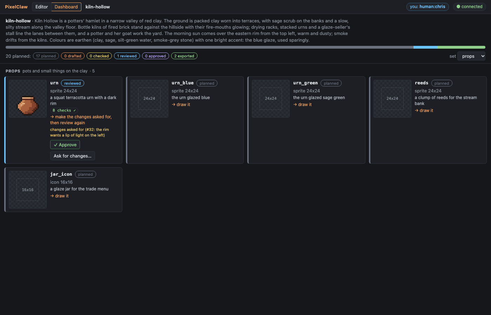
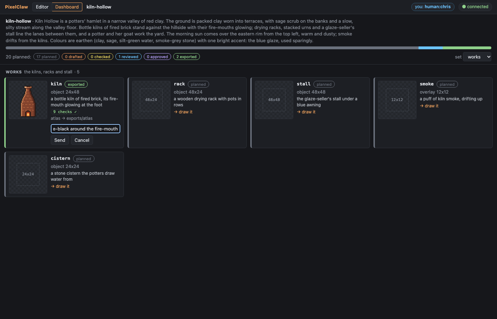
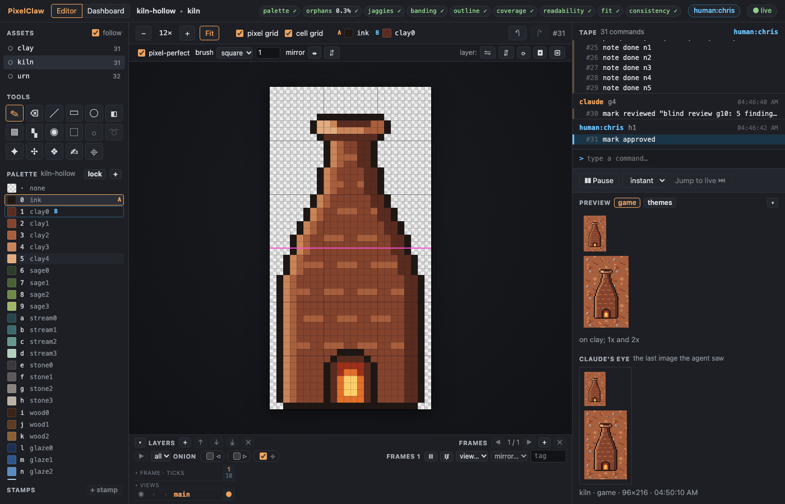

# Demo G10: from a theme to a planned set, three assets end to end

The agent starts a new game's art from one paragraph. It writes a palette, a style guide and a
manifest of 20 assets in five sets; the tool checks the manifest against its schema, draws flat
templates from it (a mockup screen and a coverage map per family, the stream's rounded
`blob47-round` bank included), and the dashboard shows the 20 planned assets. Then the agent takes
three of them end to end: the clay ground tile, a terracotta urn and a 24x48 bottle kiln are
drawn (their `new` lines leave the size to the manifest), checked, reviewed by a fresh-context
agent that sees only the review bundle, fixed by coordinates, marked reviewed, approved by a
person in the dashboard and exported through the manifest's profile.

The theme, *Kiln Hollow*, and all its art are original, made for this demo.

You need Node 22.18 or later and pnpm. Build once, from the repo:

```sh
pnpm install
pnpm build
```

## With Claude Code

Install the skill and register the server on a new project, then open the watch link as in
[demo-g2.md](demo-g2.md):

```sh
node cli/dist/pixelclaw.js skill install
claude mcp add pixelclaw -- node "$PWD/cli/dist/pixelclaw.js" serve --project ~/art/kiln-hollow.pclaw --port 7417
```

Then give Claude the paragraph in [kiln-hollow/theme.md](kiln-hollow/theme.md) and ask, for
example: *Plan the art for this game: a palette, a style guide and a manifest of about twenty
assets in sets. Draw the flat templates and show me the mockup. Then take the clay tile, an urn
and a bottle kiln all the way: draw them, get every check green, have them reviewed blind, and
when I have approved them in the dashboard, export them.* The skill tells Claude the workflow; the
dashboard (`…&tab=dashboard`) shows where everything stands, and its **✓ Approve** and **Ask for
changes…** buttons write `mark` commands on the asset's tape that Claude reads with `changes`.

## With the stand-in agent

```sh
node examples/demo-g10-agent.ts            # --pause <ms>, --person no (approve them yourself), --linger <s>
```

It starts `pixelclaw serve` over stdio on `out/demo-g10.pclaw` (ignored by git) as Claude Code
would, and does what the skill describes, from the files in [kiln-hollow/](kiln-hollow/): the
theme, the palette, the style guide, the manifest, and the scripts for the three assets and their
review round. The blind review was run once for real (a fresh agent given only the bundle); its
report is [kiln-hollow/findings.md](kiln-hollow/findings.md), and the stand-in hands it back in
place of starting an agent. A headless browser plays the person who approves. The result is
checked in as [kiln-hollow.pclaw](kiln-hollow.pclaw) (`--keep` writes it). Below is what it
printed.

## 1. The theme

```
1. The theme (examples/kiln-hollow/theme.md):

  Kiln Hollow is a potters' hamlet in a narrow valley of red clay. The ground is packed clay worn
  into terraces, with sage scrub on the banks and a slow, silty stream along the valley floor. Bottle
  kilns of fired brick stand against the hillside with their fire-mouths glowing; drying racks,
  stacked urns and a glaze-seller's stall line the lanes between them, and a potter and her goat
  work the yard. The morning sun comes over the eastern rim from the top left, warm and dusty; smoke
  drifts from the kilns. Colours are earthen (clay, sage, silt-green water, smoke-grey stone) with
  one bright accent: the blue glaze, used sparingly.

   Watch the agent work, and the plan: http://127.0.0.1:7417/?token=…&tab=dashboard
```

## 2. The style guide and the palette

```
2. The style guide (style.md, and its settings in project.json) and the palette (kiln-hollow: 29 colours, 7 ramps)
  Palette · Light · Outline · Clusters · Sizes · Ground tiles · Readability · Round pots

```

## 3. The manifest

```
3. The manifest: 20 assets in five sets, written through the plan tool (checked against its schema first)
  the manifest was not written; 2 problems:
    assets[20].name: 'kiln' is already assets[12]
    assets[20].size: pixels like "24x24"
  wrote manifest.json: 20 assets
  20 planned: 20 planned · 0 drafted · 0 checked · 0 reviewed · 0 approved · 0 exported

```



The manifest is [kiln-hollow/manifest.json](kiln-hollow/manifest.json); its fields are in [docs/pipeline.md](../docs/pipeline.md#the-manifest). The broken one (a second `kiln` with a size of `24`) is refused whole.

## 4. The flat templates

```
4. The flat templates: a mockup screen and a coverage map per family (templates/)
  templates in out/demo-g10.pclaw/templates: mockup.png, mockup@2x.png, mockup.txt, terrace.coverage.png, terrace.coverage.txt, bank.coverage.png, bank.coverage.txt, lane.coverage.png, lane.coverage.txt
  A mockup screen, 16x9 cells of 24 px, laid out from the manifest (sets: ground, props, works, folk, scenes).
  
    0: aaaaaaaaaaKaaaaa
    1: aFFaabbaDaaaaaaa
    2: aaabbbbcaaacccaa
    3: bbbbbbbbcaacccaH
    4: aaabbbbbcaacccaa
    5: aaabbbbbaaacccaG
    6: aaaEEaJbaaaIaaaa
    7: aaaaaaabbbbbbbbb
    8: aaaaaaaaaaaaaaaa
  
    a  sage
    b  clay
    c  stream
    D  kiln stands here
    E  rack stands here
    F  stall stands here
    G  cistern stands here
    H  urn stands here
    I  reeds stands here
    J  potter stands here
    K  goat stands here
  blob47-round: 25x19 tiles of 24 px, 176 of 176 variants

```





## 5. Three assets drawn

```
5. Three assets drawn; their `new` lines leave the size to the manifest
  clay: checks: palette 0 ✓ · orphans 1.7% ✓ · jaggies 1 ✓ · seam 0.72 ✓ · coverage 0 ✓ · repetition 2.7 ✓
  urn: checks: palette 0 ✓ · orphans 0% ✓ · jaggies 0 ✓ · banding 0 ✓ · outline 1 ✓ · coverage 0 ✓ · readability 1 ✓ · consistency 0 ✓
  kiln: checks: palette 0 ✓ · orphans 0% ✓ · jaggies 0 ✓ · banding 0 ✓ · outline 1 ✓ · coverage 0 ✓ · readability 1 ✓ · fit 0 ✓ · consistency 0 ✓
  new object kiln 24x48 palette=kiln-hollow wrap=off cell=24x24 bg=none <<
    ✓  consistency 0      ≤ 0     no outliers against the plan
    ✓  readability 1      ≥ 0.8   edge contrast: 114 of 114 edge px differ from 'clay' by ΔL* ≥ 15; lightness spread: L* 8..61 inside the sprite
    ✓  fit         0      ≤ 0     1x2 cells, footprint 1x1 at 0,1 drawn, overhangs are roofs

```

## 6. The blind review

```
6. A blind review bundle, handed to a fresh agent with no other context
  out/demo-g10.pclaw/reviews/2026-10-28-g10: assets/clay.png, assets/clay.game.png, assets/urn.png, assets/urn.game.png, assets/kiln.png, assets/kiln.game.png, tiles/clay.3x3.png, scenes/urn.png, scenes/kiln.png, palette.md, brief.md, style.md, rubric.md
  The reviewer's report (a real one, kept in examples/kiln-hollow/findings.md) goes in the bundle as findings.md:
  1. Readability: 4. The kiln reads at a glance as a bottle kiln: a tall bottle shape with a glowing mouth that …
  2. Cohesion: 4. They look like one set: the same palette, the same 1-px ink outline, light from the top left, …
  3. Seams and repetition: 3. There are no hard seam lines. But the bottom five rows of the tile are much busier…
  4. Style-guide fit: 4. Only palette colours are used, the outline rule is followed, the light comes from the t…
  5. Defects: 3. There are doubled ink corners on the urn, a false second outline on the kiln's shadow side, a h…
  6. Animation: does not apply (no animated assets). 7. Autotiling: does not apply (no autotile sets). 8. Scenes…

```

The whole report, every finding pinned to pixels, and what was done about each: [kiln-hollow/findings.md](kiln-hollow/findings.md). The bundle: [reviews/2026-10-28-g10/](kiln-hollow.pclaw/reviews/2026-10-28-g10/) (with `brief.md`: the theme and what each piece is meant to be).

## 7. The review round

```
7. The findings pinned on their pixels, fixed by coordinates, the notes closed, then `mark reviewed`
  clay: applied 5 commands (notes); after the fixes checks: palette 0 ✓ · orphans 1.4% ✓ · jaggies 2 ✓ · seam 0.33 ✓ · coverage 0 ✓ · repetition 2.6 ✓
  urn: applied 7 commands (notes); after the fixes checks: palette 0 ✓ · orphans 0% ✓ · jaggies 2 ✓ · banding 0 ✓ · outline 1 ✓ · coverage 0 ✓ · readability 1 ✓ · consistency 0 ✓
  kiln: applied 5 commands (notes); after the fixes checks: palette 0 ✓ · orphans 0.3% ✓ · jaggies 0 ✓ · banding 0 ✓ · outline 1 ✓ · coverage 0 ✓ · readability 1 ✓ · fit 0 ✓ · consistency 0 ✓
    reviewed urn (sprite 24x24) → a person approves it in the dashboard
    planned  urn_blue (sprite 24x24) → draw it

```

After the review: the clay calmer, its pebbles varied and off their diagonal; the urn shaded two
to three pixels deep and standing on the cell's bottom; the kiln in darker brick with lighter
mortar up the cone, a solid far side and a rounded shoulder.

  

The urn's round belly steps its shading bands with its curve, and `jaggies` counts two of those
steps as doubled corners; the style guide allows two on the urns (its outline stays clean), with
the reason in [style.md](kiln-hollow/style.md). Plan question 138 asks whether `jaggies` should
leave steps inside one ramp alone.

## 8. A person approves

```
8. A person approves the three in the dashboard (each approval is `mark approved` on the tape, by them)
  (human:chris pressed Approve on clay, urn and kiln)
  clay: 1 command (1 by human:chris) since #30; now at #31
  #31 human:chris h1  mark approved
  kiln: 1 command (1 by human:chris) since #30; now at #31
  #31 human:chris h1  mark approved
  urn: 1 command (1 by human:chris) since #30; now at #31
  #31 human:chris h1  mark approved

```

The dashboard after a person asked for changes on the urn (`mark rejected "…"`: the urn goes back
to *reviewed* and says why), and with the form open on the kiln:





The kiln in the editor: its tape ends with the notes closed, `mark reviewed` and `mark approved`.



## 9. Exported

```
9. Exported through the manifest's profile (atlas), recorded in exported.json
  atlas: 3 images, wrote 2 files into exports/atlas

```

## 10. The plan now

```
10. The plan now
  20 planned: 17 planned · 0 drafted · 0 checked · 0 reviewed · 0 approved · 3 exported
    exported clay (tile 24x24) → atlas in exports/atlas
    exported urn (sprite 24x24) → atlas in exports/atlas
    exported kiln (object 24x48) → atlas in exports/atlas
  17 of 20 still to finish.

```

## The tests

- [cli/test/kiln-hollow.test.ts](../cli/test/kiln-hollow.test.ts): every tape replays; the
  scripts rebuild the same tape commands and states (sizes from the manifest included); the plan
  is 17 planned and 3 exported; every check passes.
- [server/test/g10.test.ts](../server/test/g10.test.ts): the plan tool, statuses up and down the
  ladder, consistency against the plan and a recolour, the review bundle of a set (no author or
  method names), templates, the dashboard's endpoints, the skill install.
- [e2e/dashboard.spec.ts](../e2e/dashboard.spec.ts): the dashboard's controls and their logged
  marks.
- [core/test/g10.test.ts](../core/test/g10.test.ts): the manifest schema, marks and statuses,
  defaults, consistency fixtures, the templates.
- [server/test/cache.test.ts](../server/test/cache.test.ts): the state cache against a full replay.
