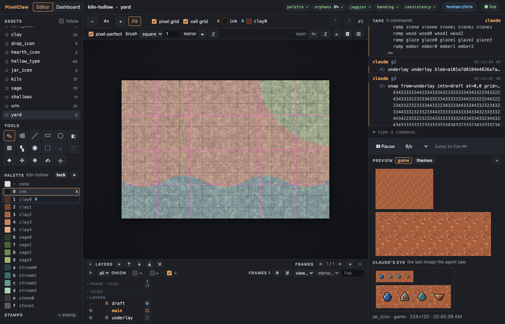
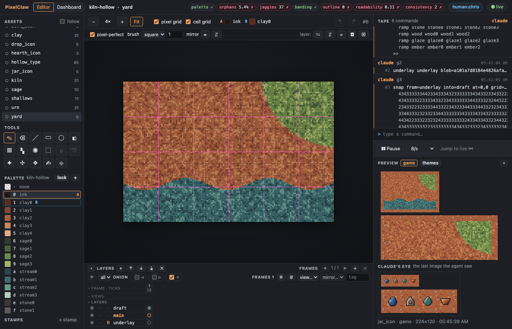
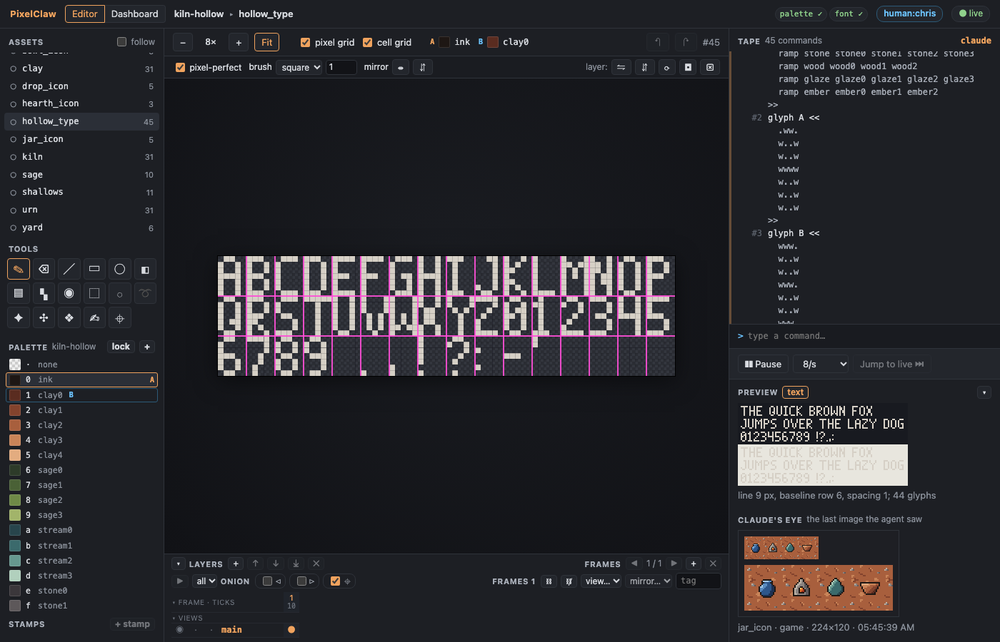
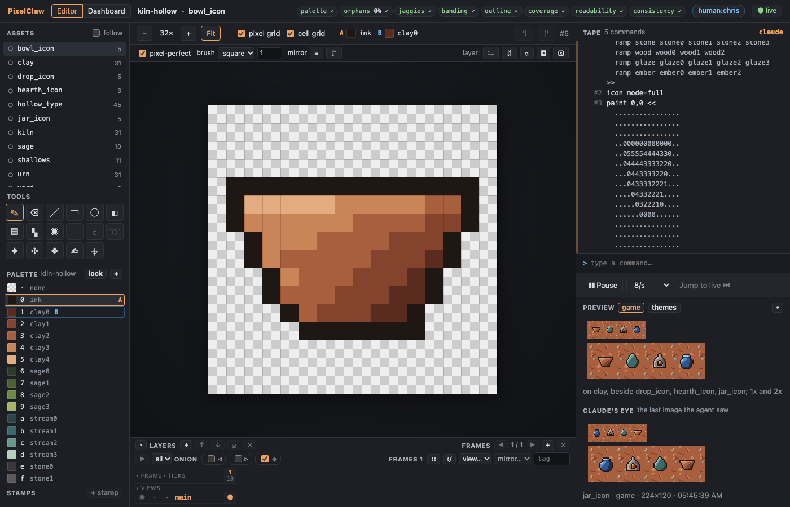

# Demo G11: underlays and snap, a pixel font, an icon set

Kiln Hollow carries on from [G10](demo-g10.md). The agent plans a HUD set (four icons and a 5x7
font) and two tiles more, then:

- puts a **mockup underlay** under a 6x4-tile scene of the yard (144x96) and **snaps** it into a
  draft layer: the grid fitted, each block quantised to the palette, with block R² and the
  material match against the flat layout it was made from;
- **cuts three tiles** out of the draft (`import … asset=yard region=… layer=draft`) and cleans
  them by coordinates until every check passes and they sit with the set (`consistency`);
- draws a **5x7 font** (44 glyphs) and exports it as a **glyph strip** and as **BMFont**;
- draws **four HUD icons** and lets the **icon-set check** (stroke weight, box fill, optical centre)
  hold them to each other; three are fixed after it and the other checks flag them.

The builder has no image API key, so the demo's mockup was made offline:
[kiln-hollow/make-yard-mockup.ts](kiln-hollow/make-yard-mockup.ts) draws the yard's flat layout
([yard-layout.png](kiln-hollow/yard-layout.png): clay, a sage bank, the stream) as a rough
pixel-art draft in the palette's colours, enlarges it to 768x512 with a sub-pixel offset, blurs it
and adds noise ([yard-mockup.png](kiln-hollow/yard-mockup.png)), with the same code as the offline
`fake` provider. [How to run a live underlay with your own key](#a-live-underlay-with-your-own-key)
is at the end.

## With the stand-in agent

```sh
pnpm install && pnpm build
node examples/demo-g11-agent.ts            # --pause <ms>, --linger <s> (keep the server up to watch), --keep
```

It copies [kiln-hollow.pclaw](kiln-hollow.pclaw) as G10 left it to `out/demo-g11.pclaw` (ignored
by git), starts `pixelclaw serve` over stdio as Claude Code would, and runs the scripts in
[kiln-hollow/scripts/](kiln-hollow/scripts/) (`yard`, `sage`, `yard_clay`, `shallows` and their
`_clean`, `hollow_type`, the icons and their `_fix`). The cleaning scripts are what an agent writes
from `check`'s coordinates: the repetition check's stripe, every other flagged pixel moved a ramp
step toward the rest, after merging one- and two-pixel specks (`clean orphans size=2`; the
snapped texture was finer-grained than the hand-drawn clay, and `consistency` said so). The result
is checked in as [kiln-hollow.pclaw](kiln-hollow.pclaw) (`--keep` writes it; the G10 stand-in's
`--keep` writes only G10's work, so run this one after it). `cli/test/kiln-hollow.test.ts`
rebuilds it from the scripts and the mockup. What it printed:

```
Kiln Hollow, carried on from G10. Watch: http://127.0.0.1:7417/?token=…

1. The plan grows: a HUD set (four icons and a 5x7 font) and two tiles from a mockup of the yard
  wrote manifest.json: 26 assets
  26 planned: 23 planned · 0 drafted · 0 checked · 0 reviewed · 0 approved · 3 exported

2. A mockup underlay for the 6x4-tile yard (offline: made by examples/kiln-hollow/make-yard-mockup.ts, no key needed)
  underlay underlay blob=a101a7d8184e4826afa3f08f52a062f7a6900ca0b9dbc7f6fce943bc50c59d00 image=768x512 at=0,0 size=144x96 layout=1bcad0dd79768675fae3faf6c1863e13b8ec637fd1b8bedfabb174878bbdf306 from="y…
  the render view shows it faded under the (empty) art: out/demo-g11.pclaw/views/yard.render.png

3. snap: the grid fitted, each block quantised to the palette on a new draft layer
  snap from=underlay into=draft at=0,0 grid=144x96 pitch=5.333x5.334 offset=0.66,0.65 r2=0.97 material=0.98
  warnings: none

4. Three tiles cut from the draft (import … asset=yard region=… layer=draft), cleaned by coordinates
  sage: cut: palette 0 ✓ · orphans 0% ✓ · jaggies 0 ✓ · seam 0.46 ✓ · coverage 0 ✓ · repetition 8.1 ✗ · consistency 0 ✓  (1 failing: `check` gives coordinates)
    ✓ seam 0.46 ≤ 1 jump x -0.97 y 0.46; line x 0.17 y 0.3 (about 1 or less reads as no seam) ✗ repetition 8.1 ≤ 3 most visible stripe: columns 16-18, lighter by ΔL…
    after 8 commands: palette 0 ✓ · orphans 0% ✓ · jaggies 0 ✓ · seam 0.25 ✓ · coverage 0 ✓ · repetition 2.6 ✓ · consistency 0 ✓
  yard_clay: cut: palette 0 ✓ · orphans 0% ✓ · jaggies 1 ✓ · seam 0.81 ✓ · coverage 0 ✓ · repetition 4.7 ✗ · consistency 1 ✗  (2 failing: `check` gives coordinates)
    ✓ seam 0.81 ≤ 1 jump x 0.81 y -0.28; line x 0.62 y 0.18 (about 1 or less reads as no seam) ✗ repetition 4.7 ≤ 3 most visible stripe: columns 0-3, lighter by ΔL*…
    after 5 commands: palette 0 ✓ · orphans 0% ✓ · jaggies 0 ✓ · seam 0.47 ✓ · coverage 0 ✓ · repetition 2.9 ✓ · consistency 0 ✓
  shallows: cut: palette 0 ✓ · orphans 0.5% ✓ · jaggies 0 ✓ · seam 1.56 ✗ · coverage 0 ✓ · repetition 6.5 ✗ · consistency 0 ✓  (2 failing: `check` gives coordinates)
    ✗ seam 1.56 ≤ 1 jump x 1.56 y -0.48; line x 0.01 y 0.86 (about 1 or less reads as no seam) ✗ repetition 6.5 ≤ 3 most visible stripe: rows 16-17, darker by ΔL* 4…
    after 9 commands: palette 0 ✓ · orphans 0% ✓ · jaggies 0 ✓ · seam 0.7 ✓ · coverage 0 ✓ · repetition 2.6 ✓ · consistency 0 ✓

5. A 5x7 font (hollow_type): 44 glyphs, the size and characters from the manifest
  checks: palette 0 ✓ · font 0 ✓
  ✓ font 0 ≤ 0 metrics agree (43 of 44 glyphs drawn, 1 empty; cap height 7, x-height —, baseline row 6, line 9)
  strip: exports/strip/hollow_type.png, exports/strip/hollow_type.txt
  bmfont: exports/bmfont/hollow_type.fnt, exports/bmfont/hollow_type_0.png

6. Four HUD icons (icon mode=full), then the icon-set check (stroke weight, box fill, optical centre)
  jar_icon: palette 0 ✓ · orphans 1.7% ✗ · jaggies 4 ✗ · banding 0 ✓ · outline 1 ✓ · coverage 0 ✓ · readability 1 ✓ · consistency 0 ✓  (2 failing: `check` gives coordinates)
  hearth_icon: palette 0 ✓ · orphans 0.9% ✓ · jaggies 0 ✓ · banding 0 ✓ · outline 1 ✓ · coverage 0 ✓ · readability 1 ✓ · consistency 0 ✓
  drop_icon: palette 0 ✓ · orphans 0% ✓ · jaggies 0 ✓ · banding 0 ✓ · outline 1 ✓ · coverage 0 ✓ · readability 1 ✓ · consistency 1 ✗  (1 failing: `check` gives coordinates)
  bowl_icon: palette 0 ✓ · orphans 1.3% ✗ · jaggies 0 ✓ · banding 0 ✓ · outline 0.9 ✓ · coverage 0 ✓ · readability 1 ✓ · consistency 2 ✗  (2 failing: `check` gives coordinates)
  box fill: 0.38 against the set's median 0.61 (3 others) (needs ± 0.2 of the set's 0.61)
         optical centre: the drawn pixels' centre is at 7.5,5.9, 1.6 px from the canvas centre 7.5,7.5 (needs ≤ 1.5 px from the canvas centre)
  Fixed: the jar's rim by coordinates; the drop drawn wider; the bowl larger and lower
  jar_icon: palette 0 ✓ · orphans 0% ✓ · jaggies 0 ✓ · banding 0 ✓ · outline 1 ✓ · coverage 0 ✓ · readability 1 ✓ · consistency 0 ✓
  drop_icon: palette 0 ✓ · orphans 0% ✓ · jaggies 0 ✓ · banding 0 ✓ · outline 1 ✓ · coverage 0 ✓ · readability 1 ✓ · consistency 0 ✓
  bowl_icon: palette 0 ✓ · orphans 0% ✓ · jaggies 0 ✓ · banding 0 ✓ · outline 1 ✓ · coverage 0 ✓ · readability 1 ✓ · consistency 0 ✓

7. The plan now
  5 planned: 0 planned · 0 drafted · 5 checked · 0 reviewed · 0 approved · 0 exported
    checked  jar_icon (icon 16x16) → a blind review, then `mark reviewed`
    checked  hearth_icon (icon 16x16) → a blind review, then `mark reviewed`
    checked  drop_icon (icon 16x16) → a blind review, then `mark reviewed`
    checked  bowl_icon (icon 16x16) → a blind review, then `mark reviewed`
    checked  hollow_type (font 5x7) → a blind review, then `mark reviewed`
  26 planned: 15 planned · 0 drafted · 8 checked · 0 reviewed · 0 approved · 3 exported
```

What it looks like ([scripts/screenshots-g11.ts](../scripts/screenshots-g11.ts)):

| | |
|---|---|
|  |  |
| the underlay ([g11-yard-underlay.png](../docs/screenshots/g11-yard-underlay.png)) | the snapped draft ([g11-yard-draft.png](../docs/screenshots/g11-yard-draft.png)) |
|  |  |
| the font and its text preview ([g11-font-editor.png](../docs/screenshots/g11-font-editor.png)) | the bowl icon and the set ([g11-icon-editor.png](../docs/screenshots/g11-icon-editor.png)) |

The tiles cut from the draft, 3x3: [sage](../docs/screenshots/g11-sage-tile3x3.png),
[yard_clay](../docs/screenshots/g11-yard_clay-tile3x3.png),
[shallows](../docs/screenshots/g11-shallows-tile3x3.png). The font's
[glyph strip](../docs/screenshots/g11-font-strip.png) (red separator columns, at 4x) and
[BMFont page](../docs/screenshots/g11-font-bmfont.png) (at 6x); the exported files are in
[kiln-hollow.pclaw/exports/strip/](kiln-hollow.pclaw/exports/strip/) and
[exports/bmfont/](kiln-hollow.pclaw/exports/bmfont/). The icons at 1x and 2x:
[g11-icons-game.png](../docs/screenshots/g11-icons-game.png).

## With Claude Code

As in [demo-g10.md](demo-g10.md), on a copy of the example project. Ask, for example: *Put the
mockup in examples/kiln-hollow/yard-mockup.png under a 6x4-tile sheet called yard, with
yard-layout.png as its layout, snap it, and cut tiles for sage and the stream out of the draft;
clean them until every check passes. Then draw a 5x7 font for the HUD and export it as a strip and
as BMFont, and four 16x16 icons that the icon-set check is happy with.* The skill's workflows
("A mockup underlay, snapped", "A font", "Icons") tell Claude the steps.

## A live underlay with your own key

The tool calls OpenAI's Images API only for `underlay generate` with `provider=openai` (the
default), and only with a key in the environment of the process that runs the command. Nothing
else in PixelClaw needs a key.

1. **Pick the scene and its layout.** A sheet the size of the scene in art pixels, and a flat
   layout to follow: the yard's ([kiln-hollow/yard-layout.png](kiln-hollow/yard-layout.png), 6x4
   tiles of 24 px), or the project's flat mockup screen (`pixelclaw plan <project> --templates`
   writes `templates/mockup.png`, a camera-sized screen; use a sheet of the same size).

   ```sh
   cp -r examples/kiln-hollow.pclaw ~/art/kiln-live.pclaw
   node cli/dist/pixelclaw.js run ~/art/kiln-live.pclaw -e 'new sheet yard_live 144x96 cell=24x24'
   ```

2. **Generate the underlay.** Set the key for this one command (it is read from
   `OPENAI_API_KEY`, sent only in the request's `Authorization` header, and never written to the
   project, the tape, the cost log or any output):

   ```sh
   OPENAI_API_KEY=sk-… node cli/dist/pixelclaw.js run ~/art/kiln-live.pclaw --asset yard_live -e \
     'underlay generate "Kiln Hollow, a potters hamlet in red clay: packed clay ground, a sage bank top right, a slow silty stream along the bottom. Top-down pixel art for a game, 24 px tiles, crisp square pixels, an earthen palette, light from the top left" layout='"$PWD"'/examples/kiln-hollow/yard-layout.png'
   ```

   The doc is 3:2, so it asks for 1536x1024 from `gpt-image-1.5` at `medium` quality, an edit of
   the layout: about **$0.05** by the price table (OpenAI also bills the layout's input tokens, a
   cent or two). The cap is **$0.25 a call**: `cap=0.10` on the line, `PIXELCLAW_UNDERLAY_CAP`, or
   project.json `"underlay": { "cap": 0.1 }` changes it, and a call over it is refused before
   anything is sent. `quality=low` (about $0.013) is enough to judge a layout; `model=` and
   project.json `underlay.prices` cover other models (check https://openai.com/api/pricing/; the
   table in the server holds the prices published when this was written). Every call, refused or
   made, is a line in `~/art/kiln-live.pclaw/logs/underlay-costs.jsonl` (estimate, usage, blob,
   prompt; no key).

3. **Look, then snap.**

   ```sh
   node cli/dist/pixelclaw.js view ~/art/kiln-live.pclaw yard_live render --scale 4
   node cli/dist/pixelclaw.js run ~/art/kiln-live.pclaw --asset yard_live -e snap
   ```

   The `snap` line on the tape says `r2=` and `material=`; under 0.8 or 0.85 the run warns. A
   generated image rarely keeps an exact pixel grid, so expect to reroll (another prompt, a
   lower-detail one) or to trace over the underlay at 24 px instead of snapping; that comparison
   is part of the acceptance project (A1).

The same works through the watch view's command line (start `OPENAI_API_KEY=sk-… node
cli/dist/pixelclaw.js serve --project ~/art/kiln-live.pclaw --no-mcp`) or through Claude Code: the
server reads the key from its own environment, so give it to the server process, for example with
`claude mcp add pixelclaw -e OPENAI_API_KEY=sk-… -- node "$PWD/cli/dist/pixelclaw.js" serve --project
~/art/kiln-live.pclaw` (Claude Code keeps that in its own configuration, in plain text; remove it
with `claude mcp remove pixelclaw` when you are done). `provider=fake` gives the offline draft
instead, free.
