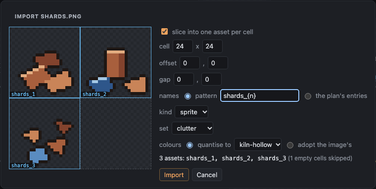
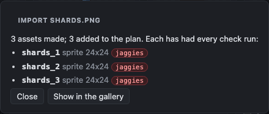
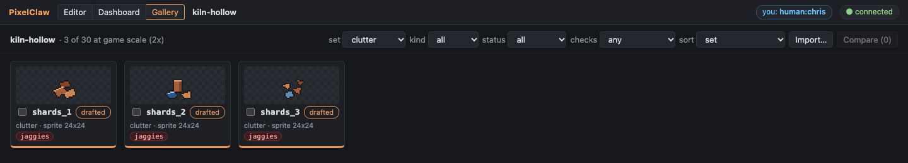
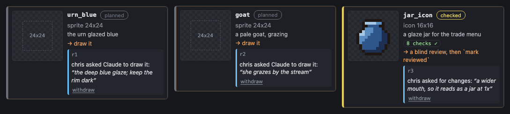
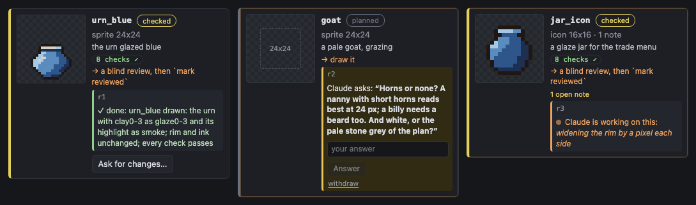
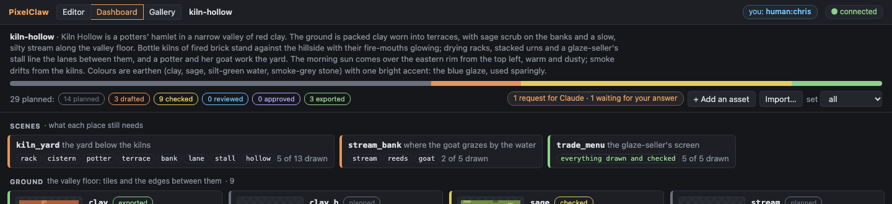
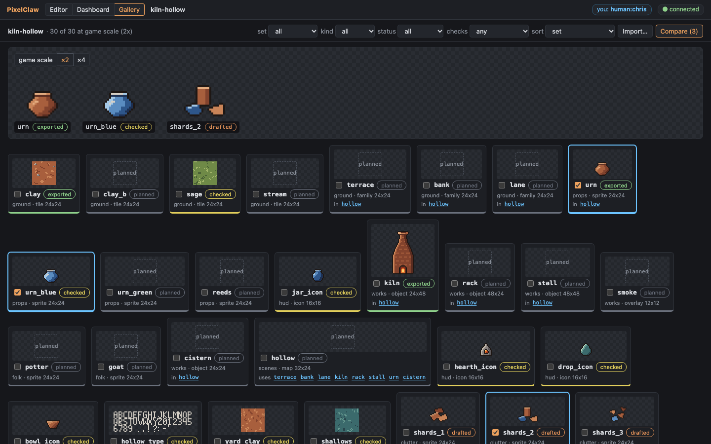
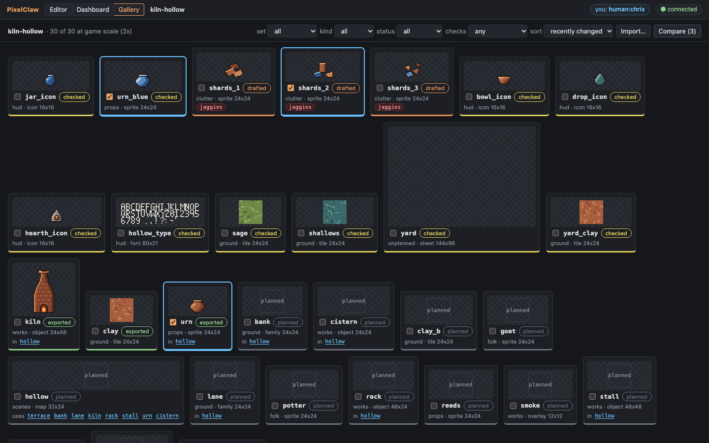
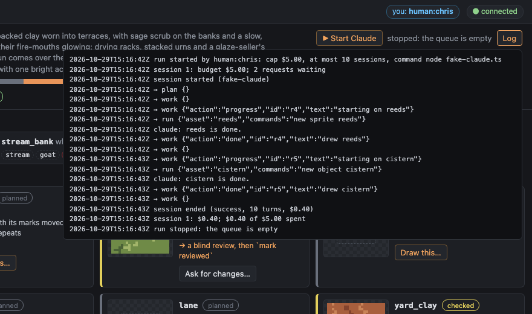

# Demo G12: the work queue, the gallery and import

Kiln Hollow ([`kiln-hollow.pclaw`](kiln-hollow.pclaw)) carried on from G11. A person, in the
browser, brings in art they already have and asks Claude for work from the dashboard; Claude
hears through `plan` and takes the requests with `work`. Nobody types in a chat.

The stand-in ([`demo-g12-agent.ts`](demo-g12-agent.ts)) plays both parts: the person is a
Playwright browser (as `human:chris`), the agent drives `pixelclaw serve` over MCP as Claude
does. It works on a copy (`out/demo-g12.pclaw`), without G12's assets, requests and scenes:

```sh
node examples/demo-g12-agent.ts            # add --shots for docs/screenshots/g12-*.png, --keep to write the example back
```

## 1. Scenes

The agent adds a `clutter` set and three scenes to the manifest: the yard below the kilns (built
by the `hollow` map), the stream bank, and the glaze-seller's trade screen. `plan(order="scene")`
says what each still needs:

```
scene kiln_yard (the yard below the kilns), built by the map hollow: missing rack, urn_blue, cistern, potter, terrace, bank, lane, stall, hollow
scene stream_bank (where the goat grazes by the water): missing stream, reeds, goat
scene trade_menu (the glaze-seller's screen): everything it needs is drawn and checked
```

## 2. The person imports a sheet

The person has a sheet of pot shards, three 24x24 cells and one empty
([`kiln-hollow/shards.png`](kiln-hollow/shards.png), made by
[`make-shards-sheet.ts`](kiln-hollow/make-shards-sheet.ts), so it is original). They drop it on the
gallery (here: **Import…**). The slice dialog draws the 24x24 grid over it, skips the empty cell
and names the rest by the pattern `shards_{n}`; kind sprite, set clutter, quantised to the
project's palette.



The server makes three assets whose tapes start with `import` (the sheet kept under `blobs/`),
adds three manifest entries (`"description": "imported from shards.png cell 1,0"`) and runs every
check. They come in **drafted**: the sheet's outlines have spikes and notches, and `jaggies` says
where. That is the art as it was drawn; fixing it is the next request.





(The shards first went into `props`: the consistency check then held the urn to a set median of
three ramp steps, and the urn fell from exported to drafted. A set of its own is right for ground
clutter, and the import said so at once.)

## 3. The person asks

On the dashboard: **Draw this…** on two planned cards, with a note each (`urn_blue`: "the deep
blue glaze; keep the rim dark"; `goat`: "she grazes by the stream"), and **Ask for changes…** on
the drawn `jar_icon` ("a wider mouth, so it reads as a jar at 1x"). Each is a record in
[`requests.jsonl`](kiln-hollow.pclaw/requests.jsonl); the change is also the `mark rejected "…"`
on the jar's tape, by `human:chris`.



## 4. The agent hears

`plan` puts the requests first:

```
Requests from people (3): take these before planned work, with `work` (it claims the next open one):
  r1 draw urn_blue: "the deep blue glaze; keep the rim dark" (from human:chris; open)
  r2 draw goat: "she grazes by the stream" (from human:chris; open)
  r3 change jar_icon: "a wider mouth, so it reads as a jar at 1x" (from human:chris; open)
```

**r1, urn_blue: done.** `work` claims it and gives the plan entry (a 24x24 sprite in props, the
urn glazed blue, 14 px tall, a recolour of the urn). The agent posts progress and draws it as a
palette swap ([`urn_blue.pclaw`](kiln-hollow/scripts/urn_blue.pclaw)): the urn's pixels
(`import … asset=urn`), clay0-3 swapped for glaze0-3 and the clay4 highlight for smoke, and a ramp
`glazed` so the highlight's steps count as shading. Every check passes (consistency sees a
recolour, not a copy). `work(action="done", text=…)`.

**r2, the goat: blocked.** Whether she has horns, and her colour, is the person's call:

```
work(action="blocked", text="Horns or none? A nanny with short horns reads best at 24 px; a billy needs a beard too. And white, or the pale stone grey of the plan?")
```

**r3, the jar: in progress.** Claimed, a progress note ("widening the rim by a pixel each side"),
and a first batch, a note pinned where the rim will widen
([`jar_icon_g12.pclaw`](kiln-hollow/scripts/jar_icon_g12.pclaw)). The stand-in stops here, so the
example keeps a request in this state.

## 5. The dashboard shows each state

The urn_blue card: ✓ done with what changed. The goat: Claude's question and an answer box (the
answer opens the request again, and `work` hands it back with the answer). The jar: **Claude is
working on this** with its latest progress note, because the claim's author wrote the asset's
latest batch.



The scenes at the top of the dashboard follow: urn_blue is no longer missing from the yard.



## 6. The gallery

Every asset at game scale (2x), planned ones as dashed boxes, the map listing what it uses and
each asset the maps that use it. Ticking urn, urn_blue and a shard and pressing **Compare** puts
them side by side at the same scale (here ×2):





The plan now: 29 planned, 14 planned · 3 drafted · 9 checked · 3 exported; requests r3 (claimed)
and r2 (blocked, waiting for an answer).

## Claude without a session: the worker

If nobody has Claude Code open on the project, the dashboard's **▶ Start Claude** (or
`pixelclaw work <project>`) runs Claude Code headless on the queue, up to a budget cap. It is off
unless the project turns it on, because it spends money. To turn it on, put this in
`kiln-hollow.pclaw/project.json`:

```json
"worker": { "enabled": true, "cap": 5 }
```

and reload the dashboard. What it runs, the cap, the log and the single-worker rule:
[docs/worker.md](../docs/worker.md). The builder has not run it with the real `claude` (that
spends money); the tests and this screenshot use a fake `claude` that works the queue through the
same MCP endpoint and reports a made-up cost:


