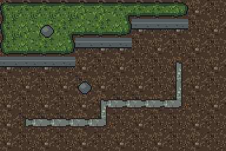
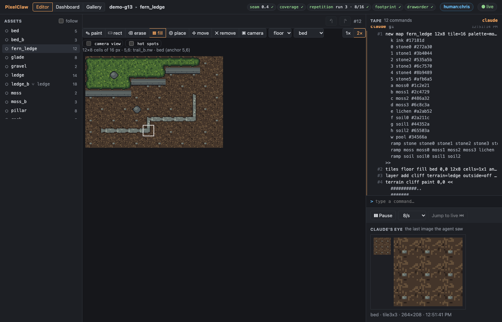
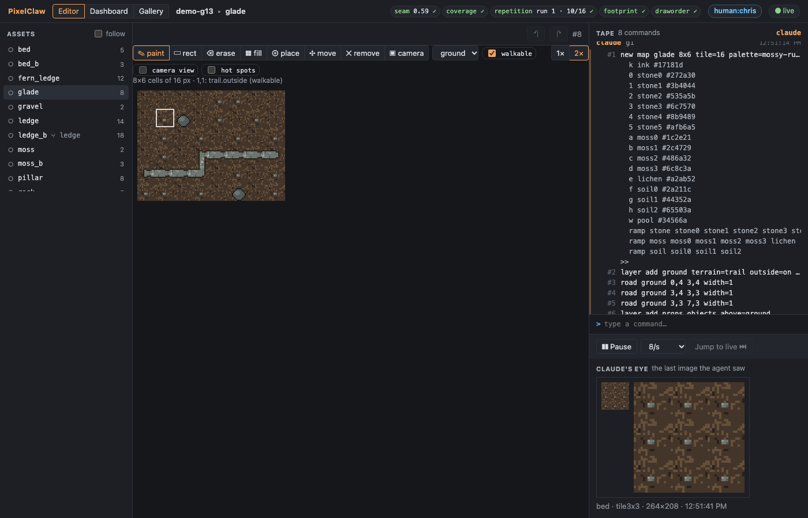
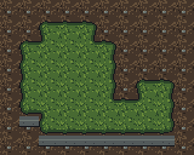
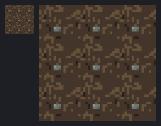
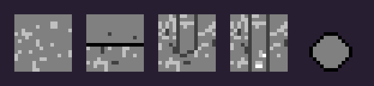

# Demo G13: fixes from the acceptance run

The acceptance run (A1) ranked the problems that slowed a real agent using the tool (plan §23).
This demo shows the first eight fixes on a small original set, **Fern Ledge**: a mossy ledge over
a stream bed, at 16 px, drawn by a stand-in agent through `pixelclaw serve` over stdio (MCP), as
Claude would. No API key: the underlay uses the offline `fake` provider.

| Item | What changed | Where in the demo |
|---|---|---|
| 1 | `repetition`'s limit rises with the band's own spread (one mark on a calm tile is not a stripe); the **`seeds`** tool ranks N seeds of a generator line by the checks; **`run dry=true`** applies, checks, reports and keeps nothing | the stream bed: a seed search, then a pebble tried dry under G5's rule and G13's |
| 2 | **Face cells** are drawn on maps whatever the terrain layer's fill setting (and a later `family band` keeps the face pieces) | the map: the ledge on a layer with `outside=off`, its faces on the floor |
| 3 | **Underlays sized from the placed area** (orientation and aspect) | the pillar: a 16x32 area of a 48x32 sheet asks for 1024x1536 |
| 4 | **Snap on the placement's grid**; a **seam warning** after `family cut` | the pillar's draft lands on 16x32 at 16,0; a cut from a badly painted map warns (dry run) |
| 5 | **`tiles <layer> fill`**; a **walkable** flag so filled ground is not sea for footprints | the floor in one line; the glade's rocks on the trail layer's filled ground |
| 6 | Profiles: a **corner order**, **path shapes** (dead ends named apart from straights), a **per-colour output map** | the `ledge-engine` profile: `nesw_nw_ne_se_sw`, `trail_end_n` / `trail_run_ns`, five tones |
| 7 | **Band jitter** | the ledge's edge, its seed chosen with `seeds` |
| 8 | **Variants that inherit the band** and override only the texture, following later fixes | `ledge_b` refuses its own band edit and follows a later fix to the ledge |

Items 9 (no part of the key ever written; input-image tokens priced) and 10 (the smaller items)
are covered by tests, not by the demo: see PROGRESS.md.

## Run it

```sh
pnpm build
node examples/demo-g13-agent.ts            # writes out/demo-g13.pclaw and prints the log below
node scripts/screenshots-g13.ts            # docs/screenshots/g13-*.png from that project
```

Open the project yourself with `pixelclaw serve --project out/demo-g13.pclaw` and the link it
prints (stop it when done).

## The log

```
Fern Ledge: a mossy ledge over a stream bed, at 16 px. Project: out/demo-g13.pclaw

1. The stream bed, a calm tile: which seed of the noise?
    bed: 8 seeds ranked by the checks (fewest failing, then least over, then most room)
    limits: seam ≤ 1, repetition ≤ 4.6, palette ≤ 0, orphans ≤ 2%, jaggies ≤ 2, coverage ≤ 0 (a limit in brackets: that seed's own, e.g. repetition's raised by its spread)
    seed  seam         repetition   palette      orphans      jaggies      coverage     failing
    3     0.37 ✓       3.8 ✓        0 ✓          0% ✓         0 ✓          0 ✓          none
    4     0.75 ✓       3 (≤ 3.5) ✓  0 ✓          0.4% ✓       1 ✓          0 ✓          none
    6     0.71 ✓       2.9 (≤ 3) ✓  0 ✓          0% ✓         0 ✓          0 ✓          none
    5     1 ✓          2.8 (≤ 3.1) ✓  0 ✓          0% ✓         0 ✓          0 ✓          none
    8     1.07 ✗       2.7 (≤ 4.4) ✓  0 ✓          0% ✓         0 ✓          0 ✓          seam
    7     0.26 ✓       3.4 (≤ 3) ✗  0 ✓          0% ✓         0 ✓          0 ✓          repetition
    2     0.34 ✓       4.1 (≤ 3) ✗  0 ✓          0.4% ✓       1 ✓          0 ✓          repetition
    1     1.59 ✗       3.5 (≤ 3) ✗  0 ✓          0% ✓         0 ✓          0 ✓          seam,repetition
    best: noise 0,0 16x16 ramp=soil weights=1,6,3 cluster=1..2 density=0.25 base=soil1 wrap=on seed=3
    
    applied seed 3 as group g2; 64 px changed
   A pebble, tried first with run dry=true (nothing kept):
     under G5's rule (contrast 0): repetition 4.6 ✗
     bed: dry run of 3 commands; 6 px would change; nothing was kept
     under G13's: repetition 2.7 ✓
     ✓  repetition  2.7    ≤ 3     most visible stripe: row 7, darker by ΔL* 2.7 (score ΔL*·√width 2.7)
   (the rows through the pebble are lighter on average, but all of it is in three pixels: the limit
    rises with the band's own spread, so one mark on a calm tile is not a stripe)

2, 7. The ledge: a cliff family with faces; its band edge jittered, the seed chosen by the checks
    the textures, each by a seed search (moss, and second looks of the moss and the bed):
    best: noise 0,0 16x16 ramp=moss weights=0,2,6,2,0 cluster=1..2 density=0.25 base=moss2 wrap=on seed=6
    applied seed 6 as group g2; 64 px changed
    best: noise 0,0 16x16 ramp=moss weights=0,3,6,1,0 cluster=1..2 density=0.25 base=moss2 wrap=on seed=26
    applied seed 26 as group g2; 64 px changed
    best: noise 0,0 16x16 ramp=soil weights=1,6,3 cluster=1..2 density=0.25 base=soil1 wrap=on seed=41
    applied seed 41 as group g2; 64 px changed
    ledge: 6 seeds ranked by the checks (fewest failing, then least over, then most room)
    limits: seam ≤ 1, coverage ≤ 0 (a limit in brackets: that seed's own, e.g. repetition's raised by its spread)
    seed  seam         coverage     failing
    6     0.42 ✓       0 ✓          none
    1     0.58 ✓       0 ✓          none
    5     0.6 ✓        0 ✓          none
    2     0.62 ✓       0 ✓          none
    4     0.63 ✓       0 ✓          none
    3     0.66 ✓       0 ✓          none
    best: family band 1:outside 1:ink 1:moss1 radius=0 inset=0 jitter=2 seed=6 draw=on
    applied seed 6 as group g2; 3170 px changed
      ✓  seam        0.35   ≤ 1     over a 12x10 island (seed 1): jump x 0.13 y -0.16; line x 0.1 y 0.35 (view map shows it)
      ✓  coverage    0      ≤ 0     face: all 51 variants and both textures drawn

8. ledge_b: a texture variant that keeps only its own moss and inherits the band
    its own band edit is refused: family band: 'ledge_b' inherits its band from 'ledge' (variant of=ledge band=inherit): fix the band there, or make it its own (variant of=ledge band=o…
    a later fix to the ledge's band (two moss rows): variants that inherit the band, brought up to date: ledge_b (family band from=ledge)

6 (paths). A gravel trail across the bed, by a seed search; a variant of it on the other bed
    best: noise 0,0 16x16 ramp=stone weights=0,0,2,6,3,1 cluster=1..2 density=0.3 base=stone3 wrap=on seed=55
    applied seed 55 as group g2; 77 px changed

5, 2. The map: the floor filled with one command; the ledge on a layer that leaves the rest to the floor
    tiles floor fill bed 0,0 12x8 cells=1x1 anchor=0,0
    checks: seam 0.4 ✓ · coverage 0 ✓ · repetition run 3 · 8/16 ✓ · footprint 0 ✓ · draworder 0 ✓
    the glade's ground is the trail layer's outside (filled); walkable=off (a dry run): footprint 2 ✗ 
    walkable=on (as it is): ✓  footprint   0      0       2 objects, every footprint on plain ground

3, 4. A draft of a rock pillar: the underlay asked for in the placed area's shape, snapped on its grid
    underlay mockup blob=1b64eec8b51600c246c6b4741ccd0fcb68dfeb1b6c6e4f0346b6d4cbf80d33cc image=1024x1536 at=16,0 size=16x32 layout=c434fba40bad65f182d361…
    snap from=mockup into=draft at=16,0 grid=16x32 pitch=64.000x48.000 offset=60.98,0.98 r2=0.99 material=0.92 <<
    family cut from a map painted with a dark line on every cell (dry run): family cut: the cut family's seam is 1.58 (limit ≤ 1) on a sample island: its tiles do not join; look at view map, fix the band or the textures by coordinates (check seam), or cut again from a cleaner…

6. Export through ledge-engine: corners nw first, the trail's pieces by shape, five tones
    ledge-engine: 143 images, wrote 143 files
    ledge (corners nw, ne, se, sw): ledge_face ledge_face_ew ledge_nes_ne_se ledge_nesw_ne_se_sw ledge_nesw_nw_ne_se_sw …
    trail (by shape): trail_cross trail_dot trail_end_e trail_end_n trail_end_s trail_end_w trail_inside trail_outside trail_run_ew trail_run_ns trail_tee_esw trail_tee_nes trail_tee_new trail_tee_nsw trail_turn_es trail_turn_ne trail_turn_nw trail_turn_sw
    rock.png is drawn in the tones only: #000000 #808080

Every check:
    bed: palette 0 ✓ · orphans 0% ✓ · jaggies 0 ✓ · seam 0.54 ✓ · coverage 0 ✓ · repetition 2.7 ✓ · consistency 0 ✓
    bed_b: palette 0 ✓ · orphans 0.4% ✓ · jaggies 0 ✓ · seam 0.81 ✓ · coverage 0 ✓ · repetition 3.5 ✓ · variant 0.09 · ΔL* 1.1 ✓ · consistency 0 ✓
    fern_ledge: seam 0.4 ✓ · coverage 0 ✓ · repetition run 3 · 8/16 ✓ · footprint 0 ✓ · draworder 0 ✓
    glade: seam 0.59 ✓ · coverage 0 ✓ · repetition run 1 · 10/16 ✓ · footprint 0 ✓ · draworder 0 ✓
    gravel: palette 0 ✓ · orphans 1.6% ✓ · jaggies 1 ✓ · seam 0.34 ✓ · coverage 0 ✓ · repetition 5.4 ✓ · consistency 0 ✓
    ledge: palette 0 ✓ · orphans 0.6% ✓ · seam 0.31 ✓ · coverage 0 ✓
    ledge_b: palette 0 ✓ · orphans 0.6% ✓ · seam 0.27 ✓ · coverage 0 ✓ · variant 0.08 · ΔL* 0.9 ✓
    moss: palette 0 ✓ · orphans 0.4% ✓ · jaggies 0 ✓ · seam 0.77 ✓ · coverage 0 ✓ · repetition 3.3 ✓ · consistency 0 ✓
    moss_b: palette 0 ✓ · orphans 0.8% ✓ · jaggies 0 ✓ · seam 0.19 ✓ · coverage 0 ✓ · repetition 4.8 ✓ · variant 0.11 · ΔL* 1.5 ✓ · consistency 0 ✓
    rock: palette 0 ✓ · orphans 0% ✓ · jaggies 0 ✓ · banding 0 ✓ · outline 1 ✓ · coverage 0 ✓ · readability 1 ✓ · fit 0 ✓ · consistency 0 ✓
    trail: palette 0 ✓ · orphans 0.3% ✓ · seam 0.61 ✓ · coverage 0 ✓
    trail_b: palette 0 ✓ · orphans 0.6% ✓ · seam 0.68 ✓ · coverage 0 ✓ · variant 0.04 · ΔL* 0.4 ✓
    (pillar is a draft: its snapped layer is still to be cleaned)

(the project is in out/demo-g13.pclaw)
```

Notes on the log:

- **The seed table** lists every check that applies, with each seed's score; a limit in brackets is
  that seed's own (repetition's, raised by the band's spread along its length). Seeds 7, 2 and 1
  fail on stripes the eye would see; seed 3 is kept.
- **The pebble**: the rows through it are lighter on average (4.6 under G5's rule, a fail), but the
  difference is all in three pixels of each row, so the band's spread is high and its limit rises;
  under G13's rule the most visible stripe is a faint row of the noise itself (2.7, a pass).
- **The ledge's jitter** was chosen by `seeds` on the `family band … jitter=2` line, ranked by the
  family's seam over a sample island.
- **ledge_b** was forked and marked `variant of=ledge band=inherit`; it changed only its inside
  texture. When the ledge's band got a second moss row, the server wrote `family band from=ledge`
  on ledge_b's tape (its own undo group), so its band is the ledge's again; its moss stayed its own.
- **The glade**'s ground is the trail layer's outside (`outside=on`): with `walkable=on` the rocks
  may stand on it; the dry run with `walkable=off` shows what the footprint check said before.
- **The pillar** is a draft: its snapped layer is still to be cleaned (not part of the set's checks).

## Screenshots

The map at the game's scale: the floor filled with the stream bed (its two looks mixed cell by
cell), the ledge with its jittered edge and its faces drawn on the floor below each edge, the
gravel trail (dead ends at both ends), two rocks.



The map editor's fill tool (a click fills the layer's empty cells, a drag a box) and the walkable
box beside the terrain layer being painted; the hover line says `(walkable)`:





The ledge on a sample island (`view map`), and the stream bed tiled 3x3 with its pebble:

 

Five images as the `ledge-engine` profile wrote them (enlarged): `ledge_nesw_nw_ne_se_sw`,
`ledge_face_ew`, `trail_end_n`, `trail_run_ns`, `rock`, every colour mapped to one of five tones:


