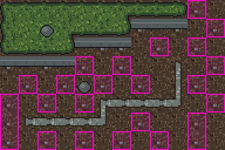
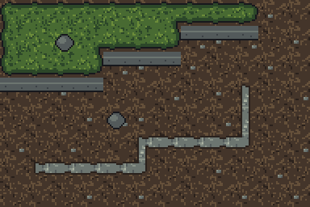
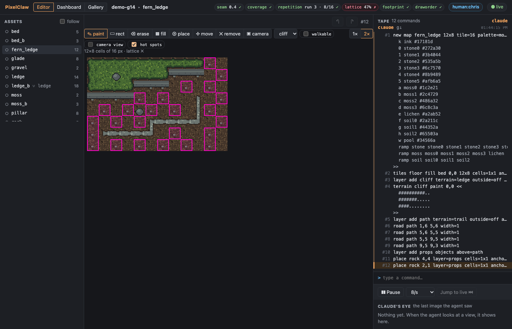
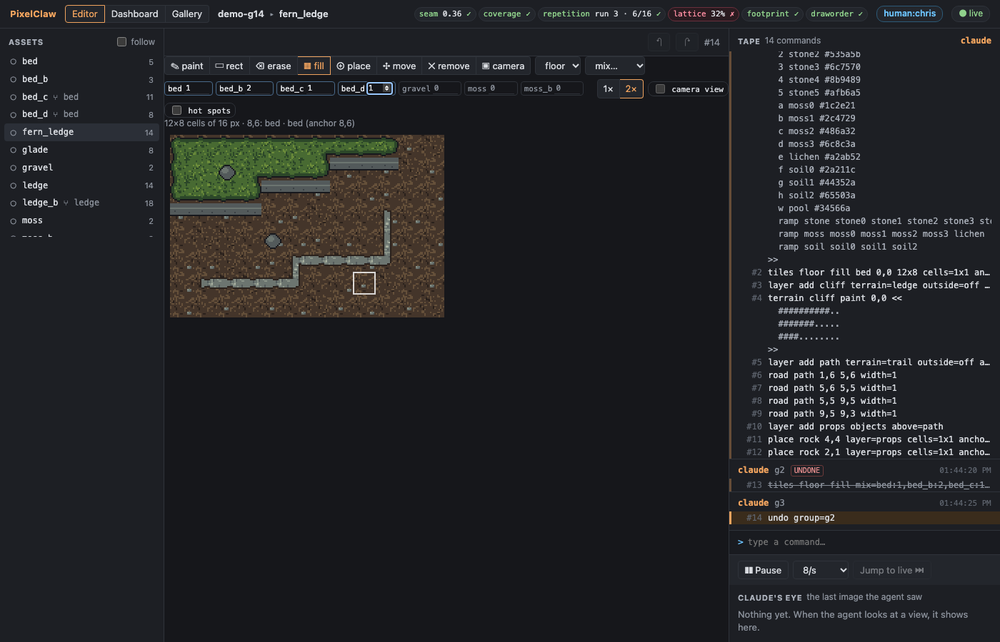
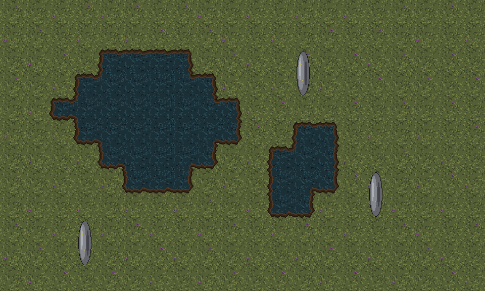
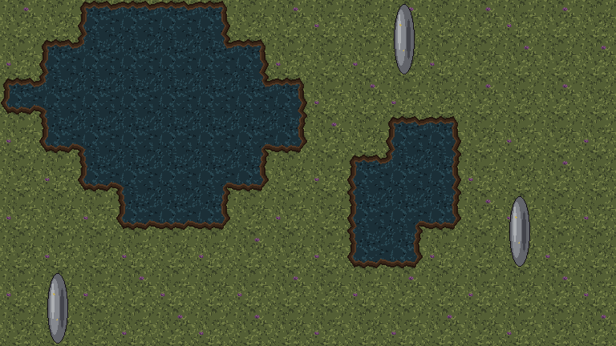
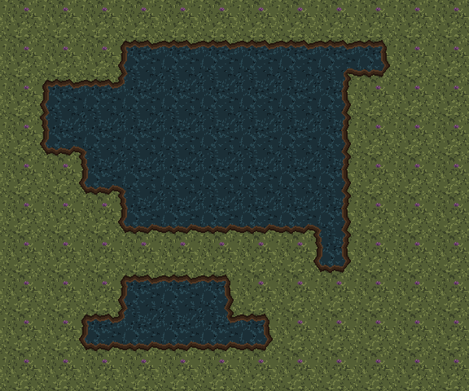
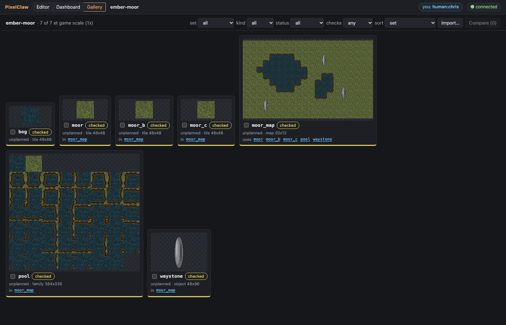
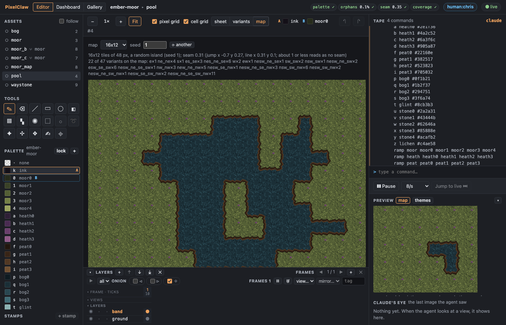
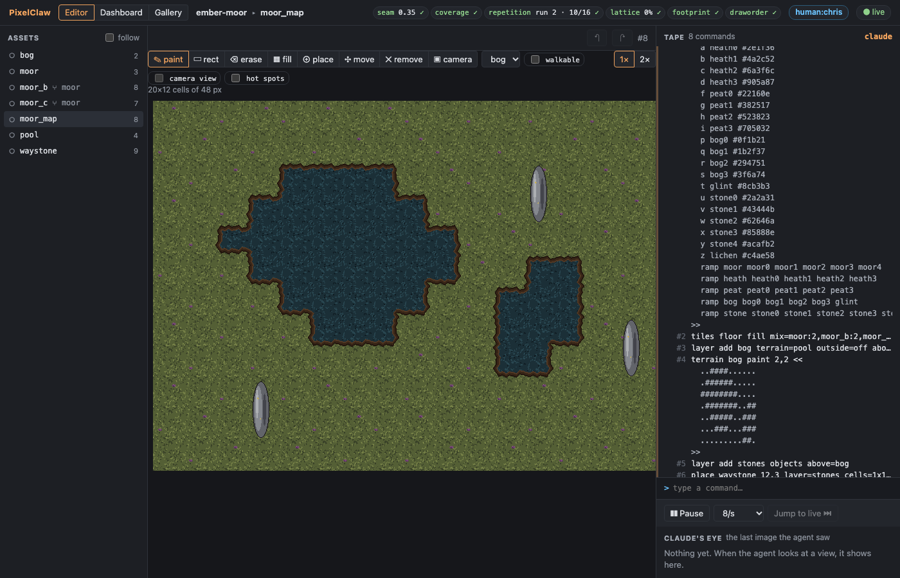

# Demo G14: map-scale variety and 48 px

G13's demo left a problem the reader saw at once: Fern Ledge's floor is a stream-bed
tile with one pebble, and every tile passes its checks, but the map shows an even lattice of
pebbles. G14 adds a check that sees it, a fill that cures it, a smaller tape for inheriting
variants, and the groundwork for 48 px sets. A stand-in agent drives `pixelclaw serve` over stdio
(MCP), as Claude would.

| Item | What changed | Where in the demo |
|---|---|---|
| 1 | The map-scale **`lattice`** check: a mark at the same spot of the cell in too many cells of one ground (an asset and its variants), with the cells, where in the cell, and what to do; sizes in px scale with the tile | Fern Ledge's floor fails (47%), then passes (23%); the glade too |
| 2 | **`tiles <layer> fill mix=<tile>:<weight>,…`**: a seeded scatter, no two equal neighbours where it can help it; the map editor's fill tool picks a mix | the floor laid again as `mix=bed:1,bed_b:2,bed_c:1,bed_d:1` |
| 3 | Inheriting variants record **only the pieces and detached cells** | not in the log: a sync on a 24 px blob47 sheet went from 33,110 to 4,348 bytes of tape (`server/test/g14.test.ts`); the glade's new trail variants inherit the band this way |
| 4 | The **48 px audit**: the project's grid, and what assumed 16 or 24 px | Ember Moor: grid 48, camera 768x432, draw scale 1x |
| 5 | **`examples/ember-moor.pclaw`** and the skill's per-size defaults | Ember Moor's checks, its map and a screen of it |

## Run it

```sh
pnpm build
node examples/demo-g14-agent.ts      # rebuilds Fern Ledge with examples/demo-g13-agent.ts, then fixes it
node scripts/screenshots-g14.ts      # docs/screenshots/g14-*.png from those projects
```

The projects land in `out/demo-g14.pclaw` (Fern Ledge, fixed), `out/demo-g14-before.pclaw` (as G13
left it) and `out/demo-g14-moor.pclaw` (a copy of the example). Open one with `pixelclaw serve
--project <dir>` and the link it prints (stop it when done).

## The log

```
G14: map-scale variety and 48 px. Projects: out/demo-g14.pclaw (Fern Ledge), out/demo-g14-moor.pclaw (Ember Moor)

1. Fern Ledge as G13 left it: every tile passes, the map shows a lattice of pebbles
    bed: all 7 checks pass
    ✓  repetition  run 3 · 8/16 run ≤ 4, ≤ 10/16 longest straight run of one edge tile: 3; most of one textured tile in a 4x4 window: 8 of 16
    ✗  lattice     47%    ≤ 30%   a mark at 6,9 3x2 of the cell (bed ×25) comes back on the tile pitch: 25 of the 53 cells of bed's ground show it at the same spot; give bed texture variants that move or leave out the mark (variant of=bed) and fill with a mix of them (tiles <layer> fill mix=bed:1,<variant>:2,...), or soften the mark
    the cells it flags (view map marks="failing" outlines them): 25, 10,0 11,1 8,2 10,2 4,3 6,3 11,3 1,4 …

   Two more looks of the stream bed, forked from it (its border stays the bed's):
   bed_c with the pebble moved, bed_d with none; then the floor laid again as a mix
     bed_c: palette 0 ✓ · orphans 0% ✓ · jaggies 0 ✓ · seam 0.51 ✓ · coverage 0 ✓ · repetition 2.7 ✓ · variant 0 · ΔL* 0 ✓ · consistency 0 ✓
     bed_d: palette 0 ✓ · orphans 0% ✓ · jaggies 0 ✓ · seam 0.37 ✓ · coverage 0 ✓ · repetition 3.8 ✓ · variant 0.05 · ΔL* 0.6 ✓ · consistency 0 ✓
     tiles floor fill mix=bed:1,bed_b:2,bed_c:1,bed_d:1 0,0 12x8 cells=1x1 anchor=0,0 replace variants=named seed=1149479272
     ✓  lattice     23%    ≤ 30%   the mark most often at one spot: at 6,9 3x2 of the cell (bed ×12): 12 of the 53 cells of bed's ground show it at the same spot
     fern_ledge: all 6 checks pass
   The glade: its ground is the trail's outside (the bed's look); two more trail variants
   (band=inherit, outside from bed_c and bed_d) and the map mixes them cell by cell
     ✗  lattice     46%    ≤ 30%   a mark at 6,9 3x2 of the cell (trail ×18) comes back on the tile pitch: 18 of the 39 cells of trail's ground show it at the same spot
     ✓  lattice     28%    ≤ 30%   the mark most often at one spot: at 6,9 3x2 of the cell (trail ×11): 11 of the 39 cells of trail's ground show it at the same spot
     glade: all 6 checks pass

2. Ember Moor, 48 px (examples/ember-moor.pclaw): the project's grid and what follows from it
    grid 48 px (new maps' tile; camera 768x432; draw scale 1x)
    bog: palette 0 ✓ · orphans 0% ✓ · jaggies 3 ✓ · seam 0.18 ✓ · coverage 0 ✓ · repetition 1.9 ✓ · consistency 0 ✓
    moor: palette 0 ✓ · orphans 0.2% ✓ · jaggies 5 ✓ · seam 0.56 ✓ · coverage 0 ✓ · repetition 2.2 ✓ · consistency 0 ✓
    moor_b: palette 0 ✓ · orphans 0.3% ✓ · jaggies 5 ✓ · seam 0.5 ✓ · coverage 0 ✓ · repetition 2.4 ✓ · variant 0.01 · ΔL* 0.1 ✓ · consistency 0 ✓
    moor_c: palette 0 ✓ · orphans 0.3% ✓ · jaggies 3 ✓ · seam 0.63 ✓ · coverage 0 ✓ · repetition 2.2 ✓ · variant 0.03 · ΔL* 0.1 ✓ · consistency 0 ✓
    moor_map: seam 0.35 ✓ · coverage 0 ✓ · repetition run 2 · 10/16 ✓ · lattice 0% ✓ · footprint 0 ✓ · draworder 0 ✓
    pool: palette 0 ✓ · orphans 0.1% ✓ · seam 0.35 ✓ · coverage 0 ✓
    waystone: palette 0 ✓ · orphans 0% ✓ · jaggies 0 ✓ · banding 0.32 ✓ · outline 1 ✓ · coverage 0 ✓ · readability 1 ✓ · fit 0 ✓
    moor_map: a map of 20x12 cells of 48 px (960x576 px); seam over the ground 0.35 (about 1 or less reads as no seam)
    showing the whole map at 1x
    showing the camera at 10,6: a 768x432 px screen, cells 2,2 16x9 at 1x
    game: 80x128 px (the scene once: the draw scale is 1)

(the projects are in out/demo-g14.pclaw and out/demo-g14-moor.pclaw)
```

Notes on the log:

- **Why the per-tile checks pass and the map fails.** Half the floor's cells show `bed` (the
  other half its variant `bed_b`, without a pebble): `repetition`'s motif count sees two tiles
  alternating (8 of 16 in a window, a pass). But every `bed` cell has its pebble at 6,9, so the
  pebbles sit on the tile pitch whichever cells have them: 25 of the 53 cells of the stream bed's
  ground. The `lattice` check counts, at each spot of the cell, the cells of one ground (an asset
  and its texture variants) that show a mark there; a mark is a group of pixels at least 18 ΔL* off
  its cell's median lightness. 30% is the limit.
- **The cure.** Two more looks forked from the bed (so their border is the bed's and no seam shows
  where they meet): `bed_c` with the pebble at 12,12, `bed_d` with none. `fill mix=` lays them by
  weight, avoiding equal neighbours, and writes the seed and the weights into the line; each cell
  shows exactly the tile drawn for it. The pebble at 6,9 is now on 12 of 53 cells (23%).
- **The glade**'s ground is the trail family's outside texture (the bed, pebble and all), so its
  lattice is fixed by more variants of the trail (each inheriting the trail's band, its outside from
  `bed_c` or `bed_d`); the map picks among a family's variants cell by cell.
- **Ember Moor** is `examples/ember-moor.pclaw`, built by its scripts through the CLI. Its
  project's grid is 48, so `new map moor_map 20x12` took 48 px cells, the camera is 16x9 cells
  (768x432) and the draw scale is 1x; the game view shows the scene once.

## Screenshots

Fern Ledge before (the lattice's cells outlined by `view map marks="failing"`) and after the mix:

 

The map editor: the lattice's hot spots on Fern Ledge as G13 left it, and the fill tool with a mix
(*mix…* in the tile list; a weight per one-cell tile, 0 leaves one out):




Ember Moor at 48 px: the map at 1x, a screen of it (16x9 cells), the bog pool on an island, and in
the browser the gallery at the game's scale (1x), the pool's sample map and the map editor:







