# Demo G16: art help

The second acceptance run's blind review found the weak spots where the tool had no
help: structured textures (pebbles, tufts), cliff sides, filled lanes, shadows. G16 adds generators
for structure, faces round a cliff, a lane scheme, shadows, and four check changes. A stand-in agent
drives `pixelclaw serve` over stdio (MCP), as Claude would, on a new 48 px project, Saltmere Heath
(Ember Moor's palette), whose style guide says: light from the north-west, objects' shadows a step
darker than the ground, and the glint colour reserved for the beacon.

| Item | What changed | Where in the demo |
|---|---|---|
| 1 | **`pebbles`** and **`tufts`**: stones with a shadow side and a lit pixel, grass tufts lit by side, from the style's light; never overlapping; placed so rows and columns stay even (the repetition and seam measures); `edges=<seed>` shares what crosses a tile's edges between looks; ranked by `seeds` | the shingle and grass floors, each a base and two looks (`seeds` chose every seed) |
| 2 | The **face** scheme's side faces, inner corners, corners and alternate looks; the **lane** scheme (a filled path with a plain middle; diagonal turns) | the plateau; the lane, three cells wide by the stones and diagonal elsewhere |
| 3 | The **`shadow`** helper; maps' **objects layers cast shadows** (`style.shadow`) | `layer add stones objects` writes `shadow=darker shadowdir=se`; the stones and the beacon |
| 4 | Sprite **jaggies** by size; **consistency**'s ramp steps; new **`margin`** and **`pieces`**; palette **reservations** (`style.reserved`) | the floating lamp room, the cut crab, the misused glint |

## Run it

```sh
pnpm build
node examples/demo-g16-agent.ts      # out/demo-g16.pclaw, views in out/demo-g16.pclaw/views
node scripts/screenshots-g16.ts      # docs/screenshots/g16-*.png from that project
```

Open the project with `pixelclaw serve --project out/demo-g16.pclaw` and the link it prints (stop it
when done).

## The log

```
G16: art help. Project: out/demo-g16.pclaw (48 px, Ember Moor's palette; style: light nw, shadow darker, glint reserved for the beacon)

1. A shingle and a grass floor from the generators, each a base and two looks
    shingle: pebbles 0,0 48x48 ramp=stone weights=1,1,1 size=5..11 density=0.3 light=nw cast=none gap=1 wrap=on edges=1 seed=1
      shingle: all 6 checks pass
    shingle_b: … edges=1 seed=16 · shingle_b: all 8 checks pass
    shingle_c: … edges=1 seed=24 · shingle_c: all 8 checks pass
    grass: tufts 0,0 48x48 ramp=moor0,moor1,moor3,moor4 size=8..12 blades=3..5 density=0.2 light=nw foot=moor0 gap=1 wrap=on edges=6 seed=6
      grass: all 7 checks pass
    grass_b: … edges=6 seed=11 · grass_b: all 8 checks pass
    grass_c: … edges=6 seed=26 · grass_c: all 8 checks pass

2. A cliff plateau (scheme=face): south faces, side faces, inner corners, corners; grass on top, shingle below
    cliff: palette 0 ✓ · orphans 0.4% ✓ · seam 0.6 ✓ · coverage 0 ✓

3. A lane (scheme=lane): three cells wide by the stones, diagonal turns elsewhere
    dirt: all 7 checks pass (the lane's inside)
    lane: palette 0 ✓ · orphans 0.3% ✓ · seam 0.32 ✓ · coverage 0 ✓

4. Objects with shadows (style.shadow darker: an objects layer casts them on the ground)
    stone: all 9 checks pass

5. The new checks, each on a planted fault
    beacon: palette 0 ✓ · orphans 0% ✓ · jaggies 0 ✓ · banding 0 ✓ · outline 1 ✓ · coverage 0 ✓ · readability 0.99 ✓ · fit 0 ✓ · consistency 0 ✓ · pieces 1 ✗  (1 failing: `check` gives coordinates)
      ✗  pieces      1      ≤ 0     1 part not touching the rest (678 px at 11,7 26x30): join it, or turn pieces off for this asset if it is meant to float
      the tower carried up to the lamp room (rows 36-39): palette 0 ✓ · orphans 0% ✓ · jaggies 0 ✓ · banding 0 ✓ · outline 0.97 ✓ · coverage 0 ✓ · readability 0.97 ✓ · fit 0 ✓ · consistency 0 ✓ · pieces 0 ✓
    crab: palette 0 ✓ · orphans 0% ✓ · jaggies 0 ✓ · banding 0 ✓ · outline 0.92 ✓ · coverage 0 ✓ · readability 0.92 ✓ · consistency 0 ✓ · margin 5 ✗ · pieces 0 ✓  (1 failing: `check` gives coordinates)
      ✗  margin      5      ≤ 0     5 px on the edge (left 5): move it in, or make the canvas bigger
      drawn again 5 px to the right (undo, then the same lines from x=5): palette 0 ✓ · orphans 0% ✓ · jaggies 0 ✓ · banding 0 ✓ · outline 1 ✓ · coverage 0 ✓ · readability 0.97 ✓ · consistency 0 ✓ · margin 0 ✓ · pieces 0 ✓
    pile: palette 1 ✗ · orphans 0.6% ✓ · jaggies 1 ✗ · banding 0 ✓ · outline 1 ✓ · coverage 0 ✓ · readability 1 ✓ · consistency 0 ✓ · margin 0 ✓ · pieces 0 ✓  (2 failing: `check` gives coordinates)
      ✗  palette     1      ≤ 0     1 px outside palette 'ember-moor': glint is reserved for beacon (style.reserved) (1)
      the glint taken out (stone4): palette 0 ✓ · orphans 0.6% ✓ · jaggies 0 ✓ · banding 0 ✓ · outline 1 ✓ · coverage 0 ✓ · readability 1 ✓ · consistency 0 ✓ · margin 0 ✓ · pieces 0 ✓

6. The heath: 20x12 cells of 48 px
    layer add stones objects shadow=darker shadowdir=se above=road
    ✓  seam  0.79  ≤ 1  the tile grid over the whole ground: jump x 0.42 y 0.79, line x 0.22 y 0.1
    ✓  repetition  run 3 · 7/16 run ≤ 4, ≤ 10/16 longest straight run of one edge tile: 3; most of one textured tile in a 4x4 window: 7 of 16
    ✓  lattice  19%  ≤ 30%  the mark most often at one spot: at 25,3 6x10 of the cell (grass_c ×15, grass_b ×18, grass ×28): 61 of the 61 cells of grass's ground show it at the same spot (as 19% of their marking, on average)
    ✓  footprint  0  0  4 objects, every footprint on plain ground
    ✓  draworder  0  0  objects in order of their base row; overhangs are roofs; no roof hides what stands in front
    ✓  coverage  0  0  every tile and object the map names exists and is drawn

7. Every asset
    beacon: palette 0 ✓ · orphans 0% ✓ · jaggies 0 ✓ · banding 0 ✓ · outline 0.97 ✓ · coverage 0 ✓ · readability 0.97 ✓ · fit 0 ✓ · consistency 0 ✓ · pieces 0 ✓
    cliff: palette 0 ✓ · orphans 0.4% ✓ · seam 0.6 ✓ · coverage 0 ✓
    crab: palette 0 ✓ · orphans 0% ✓ · jaggies 0 ✓ · banding 0 ✓ · outline 1 ✓ · coverage 0 ✓ · readability 0.97 ✓ · consistency 0 ✓ · margin 0 ✓ · pieces 0 ✓
    dirt: palette 0 ✓ · orphans 0.1% ✓ · jaggies 2 ✓ · seam 0.49 ✓ · coverage 0 ✓ · repetition 2.1 ✓ · consistency 0 ✓
    grass: palette 0 ✓ · orphans 0.4% ✓ · jaggies 5 ✓ · seam 0.46 ✓ · coverage 0 ✓ · repetition 2.4 ✓ · consistency 0 ✓
    grass_b: palette 0 ✓ · orphans 0.2% ✓ · jaggies 3 ✓ · seam 0.37 ✓ · coverage 0 ✓ · repetition 3.6 ✓ · variant 0.02 · ΔL* 0.2 ✓ · consistency 0 ✓
    grass_c: palette 0 ✓ · orphans 0.3% ✓ · jaggies 3 ✓ · seam 0.51 ✓ · coverage 0 ✓ · repetition 2.5 ✓ · variant 0.02 · ΔL* 0.1 ✓ · consistency 0 ✓
    heath: seam 0.79 ✓ · coverage 0 ✓ · repetition run 3 · 7/16 ✓ · lattice 19% ✓ · footprint 0 ✓ · draworder 0 ✓
    lane: palette 0 ✓ · orphans 0.3% ✓ · seam 0.32 ✓ · coverage 0 ✓
    pile: palette 0 ✓ · orphans 0.6% ✓ · jaggies 0 ✓ · banding 0 ✓ · outline 1 ✓ · coverage 0 ✓ · readability 1 ✓ · consistency 0 ✓ · margin 0 ✓ · pieces 0 ✓
    shingle: palette 0 ✓ · orphans 0% ✓ · jaggies 1 ✓ · seam 0.63 ✓ · coverage 0 ✓ · repetition 2.4 ✓ · consistency 0 ✓
    shingle_b: palette 0 ✓ · orphans 0% ✓ · jaggies 0 ✓ · seam 0.55 ✓ · coverage 0 ✓ · repetition 2.3 ✓ · variant 0.07 · ΔL* 0 ✓ · consistency 0 ✓
    shingle_c: palette 0 ✓ · orphans 0% ✓ · jaggies 0 ✓ · seam 0.61 ✓ · coverage 0 ✓ · repetition 2.2 ✓ · variant 0.05 · ΔL* 0 ✓ · consistency 0 ✓
    stone: palette 0 ✓ · orphans 0% ✓ · jaggies 0 ✓ · banding 0.2 ✓ · outline 1 ✓ · coverage 0 ✓ · readability 0.97 ✓ · fit 0 ✓ · consistency 0 ✓ · pieces 0 ✓

(the project is in out/demo-g16.pclaw; views in out/demo-g16.pclaw/views)
```

Notes on the log:

- **The floors.** Each look is a fork of the base with the ground laid again and the generator run
  with the base's `edges=` and its own seed (chosen by `seeds`, which ranks by the checks): the
  stones and tufts that cross a tile's edges are the same in every look, so the looks join each
  other in any order, and their insides differ, so the map's `lattice` stays low (19% on the
  grass, where a tuft carried by all three looks' edges is the commonest mark).
- **The plateau** is grass over shingle: south faces below it, side faces beside its east and west
  edges, corners where they meet, an inner corner where the notch in its north edge and the bend
  in its south edge make a face meet the terrain beside it (`face_e_iw`, `face_ie_w`). The faces
  are drawn by hand on nine pieces' band layer; the long middles have other looks (`face_ew_b`,
  `face_ew_c`) that stay copies of the middle until detached and drawn. The family's seam is
  measured with its faces as the ground under them (they meet the terrain at the cell's edge by
  design): 0.6.
- **The lane**: the three-wide block has a plain middle (`path` would show the grass at every inside
  corner); the diagonal runs are one strip, the cells beside each step carrying its edge, and every
  row of a diagonal crosses the same run of colours (clean 45° steps).
- **Shadows**: the style guide's `shadow: {"c": "darker"}` made the objects layer cast them; each is
  a flat ellipse under the object's foot, moved south-east, each ground pixel a step down its ramp,
  drawn before any object. The map checks read the ground without them.
- **The planted faults**: the beacon's lamp room drawn two rows above its tower (`pieces`); the crab
  drawn against the canvas's left edge (`margin`; the bottom, where a sprite stands, is allowed); a
  pebble pile with one glint pixel (`palette`: the glint is reserved for the beacon). The pile's
  glint also made a `jaggies` defect, gone with it. Each fix is the drawing it calls for, and every
  asset then passes.

## Screenshots

The heath at 1x; the plateau, the lane and the stones' shadows; the shingle and grass tiles 3x3:

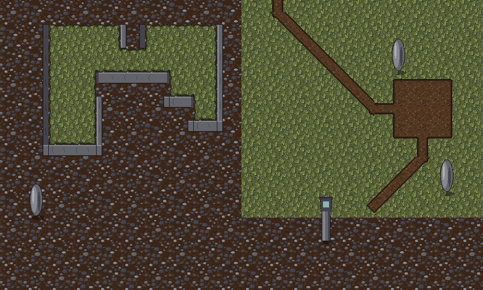
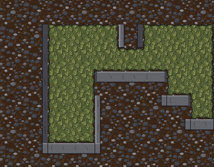 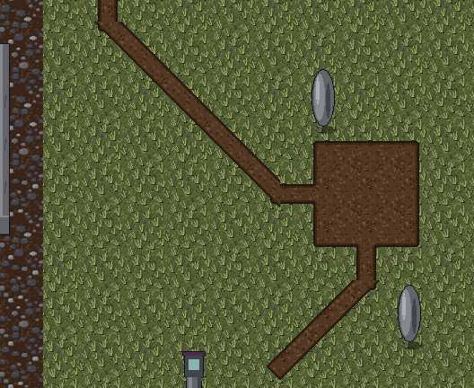 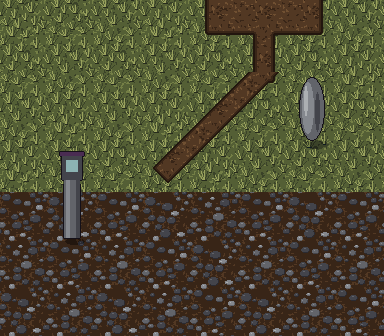
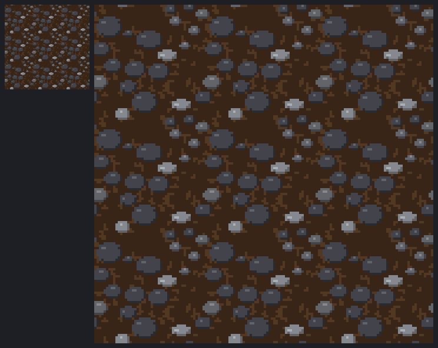 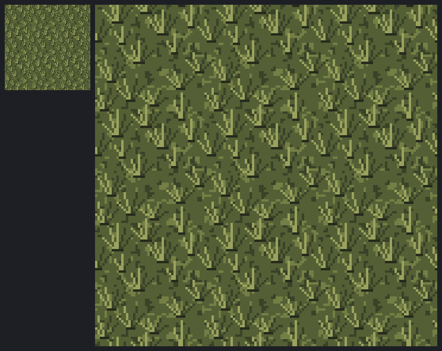

In the browser: the heath in the map editor, the cliff's and the lane's sample islands, and each
new check's chip pressed on its planted fault (on a copy with the fixes undone):

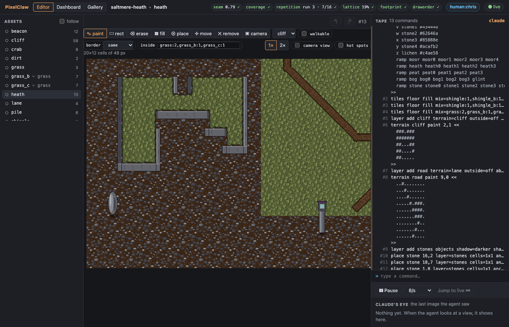
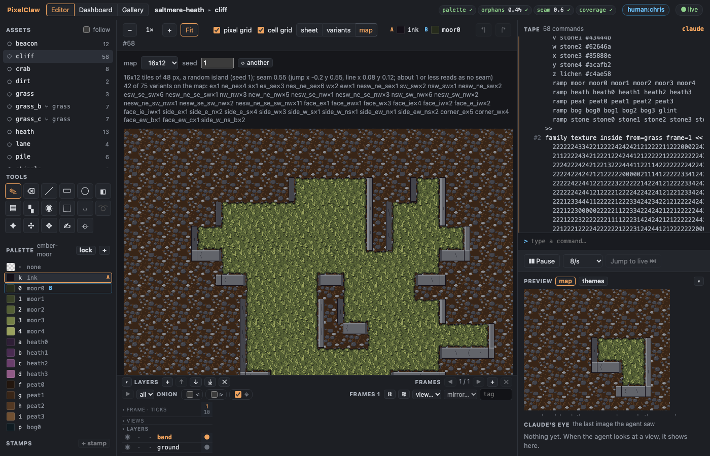
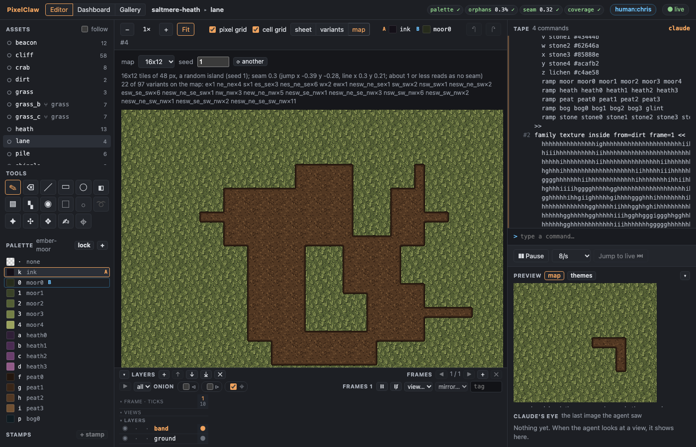
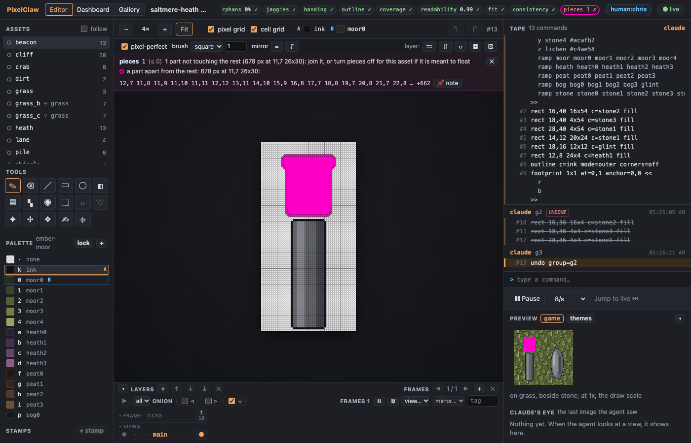
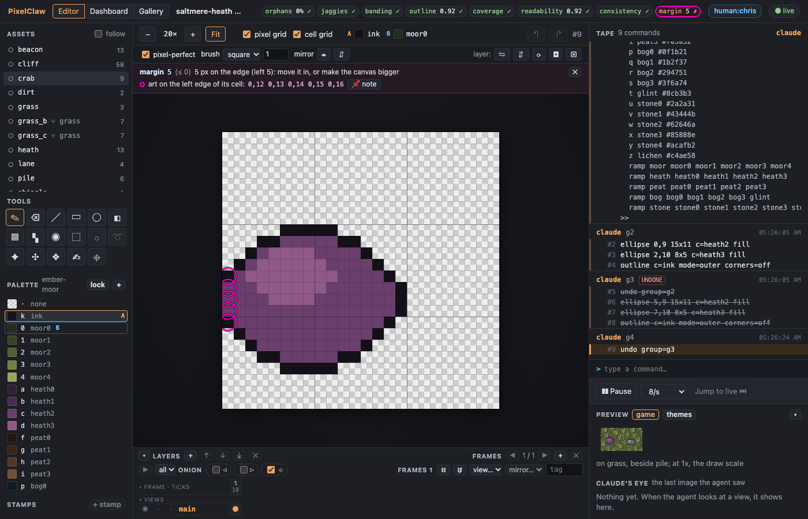
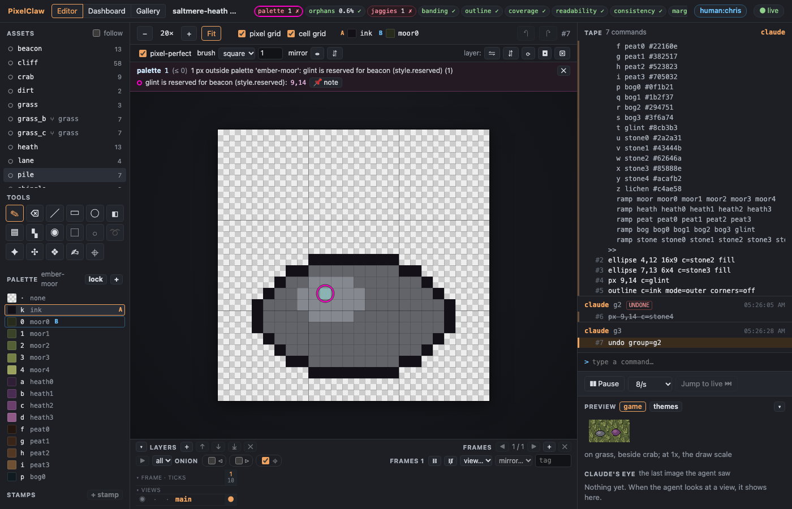
