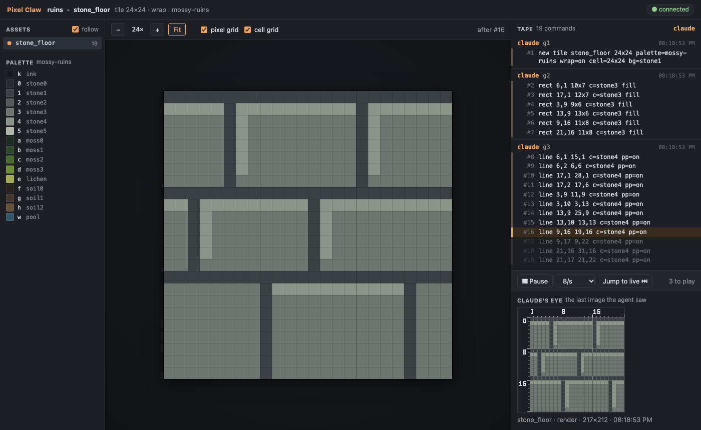
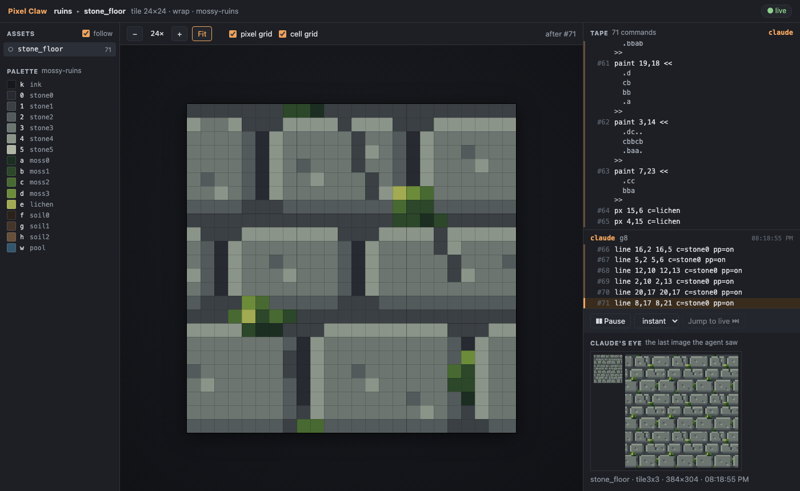
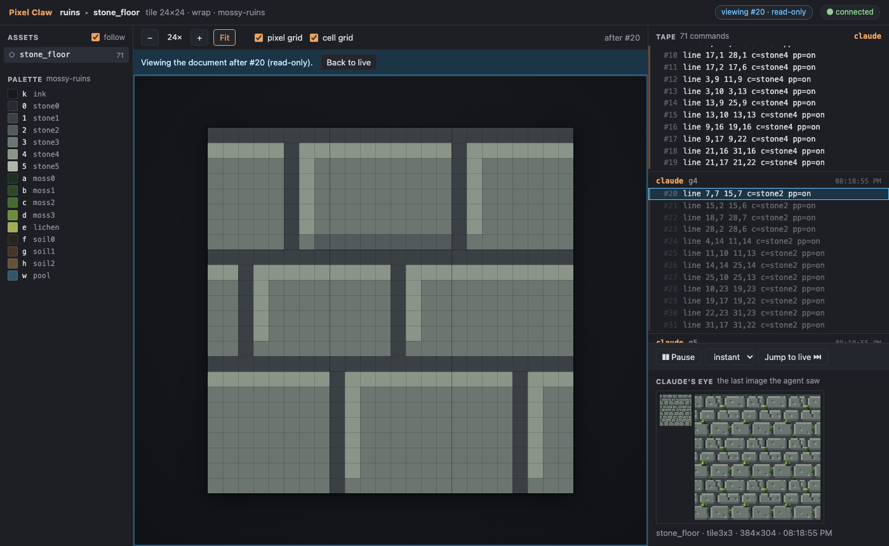

# Demo G2: watch the agent draw a tile

The agent draws a 24x24 tile through MCP while you watch it form on the canvas and the commands
scroll past on the tape.

You need Node 22.18 or later and pnpm. Build once, from the repo:

```sh
pnpm install
pnpm build
```

## With Claude Code

1. **Start the server.** Register it with Claude Code (once), pointing at a project folder. The
   folder is created if it doesn't exist:

   ```sh
   claude mcp add pixelclaw -- node "$PWD/cli/dist/pixelclaw.js" serve --project ~/art/mossy-ruins.pclaw --port 7417
   ```

   Then start Claude Code (`claude`) in the same folder (`claude mcp add` registers servers for the
   current folder unless you add `--scope user`). It starts the Pixel Claw server with the
   session; `/mcp` shows it as connected.

2. **Open the URL.** Ask Claude:

   > Open the Pixel Claw project, add the palette `<repo>/examples/src/mossy-ruins.json`, and give
   > me the watch link.

   Claude calls the `project` tool and replies with a link like
   `http://127.0.0.1:7417/?token=3f9c…`. Open it in your browser. You see an empty canvas, the
   mossy-ruins palette on the left and an empty tape on the right.

3. **The agent draws.** Ask:

   > Draw a seamless 24x24 mossy stone floor tile, a few batches at a time. Look at the 3x3
   > preview at the end.

   Each `run` call appears on the tape as a group of commands, in orange (the agent's colour). The
   canvas plays each batch command by command: the line being drawn is highlighted, and the lines
   still to come are dimmed. When Claude looks at its work, the image it saw appears under
   **Claude's eye**.

While it draws, try:

- the **speed** menu (1 to 60 commands a second, or instant), **Pause** and **Jump to live**;
- clicking any tape line to see the tile as it was then (read-only), then **Back to live**;
- zooming (−/+, Fit, or Ctrl/⌘ + scroll) and the pixel grid;
- opening the link in a second window: both receive the same stream.

When you quit Claude Code, the server stops.

## Without Claude Code

A small script stands in for the agent. It starts the server over stdio, exactly as Claude Code
does, and draws the G1 stone floor in eight batches (its sections), looking at the result as it
goes:

```sh
node examples/demo-g2-agent.ts
```

It prints the link and waits. Open the link, press Enter in the terminal, and watch. Options:
`--pause <seconds>` between batches (default 2), `--project <dir>` (default `out/demo-g2.pclaw`,
recreated each run), `--linger <seconds>` before the server stops (default 120).

## What it looks like






