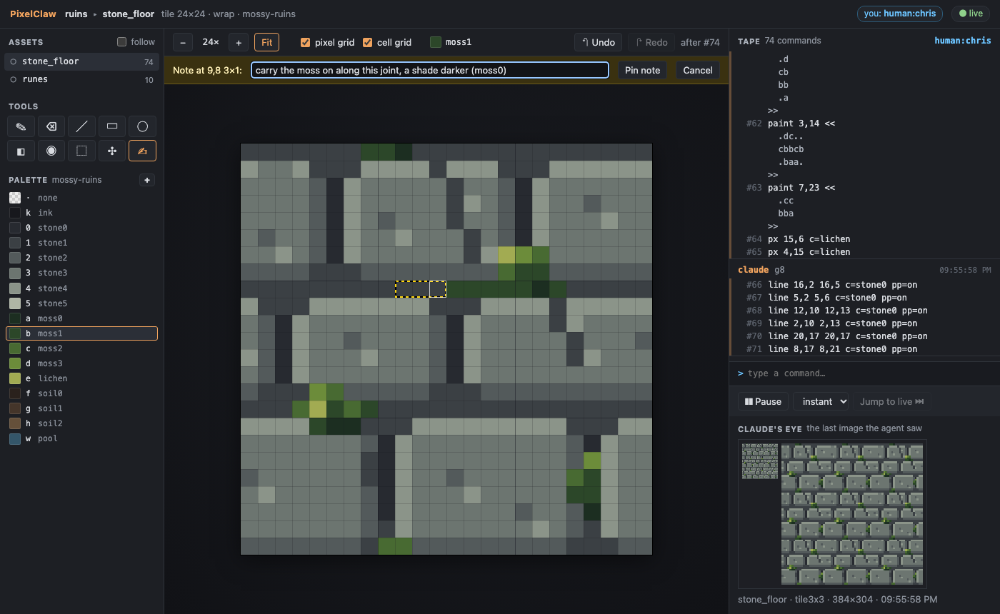
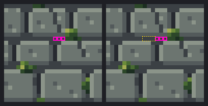
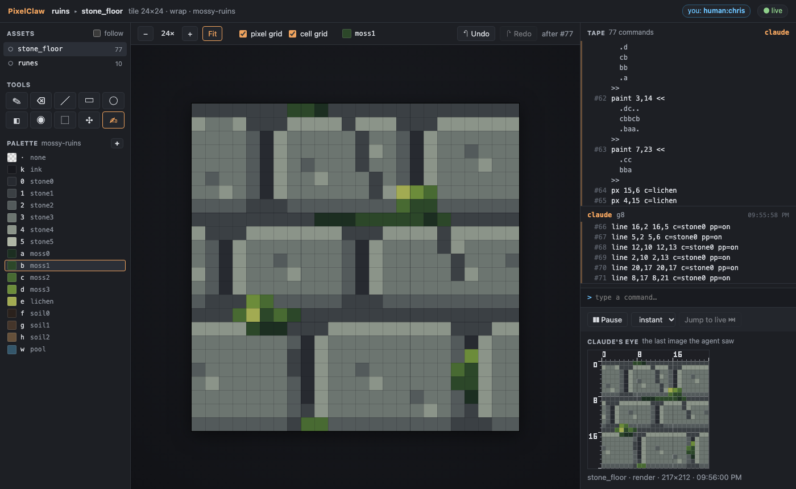

# Demo G3: you edit, and the agent reads your edits

The agent draws a tile. You fix three pixels in the browser and pin a note. The agent's `changes`
tool returns exactly those lines, the note and a diff image, and the agent carries on from them.

You need Node 22.18 or later and pnpm. Build once, from the repo:

```sh
pnpm install
pnpm build
```

## With Claude Code

1. Register the server and open the watch link as in [demo-g2.md](demo-g2.md) (steps 1 and 2),
   and ask Claude to draw the stone floor tile.

2. **Set your name.** Click **you: human:guest** in the page's header and type your name (or add
   `&name=<you>` to the link). Your edits are written to the tape as `human:<you>`.

3. **Fix three pixels.** Pick a colour in the palette (say `moss1`), press **B** for the pencil and
   click three pixels: one joint between two stones, for instance 12,8, 13,8 and 14,8 (the
   hovered pixel is outlined; the rulers in Claude's eye help). Each click is a line on the tape,
   in blue: `stroke pencil c=moss1 pp=on 12,8`.

4. **Leave a note.** Press **N**, drag across 9,8 to 11,8, write *carry the moss on along this
   joint, a shade darker (moss0)* and press **Pin note**. The note shows on the canvas and in the
   Notes panel.

5. **Tell Claude.** For example: *I fixed a few pixels and left you a note.* Claude calls
   `changes` and gets back:

   ```
   stone_floor: 4 commands (4 by human:you) since #71; now at #75
   #72 human:you h1  stroke pencil c=moss1 pp=on 12,8
   #73 human:you h2  stroke pencil c=moss1 pp=on 13,8
   #74 human:you h3  stroke pencil c=moss1 pp=on 14,8
   #75 human:you h4  note 9,8 3x1 "carry the moss on along this joint, a shade darker (moss0)" id=n1
   open notes (1):
     n1 at 9,8 3x1: "carry the moss on along this joint, a shade darker (moss0)"  (new)
   diff #71 → #75: 3 px changed:
     12,8 stone1→moss1
     …
   ```

   with the diff image (before and after, your pixels outlined in magenta, the note in yellow),
   saved as `views/stone_floor.diff.png`. The page shows that image under **Claude's eye**.
   Calling `changes` again returns `No changes since you last looked.`

6. **Claude carries on**: it draws what the note asks and closes it (`note done n1`); the note
   disappears from the canvas.

Then try the rest:

- the other tools (E eraser, L line, U rectangle, Shift+U ellipse, F filled, G fill, I or
  Alt+click picker, M select and drag inside to move, V move, arrows to nudge), all with their
  shortcut in the tooltip;
- double-click a palette swatch to change its colour, or **+** to add one;
- **Undo** / **Redo** (Ctrl/⌘+Z, Ctrl/⌘+Shift+Z): they take back only your edits, never the
  agent's or another person's;
- click a tape line to time travel, then **Branch here** to start a new asset from that point;
- open the link in a second browser with another name and draw in both at once.

## Without Claude Code

A script stands in for the agent: it starts the server over stdio as Claude Code would, draws the
stone floor, prints the link and waits while you do steps 3 and 4. Press Enter, and it calls
`changes`, prints what came back, fills the note's region with `moss0`, closes the note and looks
at the tile again.

```sh
node examples/demo-g3-agent.ts
```

`--simulate` plays the person too, over the page's WebSocket as `human:demo`, so the whole demo
runs with no browser. Other options: `--project <dir>` (default `out/demo-g3.pclaw`, recreated
each run) and `--linger <seconds>` before the server stops (default 120, or 0 with `--simulate`).

## What it looks like








More: [a pencil stroke in progress](../docs/screenshots/g3-pencil.png),
[a selection moved](../docs/screenshots/g3-select-move.png),
[changing a palette colour](../docs/screenshots/g3-palette.png),
[branch here](../docs/screenshots/g3-branch.png) and [the branch](../docs/screenshots/g3-branched.png),
[a second person undoing their own stroke](../docs/screenshots/g3-two-people.png),
[a 10,000-line tape](../docs/screenshots/g3-long-tape.png).
