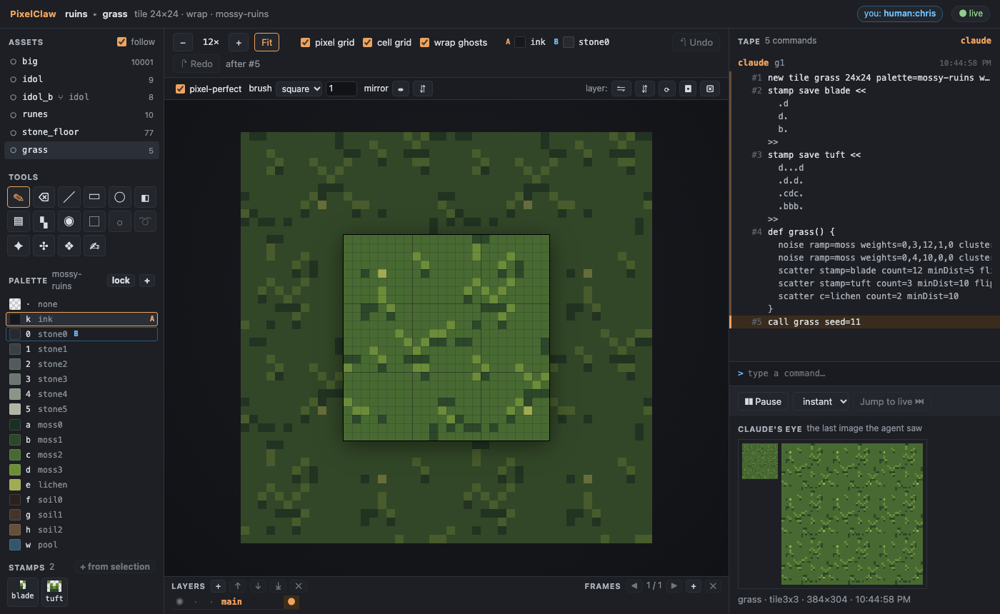
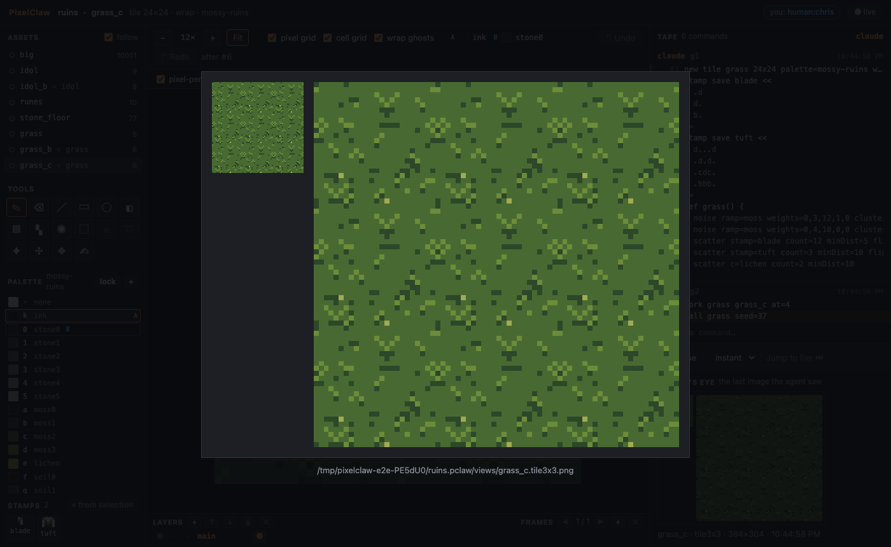
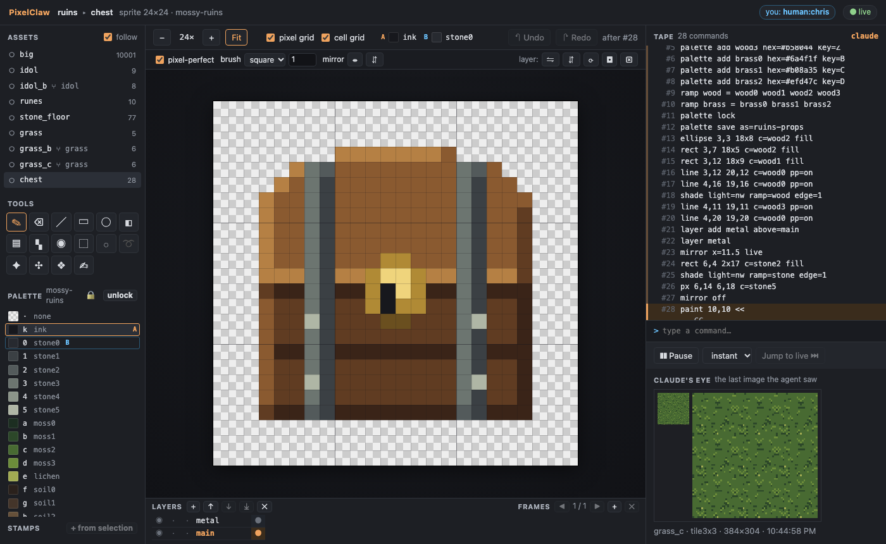
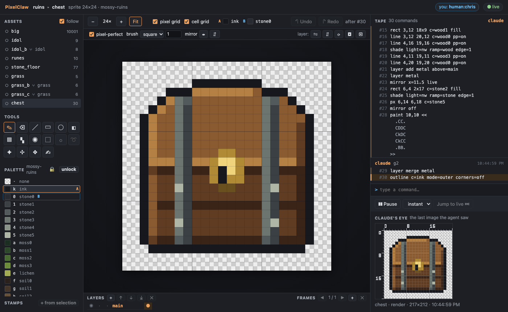
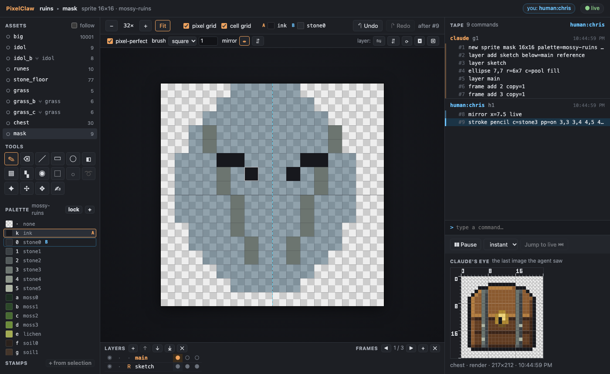
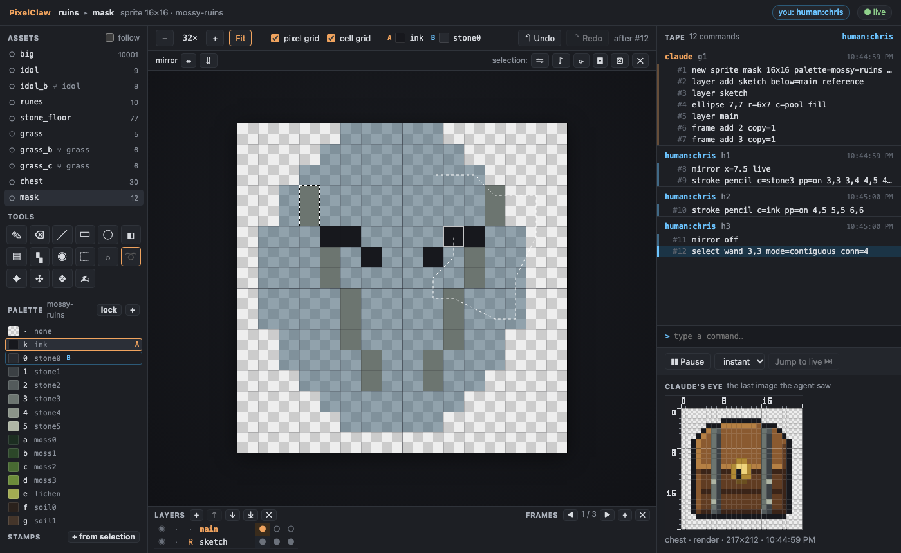
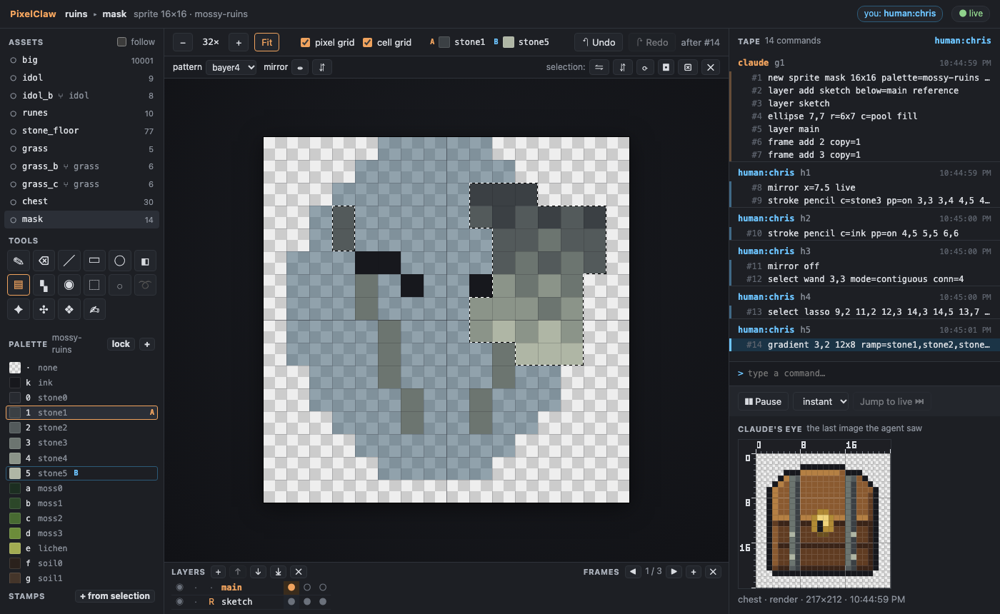
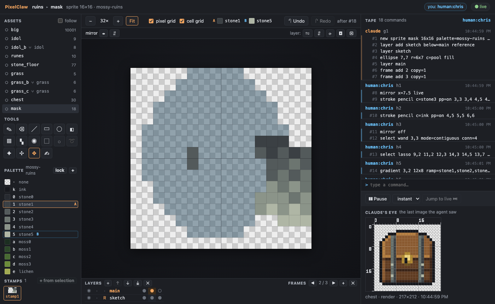

# Demo G4: the drawing toolkit

The agent makes a seamless grass tile with two variants and a 24x24 chest sprite, using the G4
toolkit: generators with seeds, stamps, a macro, forks for variants, palette edits and locking,
ramps, shading, live symmetry, a layer, the lock detail and an outline. After each piece it looks
at the result in context and reads the grid view, the exact pixels, to check it.

You need Node 22.18 or later and pnpm. Build once, from the repo:

```sh
pnpm install
pnpm build
```

## With Claude Code

Register the server and open the watch link as in [demo-g2.md](demo-g2.md) (steps 1 and 2), then
ask Claude for the two pieces, for example: *Make a seamless 24x24 grass tile for the mossy
ruins, with two variants, and a 24x24 treasure chest with an outline, shading and a lock. Check
both in the grid view.* The scripts below are one way to do it; Claude writes its own.

## With the stand-in agent

```sh
node examples/demo-g4-agent.ts            # --pause <ms> between batches (default 1500), --linger <s>
```

It starts `pixelclaw serve` on `out/demo-g4.pclaw` exactly as Claude Code would, prints the watch
link (open it to watch), and runs the scripts in [examples/scripts/](scripts/) batch by batch:

1. **The grass tile** ([grass.pclaw](scripts/grass.pclaw)). Two stamps (a curved blade and a
   tuft, each as a paint block), and a macro `grass()` that fills the tile: a calm `noise` base on
   the moss ramp, a few soft darker patches, then `scatter` blades and tufts at least 5 and 10 px
   apart, and two lichen flowers. Every generator works with `wrap=on`, so the tile is seamless
   by construction. `call grass seed=11` draws it. The agent looks at `tile3x3` and prints the
   grid.

   

2. **Two variants** ([grass_b.pclaw](scripts/grass_b.pclaw), [grass_c.pclaw](scripts/grass_c.pclaw)).
   Each forks the grass tape after the macro is defined (`fork grass grass_b at=4`) and calls it
   with another seed. The agent compares the colour mix of the three from their grid legends:

   ```
   colour      grass  grass_b  grass_c
   moss1          47       48       55
   moss2         484      478      474
   moss3          43       48       45
   lichen          2        2        2
   ```

   

3. **The chest** ([chest.pclaw](scripts/chest.pclaw)). It adds wood and brass ramps to its own
   palette, locks the palette (no stray colours from here on) and saves it to the project as
   `ruins-props` for the next props. The body is a rounded lid (an ellipse over a rectangle) on a
   box of planks, lit with `shade light=nw ramp=wood`, with a light lid lip and a dark base. The
   iron straps go on their own `metal` layer, drawn once with `mirror x=11.5 live`, and lit from the
   same side. The lock is a paint block: a brass plate with a keyhole over the seam. Then the
   metal layer is merged down and `outline c=ink` draws the 1-px outline.

   

   The grid the agent reads to check the lock and the straps (keyhole at 11,12 and 11,13, straps
   mirrored at 6-7 and 16-17, rivets at 6,14 / 17,14 and 6,18 / 17,18):

   ```
       0         1         2
       012345678901234567890123
    2  ........kkkkkkkk........
    3  .....kkkZZZZZZZYkkk.....
    4  ....kZ32YYYYYYYY32Yk....
   10  ..kZYY31YYYCCYYY31YYXk..
   11  ..kZZZ31ZZCDDCZZ31ZZXk..
   12  ..kXWW31WWCkDCWW31WWWk..
   13  ..kYXX31XXCkCCXX31XXWk..
   14  ..kYXX51XXXBBXXX35XXWk..
   20  ..kXWW21WWWWWWWW21WWWk..
   21  ...kkkkkkkkkkkkkkkkkk...
   ```

   

The same four assets are checked in, in [examples/mossy-ruins.pclaw](mossy-ruins.pclaw), with their
views (`views/grass.tile3x3.png`, `views/chest.render.png`, the grids); a test rebuilds them from
the scripts and checks the tapes, states and previews.

## In the watch view

Everything the agent does, you can do in the page, and every control writes a command:

- **Selections**: M (rectangle), Shift+M (ellipse), Q (lasso), W (magic wand; *whole colour* for
  all of a colour). Shift adds, Alt subtracts. Your selection is yours: it never clips the agent.
- **Transforms** in the options bar: flip ⇋ ⇵, rotate ⟳ (Shift+H, Shift+V, Shift+R), on your
  selection or your layer; the move tool and arrow keys shift it.
- **Symmetry**: mirror ⇹ ⇵ in the options bar, with dashed guides on the canvas.
- **Brush** size and shape for the pencil, eraser, lines and outlines.
- **Gradient** (Shift+G): colour A (click a swatch) to colour B (right-click a swatch) along their
  ramp, through your selection. **Dither** (D) with a pattern and level.
- **Outline** and **clean orphans** buttons.
- **Stamps**: save your selection as one, then place it with S.
- **Layers and frames** in the timeline under the canvas: add, move, merge, remove, and the hidden,
  locked and reference flags; frames with + / ✕ and [ ].
- **Wrap ghosts** around a tile: draw across its edges from the neighbouring copies.





