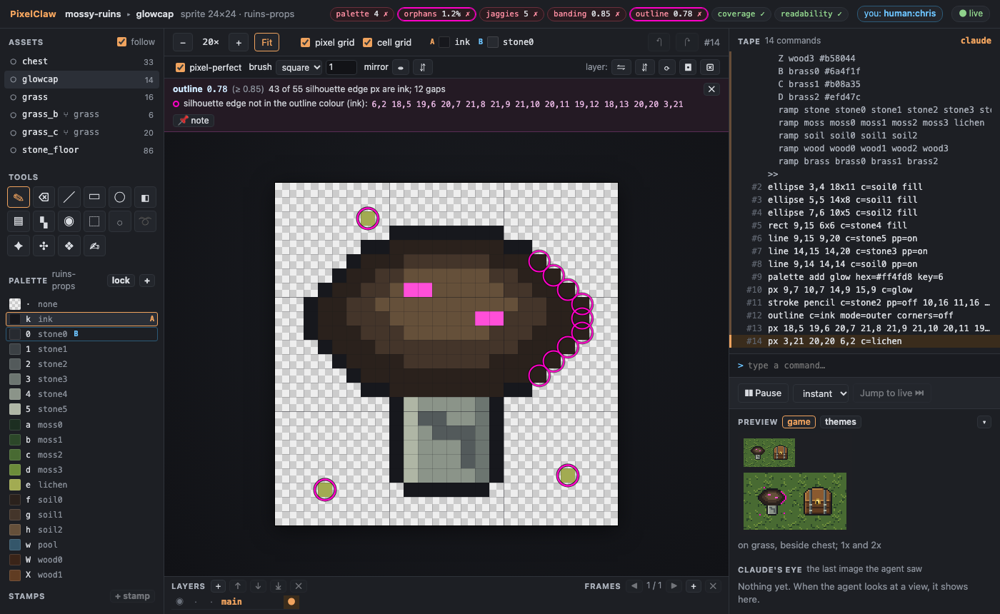
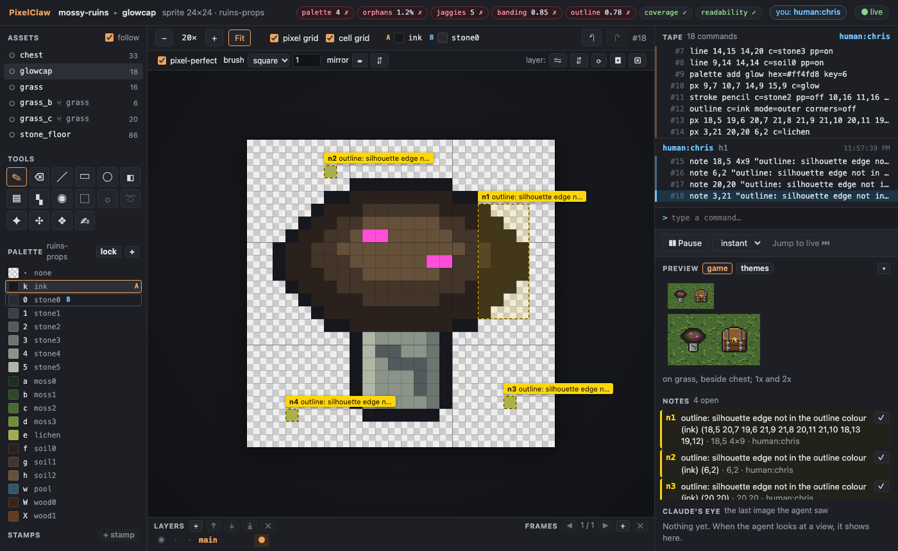
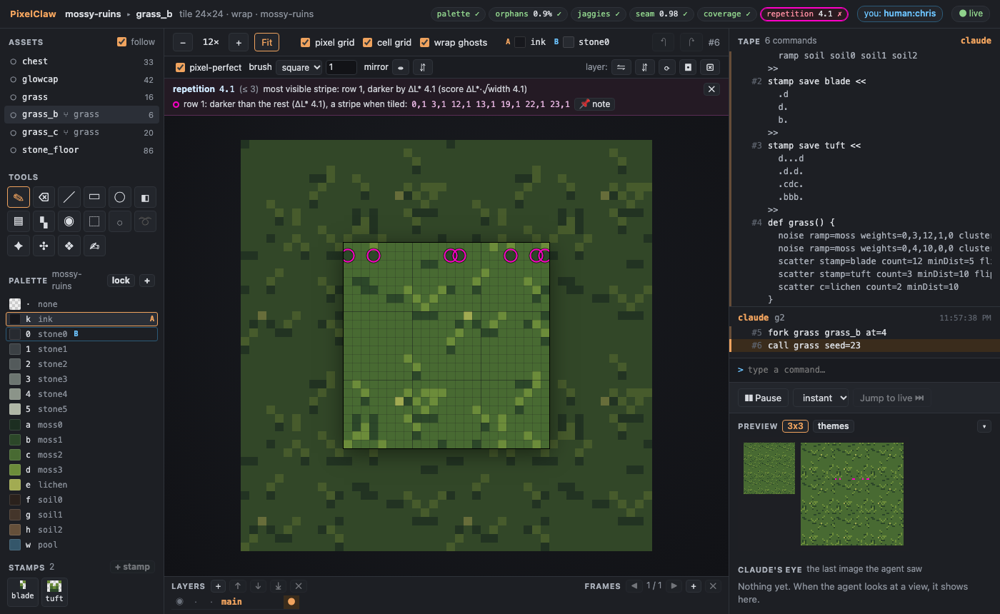
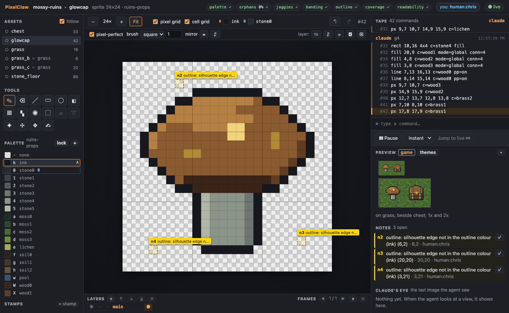
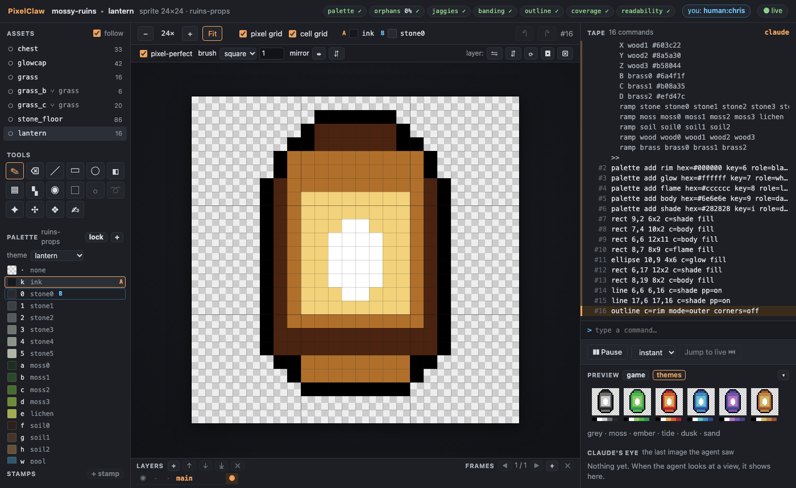
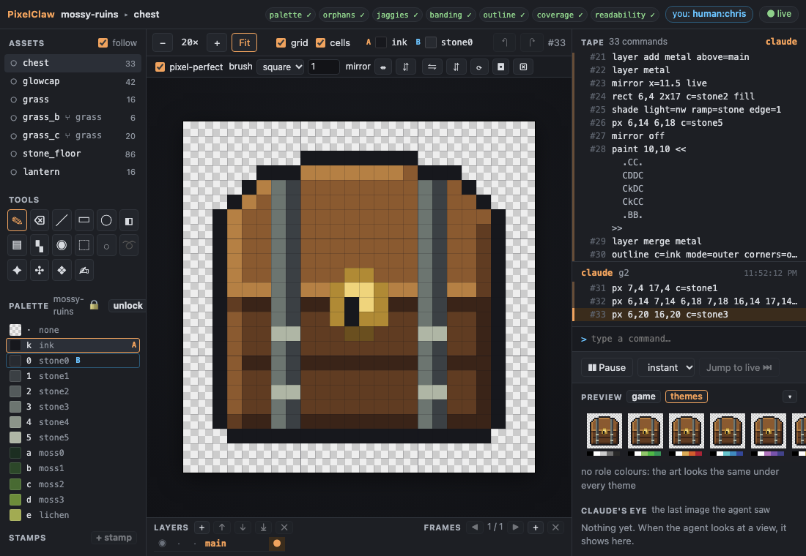

# Demo G5: checks and in-context previews

The agent checks its art against the project's style guide and fixes what the checks find, by
the coordinates they give, until every check is green; it looks at each piece in context (the
tile repeated 3x3, the sprite on its ground at game scale) and fixes what it sees there too.
First a test sprite with five deliberate defects, then the weak spots in the G4 grass tiles and
chest and the G1 stone floor. Last, a blind reviewer (a fresh agent that sees only a review
bundle) judges the set, and its findings come back as notes on the pixels.

You need Node 22.18 or later and pnpm. Build once, from the repo:

```sh
pnpm install
pnpm build
```

## The style guide

[mossy-ruins.pclaw/project.json](mossy-ruins.pclaw/project.json) gained a `style` section (the
palettes the art may use, the outline colour, the usual ground for sprites, the game's draw
scale, the sizes, and one exception: the laid stone floor's courses are its pattern, so it is not
held to the repetition check), and [style.md](mossy-ruins.pclaw/style.md) says the same in words.
The checks and their thresholds are in [docs/checks.md](../docs/checks.md).

## With Claude Code

Register the server and open the watch link as in [demo-g2.md](demo-g2.md) (steps 1 and 2), then
ask, for example: *Check every asset. Fix what fails by the coordinates the checks give, until
everything is green, and look at each tile's 3x3 and each prop's game view: fix what still looks
wrong. Then write a review bundle and have a fresh agent review it blind.*

## With the stand-in agent

```sh
node examples/demo-g5-agent.ts            # --pause <ms> between batches (default 1500), --linger <s>
```

It starts `pixelclaw serve` on `out/demo-g5.pclaw` exactly as Claude Code would, prints the watch
link, rebuilds the G1-G4 art from its scripts, and then works through the scripts in
[examples/scripts/](scripts/) (`*_fix.pclaw`, `*_review.pclaw`) batch by batch, printing the check
summary after each.

### 1. A test sprite with five deliberate defects

[glowcap.pclaw](scripts/glowcap.pclaw) draws a mushroom with one defect per check: the cap shaded
in rings (pillow shading), spots in a colour from outside the style guide, a crack drawn freehand
with doubled corners, the outline painted over down the cap's right side, and three stray specks.
The summary after the last batch:

```
checks: palette 4 ✗ · orphans 1.2% ✗ · jaggies 5 ✗ · banding 0.85 ✗ · outline 0.78 ✗ · coverage 0 ✓ · readability 1 ✓  (5 failing: `check` gives coordinates)
```

`check` gives each failure with its pixels:

```
glowcap: 5 of 7 checks failing
  ✗  palette     4      ≤ 0     4 px outside the style palettes (mossy-ruins, ruins-props): glow #ff4fd8 is not in the style palettes (4)
       glow #ff4fd8 is not in the style palettes: 9,7 10,7 14,9 15,9
  ✗  orphans     1.2%   ≤ 1%    3 stray px in 245 (3 lone, 0 near-orphans)
       lone pixel (no neighbour shares its colour): 6,2 20,20 3,21
  ✗  jaggies     5      ≤ 0     5 doubled L-corners, 0 irregular step runs, 0 spikes, 0 notches
       doubled L-corner: 8,4 15,4 6,5 8,5 15,5 5,6 6,6 7,6 16,6 4,7 5,7 6,7 7,7 16,7 17,7 11,16 11,17
  ✗  banding     0.85   ≤ 0.5   ramp soil: 58 ramp steps along the outline; inward west +1, top +0.85, east +1, bottom +1 (the same on every side: light one side and shade the other)
       pillow shading in ramp soil: it gets lighter inward on every side: 9,4 10,4 11,4 …
  ✗  outline     0.78   ≥ 0.85  43 of 55 silhouette edge px are ink; 12 gaps
       silhouette edge not in the outline colour (ink): 6,2 18,5 19,6 20,7 21,8 21,9 21,10 20,11 19,12 18,13 20,20 3,21
```

(The cap's rings also count as jagged: thin bands of colour stepping with doubled corners.)



In the watch view, *📌 note* under a check pins its pixels as notes for the agent, one per cluster:



[glowcap_fix.pclaw](scripts/glowcap_fix.pclaw) fixes it by those coordinates: the specks go, the
outline's gaps are inked, the crack's doubled corner at 11,16 goes, the cap is flattened to one
tone and lit from the top left (`shade light=nw`), the spots come back in lichen. Green after
that pass, the cap was still flat, so it gets a broad highlight on the lit side and a shadowed
underside; that left one stray at 8,14, which the next summary caught. All seven checks pass.

### 2. The weak spots in the G4 art and the G1 floor

`check` with no asset, before:

```
chest: palette 0 ✓ · orphans 2.4% ✗ · jaggies 0 ✓ · banding 0 ✓ · outline 1 ✓ · coverage 0 ✓ · readability 1 ✓
grass: palette 0 ✓ · orphans 0.7% ✓ · jaggies 0 ✓ · seam 0.39 ✓ · coverage 0 ✓ · repetition 3.4 ✗
grass_b: palette 0 ✓ · orphans 0.9% ✓ · jaggies 1 ✓ · seam 0.98 ✓ · coverage 0 ✓ · repetition 4.1 ✗
grass_c: palette 0 ✓ · orphans 1.7% ✓ · jaggies 1 ✓ · seam 0.59 ✓ · coverage 0 ✓ · repetition 3.3 ✗
stone_floor: palette 0 ✓ · orphans 2.4% ✗ · jaggies 1 ✓ · seam 1.68 ✗ · coverage 0 ✓
```

- **The grass tiles** ([grass_fix](scripts/grass_fix.pclaw), [grass_b_fix](scripts/grass_b_fix.pclaw),
  [grass_c_fix](scripts/grass_c_fix.pclaw)). Each had one row of marks lighter or darker than
  the rest, which repeats as a stripe across a tiled floor: in grass_b, seven dark marks along row
  1 (`0,1 3,1 12,1 13,1 19,1 22,1 23,1`), the "faint rows" G4 left. The fixes move a few marks
  between the busiest and the calmest rows (each mark moves its row's lightness by about 0.6 L*)
  until the most visible stripe is under 3. Green, but the 3x3 still showed the three tufts as the
  same V on a lattice (all one stamp), so each tuft loses a different blade tip and a pixel of its
  root.

  

- **The chest** ([chest_fix](scripts/chest_fix.pclaw)): nine strays, all in the straps. The
  rivets were single pixels (each is now a head across the strap) and the straps' ends were lone
  greys (they carry the strap's edge on).
- **The stone floor** ([stone_floor_fix](scripts/stone_floor_fix.pclaw)): its moss flecks were
  single pixels of four tones (now small clumps), and the tile's edge ran along a course of stone
  tops, a line at every seam (`seam 1.68`): `shift 0,4 wrap` puts the seam inside the stones
  (`0.72`).

After: every asset, every check green (`check` exits 0; `examples/mossy-ruins.pclaw` is checked
in at this point, with the review round below).

### 3. A blind review

`review` writes [reviews/2026-10-28-g5/](mossy-ruins.pclaw/reviews/2026-10-28-g5/): each asset
enlarged with rulers and at game scale, the tiles 3x3, the props on their ground, the palette,
the style guide and a rubric. It names no method or author. A fresh agent was given only the
folder ("Review the art in this folder by following rubric.md"); its report is kept beside it as
[findings.md](mossy-ruins.pclaw/reviews/2026-10-28-g5/findings.md). It found what no check
measures: the glowcap's cap is close in value to the grass and nothing says *glow*, its crack
reads as a letter and its two spots as a face; single lichen pixels in the grass repeat as a dot
grid; a straight 4-px dash gives grass_c's repeat away; the floor's vertical joints are darker
than its mortar. It also found two of the tool's own faults: the bundle's palette listed an entry
no pixel used, and the style guide was unclear about what props may use. Both are fixed.

The `*_review.pclaw` scripts pin each finding as a note where the reviewer pointed, fix it, and
close the note: the glowcap's cap moves to the props' wood ramp with brass spots of three sizes,
the lichen dots soften to moss3, the dash breaks up, the joints take the mortar's colour. Every
check is still green.



## In the watch view

- **Check chips** in the header, computed in the page with the project's style guide (the same
  answers as the agent's `check`, and they follow time travel). Click one to circle its pixels
  and open its details; *📌 note* pins them for the agent.
- **Preview** (right): the 3x3 for tiles, the game view for sprites (on the ground at 1x and 2x,
  beside the set), and the art under every preview theme.
- **Role colours** (recolourable art): double-click a swatch to give it a role; a **theme** menu
  under the palette shows the canvas under a theme, writing nothing.

  

- On narrow windows the side panels narrow, the toolbar's labels shorten and the options bar keeps
  its groups on one row:

  

Screenshots: `node scripts/screenshots-g5.ts`.
