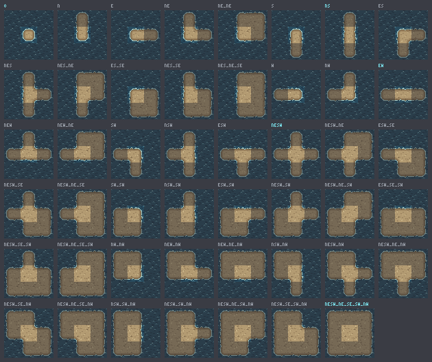
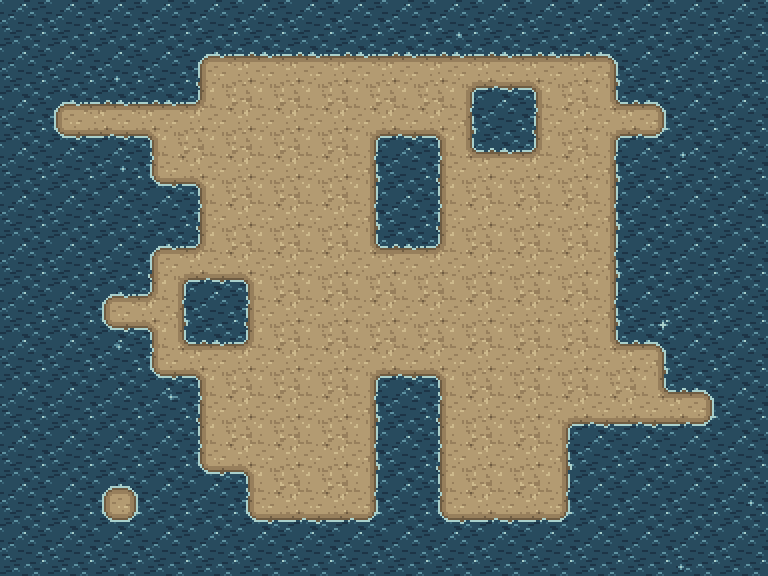
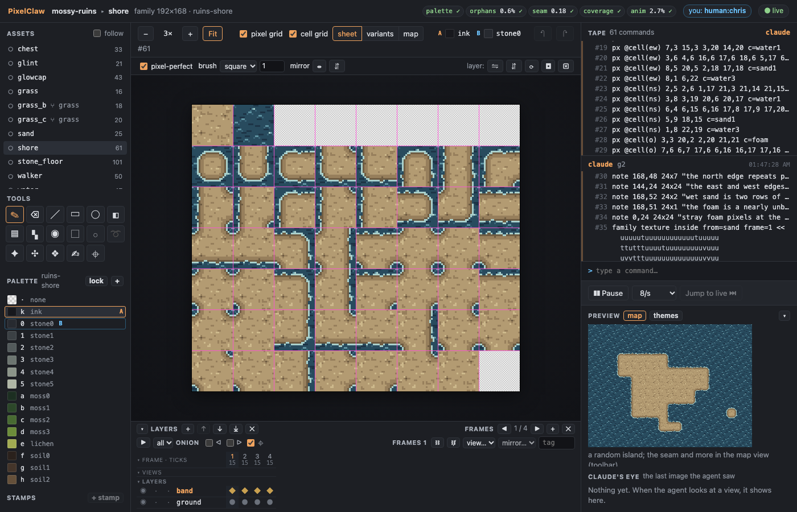
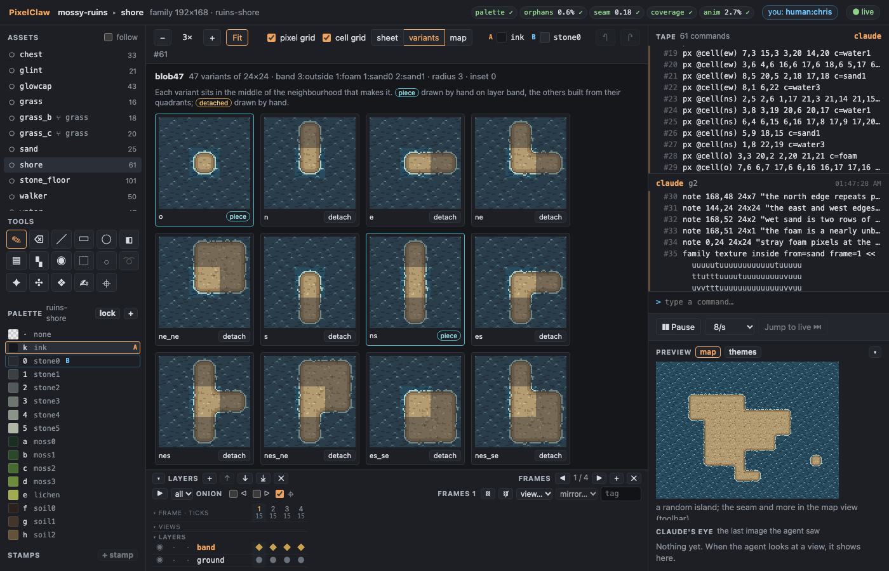
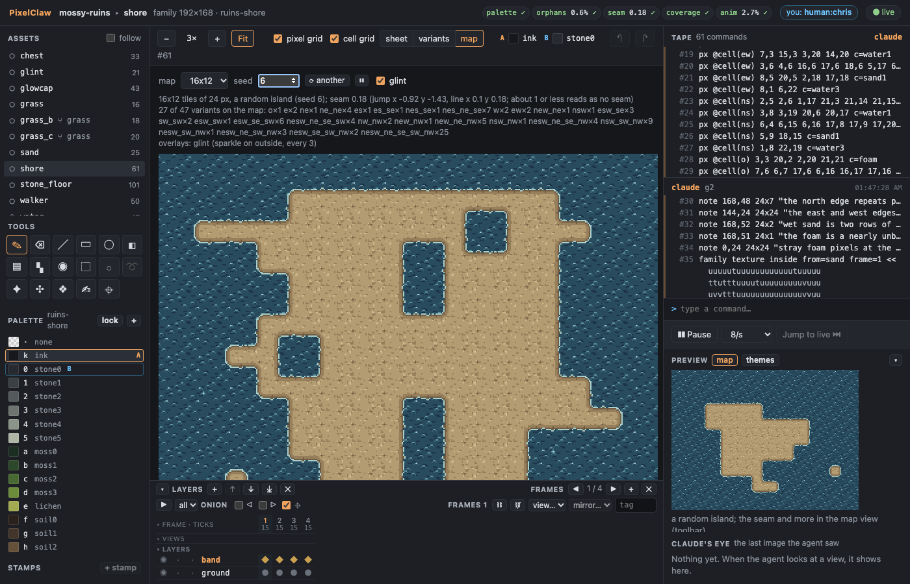
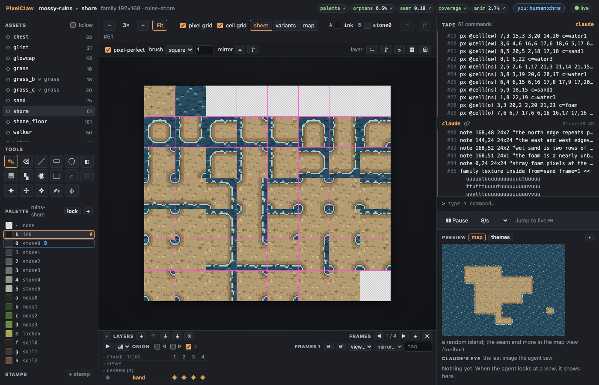

# Demo G7: tile sets and autotiling

The agent builds a shore: a `blob47` autotile family of 47 variants where sand meets water. It
draws one seamless sand tile, declares the band between sand and water (water, a line of foam,
wet sand, dry sand; round corners), and the tool draws every variant from that profile over the
two shared textures, which it copies from the sand tile and, frame by frame, from G6's
shimmering water, so the whole shore shimmers. The agent then details three of the five pieces by
hand, and every variant built from them follows at once. It looks at the shore on a random island,
with the seam score over the map (0.18; the demo asks for at most 0.5) and glints sparkling on the
water, and a blind reviewer judges the island.

You need Node 22.18 or later and pnpm. Build once, from the repo:

```sh
pnpm install
pnpm build
```

## With Claude Code

Register the server and open the watch link as in [demo-g2.md](demo-g2.md) (steps 1 and 2), then
ask, for example: *Make a seamless 24x24 sand tile for the mossy ruins, then a blob47 shore family
where the sand meets the water tile: water, a broken line of foam, wet sand, dry sand, round
corners. Detail three pieces by hand, show it on a random island with the seam score, add glints
on the water, and run a blind review on the island.*

## With the stand-in agent

```sh
node examples/demo-g7-agent.ts            # --pause <ms> between batches (default 1500), --linger <s> (default 600)
```

It starts `pixelclaw serve` on `out/demo-g7.pclaw` (the mossy ruins palette and style guide),
prints the watch link, rebuilds G6's water tile, and then works as below, printing each batch's
intent and check summary.

## 1. The sand

[sand.pclaw](scripts/sand.pclaw) adds a sand ramp (saved as `ruins-shore`) and lays clustered
noise on the tile as a torus, with two small pebbles in the sand's own colours (grey ones showed
as dots on a grid when tiled). The seeds were picked from a few by the checks:

```
checks: palette 0 ✓ · orphans 0.5% ✓ · jaggies 1 ✓ · seam 0.36 ✓ · coverage 0 ✓ · repetition 2.5 ✓
```

## 2. The shore, from a band profile

[shore.pclaw](scripts/shore.pclaw):

```
new family shore 24x24 scheme=blob47 palette=ruins-shore
family texture inside from=sand frame=1
frame add copy=1   (three times) ; frame set all ticks=15 ; cel link 1-4 layer=band
frame 1 ; family texture outside from=water frame=1    (and frames 2-4 from the water's frames 2-4)
family band 3:outside 1:foam 2:sand0 radius=3
```

The sheet holds the two textures on its first row, then the 47 variants. `family texture … from=`
copies a tile into a texture cell and writes its pixels into the line, so the tape replays alone.
`family band` gives the band from the water's edge in: 3 px where the water carries on into the
sand tile (so the edge never sits on the tile border), a pixel of foam, 2 of wet sand, then the
sand; the band's inner edge rounds with radius 3 at outer corners. It draws the band on the five
**pieces** (`o`, `nesw`, `ew`, `ns` and the interior); every other variant's band is built from
the pieces' quadrants after every command, and every variant's ground is the sand or the water
texture *at the same pixel* (the textures are re-projected, so the variants tile with each other
and with the plain tiles).

Then three pieces are detailed by hand on layer `band` (`px @cell(ew) …`): the long north and south
edges (`ew`), west and east (`ns`) and the outer corners (`o`), kept off each quadrant's edges so
the quadrants still join. Each line reaches every variant with that quadrant at once:

```
checks: palette 0 ✓ · orphans 0.9% ✓ · seam 0.2 ✓ · coverage 0 ✓ · anim 2.6% ✓
```

`coverage` counts all 47 variants and both textures drawn on all four frames; `seam` is the
pilot's metric over a 12x10 island (below). `view family` shows every variant in the middle of the
neighbours that call for it, and says where each cell is:



## 3. Glints

[glint.pclaw](scripts/glint.pclaw) is an **overlay**: a 5x5 sparkle in three frames that flashes
now and then on the water tiles of a map (`overlay set mode=sparkle on=outside every=3
spread=8x8 rest=150`), each at its own seeded moment and place.

## 4. The island

`view(mode="map", size="16x12", seed=6, with=["glint"])`:

```
16x12 tiles of 24 px, a random island (seed 6); seam 0.18 (jump x -0.91 y -1.43, line x 0.1 y 0.18; about 1 or less reads as no seam)
27 of 47 variants on the map: o×1 e×2 ne×1 ne_ne×4 … nesw_ne_se_sw_nw×25
overlays: glint (sparkle on outside, every 3)
animated GIF at game speed: …/views/shore.map.gif
```



The [GIF](../docs/screenshots/g7-shore-map.gif) plays the water's four frames and the glints at
the game's speed.

## 5. The blind review

`review(assets=["shore","sand","water","glint"], name="g7", size="16x12", seed=6)` writes a bundle
in which each family is a map at game scale (and a GIF), with the tile at each column and row and
every variant among its neighbours, and a seventh rubric question: does the edge read as one
natural edge, without the tile grid showing? A fresh agent judged it blind
([findings.md](mossy-ruins.pclaw/reviews/2026-10-28-g7/findings.md)): the island reads as land, the
corners are round and the set is cohesive (4/5), but the wet sand read as a dark outline, the foam
was an unbroken line, the long edges repeated pixel for pixel, the sand's marks bunched at its
edges, a corner kept a stray, and the glint vanished at its largest. The findings came back as
notes on the pieces and tiles they came from and were fixed by coordinates
([shore_review.pclaw](scripts/shore_review.pclaw), [sand_review.pclaw](scripts/sand_review.pclaw),
[glint_review.pclaw](scripts/glint_review.pclaw)): the band redrawn with a one-pixel waterline and
a wider drying strip, the foam in dashes, the waterline dipping and rising differently on each
side, the sand's marks spread, the glint fading out. Copying the reviewed sand in again changed
all 47 variants at once. The island now scores 0.18, every check green. The water's findings (G6's
tile: one crest stamp, a conveyor motion) are left as open notes, and the shore's edges still
repeat their piece every tile (one `ew` and one `ns`): texture variants and map hot spots are G8's.

## 6. In the watch view

Pick `shore`. The toolbar switches the middle between the **sheet** (draw on the pieces; the
toolbar names the cell under the pointer), the **variants** (each among its neighbours, pieces and
detached variants marked, detach and attach on each) and a **map** (size, seed and overlays to
choose, only for looking; the seam score above it). The timeline's rows fold away.






Detach, attach, *coverage map* and *cut from map* are commands on the tape with your name; a stroke
on a piece reaches every variant built from it as soon as it lands.

## The other routes

- **Quadrant pieces**: draw the pieces (`paint @cell(o) 0,0 << … >>` on layer `band`) without a
  band profile, or after one with `draw=off`.
- **Cut from a painted map**: `new family … map=14x12`, `family coverage` (a map laid out so every
  variant appears, with a flat template on a reference layer), paint the map area, then
  `family cut` (each variant becomes the medoid of its tiles on the map, its band only).

## In the CLI

```sh
node cli/bin/pixelclaw.js view examples/mossy-ruins.pclaw shore map --size 16x12 --seed 6 --with glint
node cli/bin/pixelclaw.js view examples/mossy-ruins.pclaw shore family
node cli/bin/pixelclaw.js review examples/mossy-ruins.pclaw shore sand --size 16x12 --seed 6
```
