# Demo G8: maps and scenes, oversized tiles

The agent builds a coastal village from its own tiles and judges the set as a whole. It draws
three objects bigger than a cell (a 48x48 house, a 24x48 tree, a well), each with a footprint that
says which cells block and which are roofs; two more families (a meadow of grass on sand, a lane of
sand through grass); then paints a 40x30 map with them on top of G7's shore, places the houses and
the well, and scatters trees. It looks at the village whole and at game scale through the camera,
runs the map checks, finds where the map repeats (long straight edges showing the same tile, the
meadow's middle one tile over and over) and fixes it with texture variants. A person moves the
well in the watch view and the agent reads the move through `changes`. Then a blind reviewer
judges the village at game scale.

You need Node 22.18 or later and pnpm. Build once, from the repo:

```sh
pnpm install
pnpm build
```

## With Claude Code

Register the server and open the watch link as in [demo-g2.md](demo-g2.md) (steps 1 and 2), then
ask, for example: *Using the shore, grass and sand of the mossy ruins, make a 48x48 house, a 24x48
tree and a well with footprints, a meadow and a lane family, and paint a 40x30 coastal village with
them. Look at it at game scale, run the map checks, fix what repeats, then tell me when to move
the well and read what I did. Finish with a blind review of the village.*

## With the stand-in agent

```sh
node examples/demo-g8-agent.ts                 # a headless browser plays the person
node examples/demo-g8-agent.ts --person no     # you move the well yourself in the watch view
```

It starts `pixelclaw serve` over stdio as Claude Code would, prints the watch link, rebuilds the
stage from its scripts (G4's grass and its two variants, G6's water, G7's sand, shore and glints),
then works through the steps below with a check summary after each batch, in
`out/demo-g8.pclaw`. `--pause <ms>` sets the time between batches (default 1200).

## 1. Objects bigger than a cell

[house.pclaw](scripts/house.pclaw): `new object house 48x48 cell=24x24`, a pitched roof of red
tiles (a new `ruins-village` palette: roof and plaster ramps over the props colours) over a
plastered front with a timber frame, a door and two windows, lit from the top left, an ink outline.
Its footprint is all four cells, the wall row blocking and the roof row a roof:

```
footprint 2x2 at=0,0 anchor=0,1 <<
  rr
  bb
>>
```

[tree.pclaw](scripts/tree.pclaw) is 24x48 and stands on one cell (`footprint 1x1 << r / b >>`): its
crown overhangs the cell above as a canopy, drawn above actors walking behind it.
[well.pclaw](scripts/well.pclaw) is one cell that blocks. The `fit` check (every footprint cell
drawn, overhangs marked as roofs) passes on all three. `view map` of an object stands it on its
ground among plain tiles at game scale:

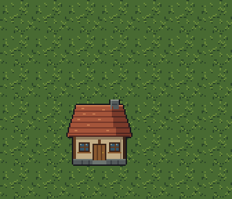
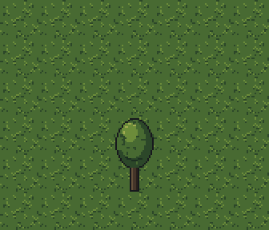

## 2. Two more families

[meadow.pclaw](scripts/meadow.pclaw): blob47, grass inside, sand outside, the band 2 px of sand and
a dark rim of moss, with tufts drawn over the rim on three pieces. [lane.pclaw](scripts/lane.pclaw):
the `path` scheme, sand inside, grass outside, a moss rim and a line of wet sand, wheel ruts on the
straight pieces. A meadow stacks on the shore because its outside texture is the shore's inside
(the sand); a lane on the meadow because its outside is the meadow's inside (the grass).

## 3. The village

[village.pclaw](scripts/village.pclaw):

```
new map village 40x30 tile=24 palette=ruins-shore
layer add land terrain=shore outside=on above=floor
layer add meadow terrain=meadow above=land
layer add lanes terrain=lane above=meadow
layer add glints overlay=glint on=land:out above=lanes
layer add props objects above=glints
map gen village seed=8
place house 15,16 layer=props
…
place well 20,15 layer=props
scatter tree count=22 on=meadow off=lanes minDist=2 layer=props seed=31
```

A map holds names, not pixels: each terrain layer says which cells are its family's terrain, and
the family's scheme picks every edge tile when the map is drawn (as the sample maps do). `map gen
village` lays out an island (smoothed: no one-cell spits), a meadow two cells in from the beach and
two lanes crossing it. Each `place` writes the footprint it read into its line (`place house 15,16
layer=props cells=2x2 anchor=0,1`), so the tape replays without reading another asset, and a
footprint may not overlap another. `view map` gives the whole map at 1x, its layers, what is placed
where, and every cell as a letter; `camera="19,15"` gives the engine's screen (384x216) around a
cell at the game's draw scale:

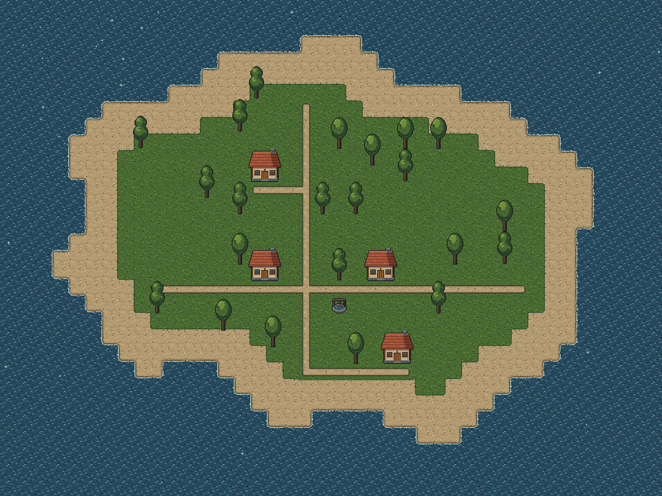
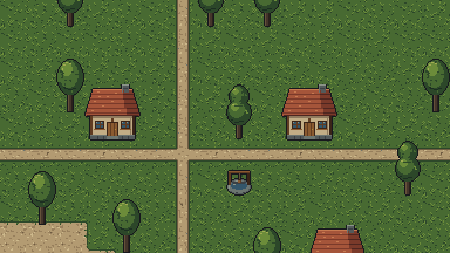

## 4. Where it repeats

```
✗  repetition  run 12 · 16/16  run ≤ 4, ≤ 10/16  longest straight run of one edge tile: 12 (lane.ew ×8 at 10,17 8x1;
   lane.ew ×12 at 19,17 12x1; meadow.new_ne_nw ×5 at 10,19 5x1; …); most of one textured tile in a 4x4 window:
   16 of 16 (hot spots: meadow.nesw_ne_se_sw_nw on 243 cells)
     12 lane.ew in a row at 19,17 12x1: 19,17 20,17 … 30,17
     10 lane.ns in a row at 18,7 1x10: …
     6 shore.nsw_sw_nw in a row at 34,14 1x6: …
```

The map checks find two kinds of hot spot: a family's edge tile repeating pixel for pixel along a
straight edge (both lanes, the meadow's and the beach's long sides), and one textured tile filling a
whole 4x4 window (the meadow's middle, where the grass's tufts sit on a 24 px lattice). `view map
marks="failing"` outlines them:

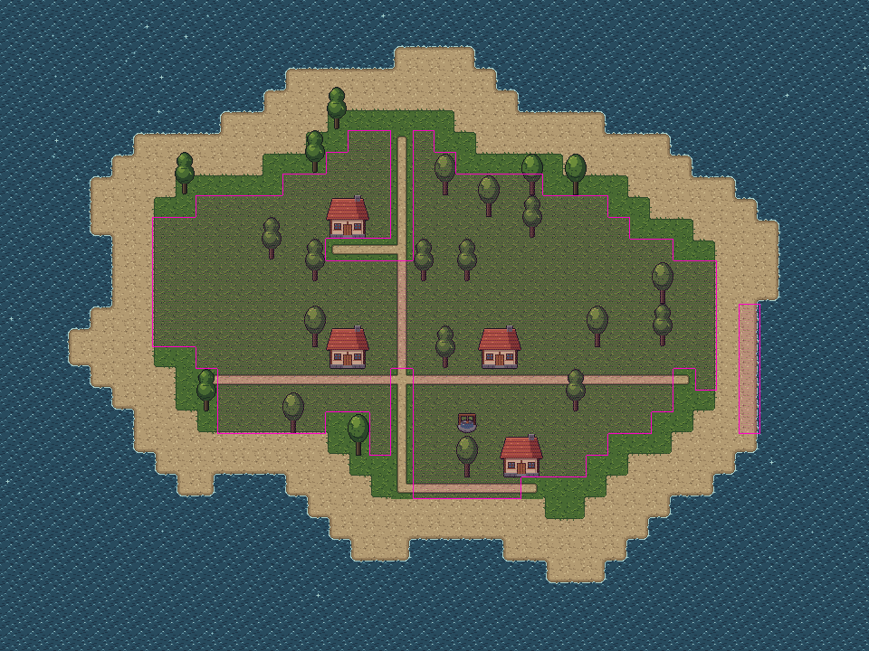
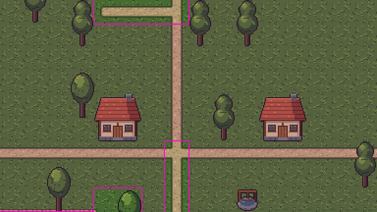

## 5. The fix: texture variants

Each repeating family gets variants: [lane_b](scripts/lane_b.pclaw) and [lane_c](scripts/lane_c.pclaw)
(forked from the lane, the band drawn again, the ruts and stones moved),
[meadow_b](scripts/meadow_b.pclaw) and [meadow_c](scripts/meadow_c.pclaw) (the grass variants from
G4 inside, the tufts moved), [shore_b](scripts/shore_b.pclaw) (the spray, breaks and wet-sand lobes
moved). Each declares `variant of=<family>`; the `variant` check holds its colour mix to the base's
(L1 < 0.3, ΔL* < 2). The village's tape does not change: the map picks among a family and its
variants cell by cell, and redraws itself:

```
✓  seam        0.04   ≤ 1
✓  repetition  run 4 · 10/16   longest straight run of one edge tile: 4; most of one textured tile in a 4x4 window: 10 of 16
```

## 6. A person moves the well

In the watch view the village opens in the map editor. The person picks *✣ move* and drags the
well from 20,15 down beside the crossroads; the tape gets one line, written by them:

```
#14 human:chris h1  move 20,15 20,18 layer=props
```

and the agent's `changes` says what moved, with the cells before and after at game scale:

```
diff #13 → #14: 2 cells look different; moved: well 20,15 → 20,18 (layer props)
```

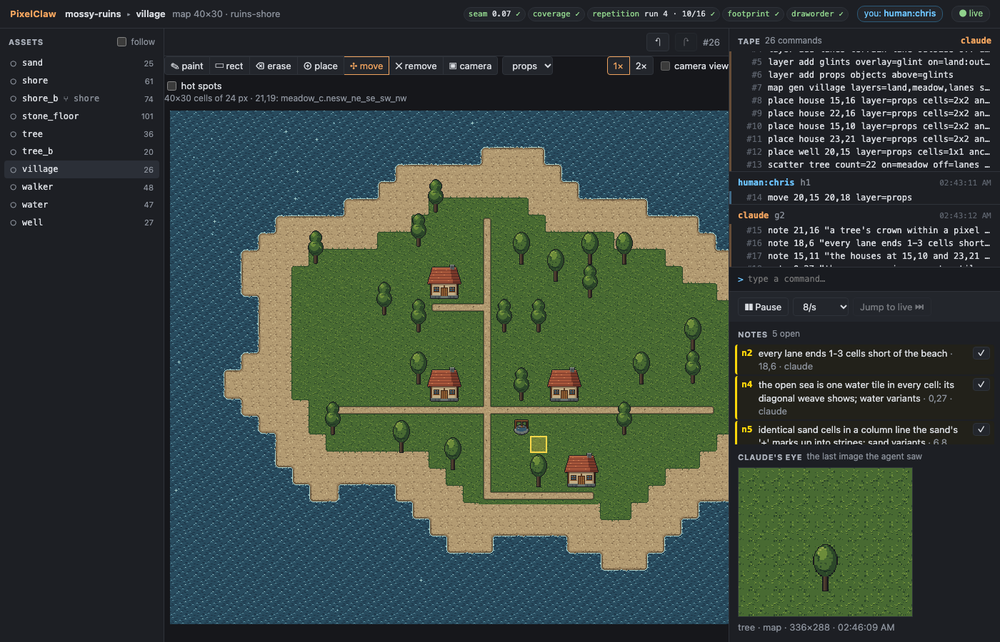
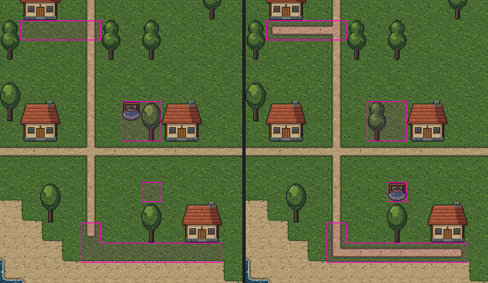

## 7. The blind review

`review(assets=["village","house","tree","well","meadow","lane","shore"], name="g8")` writes a bundle
with the village as a scene: whole at 1x, nine screens of it at game scale (which cells each
shows), every cell as a letter, and an eighth rubric question: does the scene read as one coherent
place, things sitting on their ground, in a sensible order front to back, without the grid showing?
A fresh agent judged it blind ([findings.md](mossy-ruins.pclaw/reviews/2026-10-28-g8/findings.md)):
the village reads as one place on one island, every object sits in its cells with its base on the
grass, sizes and depth order agree (scenes 3/5); the house and tree read at a glance (readability
4/5); but the house had nine lone highlight pixels and a dead-vertical roof split, the tree a
pillow rim, a scratch-like dash and a painted shadow ringed in ink, the well pillow shading and a
flat bucket, all 22 trees were one sprite, one tree touched a house, two houses faced no lane, and
the ground still showed its grid: the open sea one water tile, the sand's darkest mark lining up,
the coast and the meadow edge in long straight runs with near-square corners (seams and repetition
2/5).

The findings came back as notes on the pixels and cells they name and were fixed by coordinates
([house_review](scripts/house_review.pclaw), [tree_review](scripts/tree_review.pclaw),
[well_review](scripts/well_review.pclaw), [meadow_review](scripts/meadow_review.pclaw),
[village_review](scripts/village_review.pclaw)), plus a second tree,
[tree_b](scripts/tree_b.pclaw), a texture variant of the first (a taller crown in two masses),
which the map picks cell by cell like any variant. On the village a tree moved off the house and
`road` laid paths to the two doors. Every check is green. Five notes stay open on the village for
later steps: the sea (G6's water tile needs variants), the sand's mark (G7's sand), the coast's and
the meadow's straight runs and square corners (the schemes' geometry), and the lanes ending short of
the beach.


## 8. In the watch view

Pick `village`. The middle of the page is the map editor: *✎ paint*, *▭ rect* (Shift erases) and
*⌫ erase* paint the chosen terrain layer; *⊕ place* puts the chosen object by its anchor cell (its
footprint outlined under the pointer; an overlap is refused with the reason); *✣ move* drags,
*✕ remove* takes away. Each is a line on the tape with your name. *▣ camera* stands the camera on a
cell (*camera view* shows its screen at game scale), *hot spots* outlines what the map checks
flag; neither logs anything.

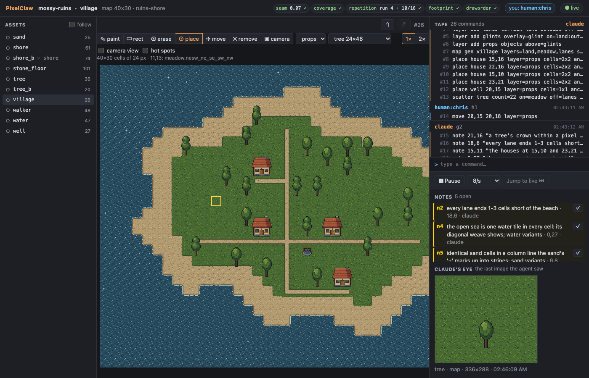
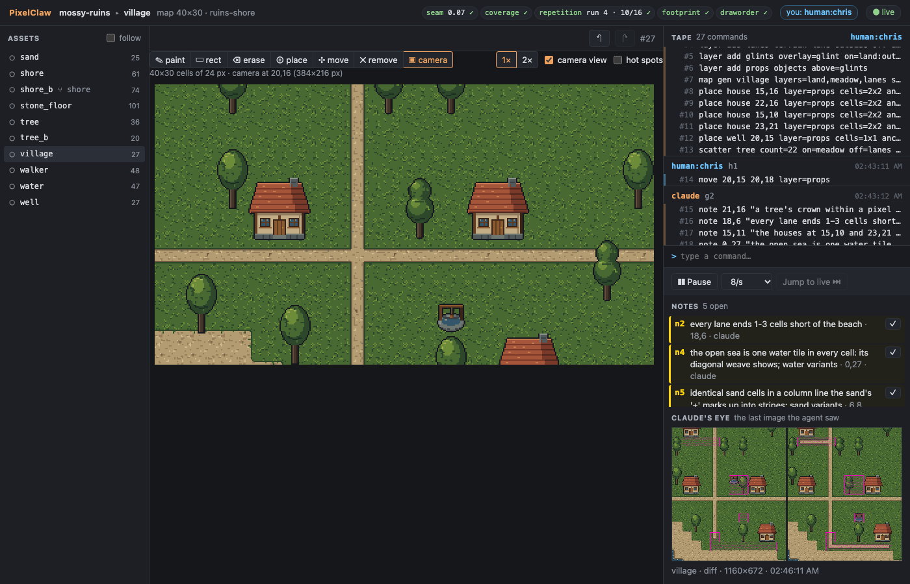
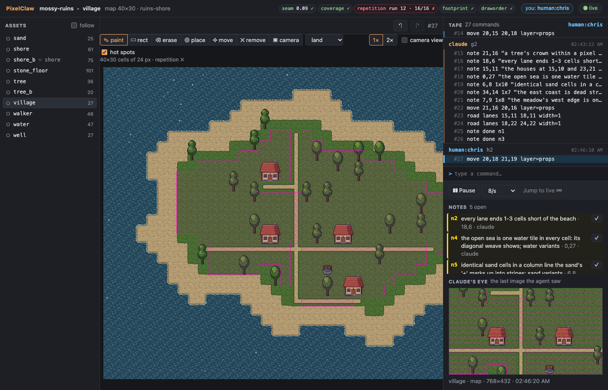

## In the CLI

```sh
node cli/bin/pixelclaw.js view examples/mossy-ruins.pclaw village map --camera 19,15
node cli/bin/pixelclaw.js check examples/mossy-ruins.pclaw village
node cli/bin/pixelclaw.js export examples/mossy-ruins.pclaw village --format tmx
node cli/bin/pixelclaw.js export examples/mossy-ruins.pclaw house --format split
```

`tmx` writes a Tiled map (a tile layer per ground layer over one tileset of every distinct tile,
objects as tile objects with their footprint, anchor and flags as properties); `split` writes the
house as four one-cell pieces and the stamp that puts them back.
