# Map variety, 48 px tiles and art help

This walkthrough has 3 parts:

1. [Fern Ledge: seeds, dry runs, faces and profiles](#part-1)
2. [map-scale variety and 48 px](#part-2)
3. [art help](#part-3)

## Part 1: Fern Ledge: seeds, dry runs, faces and profiles<a id="part-1"></a>

This part shows eight features that help an agent draw a set quickly and well, on a small original set, **Fern Ledge**: a mossy ledge over
a stream bed, at 16 px, drawn by a stand-in agent through `pixelclaw serve` over stdio (MCP), as
Claude would. No API key: the underlay uses the offline `fake` provider.

| # | Feature | Where in the walkthrough |
|---|---|---|
| 1 | `repetition`'s limit rises with the band's own spread (one mark on a calm tile is not a stripe); the **`seeds`** tool ranks N seeds of a generator line by the checks; **`run dry=true`** applies, checks, reports and keeps nothing | the stream bed: a seed search, then a pebble tried dry under the old rule and the |
| 2 | **Face cells** are drawn on maps whatever the terrain layer's fill setting (and a later `family band` keeps the face pieces) | the map: the ledge on a layer with `outside=off`, its faces on the floor |
| 3 | **Underlays sized from the placed area** (orientation and aspect) | the pillar: a 16x32 area of a 48x32 sheet asks for 1024x1536 |
| 4 | **Snap on the placement's grid**; a **seam warning** after `family cut` | the pillar's draft lands on 16x32 at 16,0; a cut from a badly painted map warns (dry run) |
| 5 | **`tiles <layer> fill`**; a **walkable** flag so filled ground is not sea for footprints | the floor in one line; the glade's rocks on the trail layer's filled ground |
| 6 | Profiles: a **corner order**, **path shapes** (dead ends named apart from straights), a **per-colour output map** | the `ledge-engine` profile: `nesw_nw_ne_se_sw`, `trail_end_n` / `trail_run_ns`, five tones |
| 7 | **Band jitter** | the ledge's edge, its seed chosen with `seeds` |
| 8 | **Variants that inherit the band** and override only the texture, following later fixes | `ledge_b` refuses its own band edit and follows a later fix to the ledge |

Two more (no part of an image provider key is ever written; input-image tokens are priced) are
covered by tests (`server/test/underlay-provider.test.ts`).

### Run it

```sh
pnpm build
node examples/ledge-agent.ts            # writes out/ledge.pclaw and prints the log below
node scripts/screenshots-ledge.ts            # docs/screenshots/g13-*.png from that project
```

Open the project yourself with `pixelclaw serve --project out/ledge.pclaw` and the link it
prints (stop it when done).

### The log

```
Fern Ledge: a mossy ledge over a stream bed, at 16 px. Project: out/ledge.pclaw

1. The stream bed, a calm tile: which seed of the noise?
    bed: 8 seeds ranked by the checks (fewest failing, then least over, then most room)
    limits: seam ≤ 1, repetition ≤ 4.6, palette ≤ 0, orphans ≤ 2%, jaggies ≤ 2, coverage ≤ 0 (a limit in brackets: that seed's own, e.g. repetition's raised by its spread)
    seed  seam         repetition   palette      orphans      jaggies      coverage     failing
    3     0.37 ✓       3.8 ✓        0 ✓          0% ✓         0 ✓          0 ✓          none
    4     0.75 ✓       3 (≤ 3.5) ✓  0 ✓          0.4% ✓       1 ✓          0 ✓          none
    6     0.71 ✓       2.9 (≤ 3) ✓  0 ✓          0% ✓         0 ✓          0 ✓          none
    5     1 ✓          2.8 (≤ 3.1) ✓  0 ✓          0% ✓         0 ✓          0 ✓          none
    8     1.07 ✗       2.7 (≤ 4.4) ✓  0 ✓          0% ✓         0 ✓          0 ✓          seam
    7     0.26 ✓       3.4 (≤ 3) ✗  0 ✓          0% ✓         0 ✓          0 ✓          repetition
    2     0.34 ✓       4.1 (≤ 3) ✗  0 ✓          0.4% ✓       1 ✓          0 ✓          repetition
    1     1.59 ✗       3.5 (≤ 3) ✗  0 ✓          0% ✓         0 ✓          0 ✓          seam,repetition
    best: noise 0,0 16x16 ramp=soil weights=1,6,3 cluster=1..2 density=0.25 base=soil1 wrap=on seed=3
    
    applied seed 3 as group g2; 64 px changed
   A pebble, tried first with run dry=true (nothing kept):
     under the old rule (contrast 0): repetition 4.6 ✗
     bed: dry run of 3 commands; 6 px would change; nothing was kept
     under the current rule: repetition 2.7 ✓
     ✓  repetition  2.7    ≤ 3     most visible stripe: row 7, darker by ΔL* 2.7 (score ΔL*·√width 2.7)
   (the rows through the pebble are lighter on average, but all of it is in three pixels: the limit
    rises with the band's own spread, so one mark on a calm tile is not a stripe)

2, 7. The ledge: a cliff family with faces; its band edge jittered, the seed chosen by the checks
    the textures, each by a seed search (moss, and second looks of the moss and the bed):
    best: noise 0,0 16x16 ramp=moss weights=0,2,6,2,0 cluster=1..2 density=0.25 base=moss2 wrap=on seed=6
    applied seed 6 as group g2; 64 px changed
    best: noise 0,0 16x16 ramp=moss weights=0,3,6,1,0 cluster=1..2 density=0.25 base=moss2 wrap=on seed=26
    applied seed 26 as group g2; 64 px changed
    best: noise 0,0 16x16 ramp=soil weights=1,6,3 cluster=1..2 density=0.25 base=soil1 wrap=on seed=41
    applied seed 41 as group g2; 64 px changed
    ledge: 6 seeds ranked by the checks (fewest failing, then least over, then most room)
    limits: seam ≤ 1, coverage ≤ 0 (a limit in brackets: that seed's own, e.g. repetition's raised by its spread)
    seed  seam         coverage     failing
    6     0.42 ✓       0 ✓          none
    1     0.58 ✓       0 ✓          none
    5     0.6 ✓        0 ✓          none
    2     0.62 ✓       0 ✓          none
    4     0.63 ✓       0 ✓          none
    3     0.66 ✓       0 ✓          none
    best: family band 1:outside 1:ink 1:moss1 radius=0 inset=0 jitter=2 seed=6 draw=on
    applied seed 6 as group g2; 3170 px changed
      ✓  seam        0.35   ≤ 1     over a 12x10 island (seed 1): jump x 0.13 y -0.16; line x 0.1 y 0.35 (view map shows it)
      ✓  coverage    0      ≤ 0     face: all 51 variants and both textures drawn

8. ledge_b: a texture variant that keeps only its own moss and inherits the band
    its own band edit is refused: family band: 'ledge_b' inherits its band from 'ledge' (variant of=ledge band=inherit): fix the band there, or make it its own (variant of=ledge band=o…
    a later fix to the ledge's band (two moss rows): variants that inherit the band, brought up to date: ledge_b (family band from=ledge)

6 (paths). A gravel trail across the bed, by a seed search; a variant of it on the other bed
    best: noise 0,0 16x16 ramp=stone weights=0,0,2,6,3,1 cluster=1..2 density=0.3 base=stone3 wrap=on seed=55
    applied seed 55 as group g2; 77 px changed

5, 2. The map: the floor filled with one command; the ledge on a layer that leaves the rest to the floor
    tiles floor fill bed 0,0 12x8 cells=1x1 anchor=0,0
    checks: seam 0.4 ✓ · coverage 0 ✓ · repetition run 3 · 8/16 ✓ · footprint 0 ✓ · draworder 0 ✓
    the glade's ground is the trail layer's outside (filled); walkable=off (a dry run): footprint 2 ✗ 
    walkable=on (as it is): ✓  footprint   0      0       2 objects, every footprint on plain ground

3, 4. A draft of a rock pillar: the underlay asked for in the placed area's shape, snapped on its grid
    underlay mockup blob=1b64eec8b51600c246c6b4741ccd0fcb68dfeb1b6c6e4f0346b6d4cbf80d33cc image=1024x1536 at=16,0 size=16x32 layout=c434fba40bad65f182d361…
    snap from=mockup into=draft at=16,0 grid=16x32 pitch=64.000x48.000 offset=60.98,0.98 r2=0.99 material=0.92 <<
    family cut from a map painted with a dark line on every cell (dry run): family cut: the cut family's seam is 1.58 (limit ≤ 1) on a sample island: its tiles do not join; look at view map, fix the band or the textures by coordinates (check seam), or cut again from a cleaner…

6. Export through ledge-engine: corners nw first, the trail's pieces by shape, five tones
    ledge-engine: 143 images, wrote 143 files
    ledge (corners nw, ne, se, sw): ledge_face ledge_face_ew ledge_nes_ne_se ledge_nesw_ne_se_sw ledge_nesw_nw_ne_se_sw …
    trail (by shape): trail_cross trail_dot trail_end_e trail_end_n trail_end_s trail_end_w trail_inside trail_outside trail_run_ew trail_run_ns trail_tee_esw trail_tee_nes trail_tee_new trail_tee_nsw trail_turn_es trail_turn_ne trail_turn_nw trail_turn_sw
    rock.png is drawn in the tones only: #000000 #808080

Every check:
    bed: palette 0 ✓ · orphans 0% ✓ · jaggies 0 ✓ · seam 0.54 ✓ · coverage 0 ✓ · repetition 2.7 ✓ · consistency 0 ✓
    bed_b: palette 0 ✓ · orphans 0.4% ✓ · jaggies 0 ✓ · seam 0.81 ✓ · coverage 0 ✓ · repetition 3.5 ✓ · variant 0.09 · ΔL* 1.1 ✓ · consistency 0 ✓
    fern_ledge: seam 0.4 ✓ · coverage 0 ✓ · repetition run 3 · 8/16 ✓ · footprint 0 ✓ · draworder 0 ✓
    glade: seam 0.59 ✓ · coverage 0 ✓ · repetition run 1 · 10/16 ✓ · footprint 0 ✓ · draworder 0 ✓
    gravel: palette 0 ✓ · orphans 1.6% ✓ · jaggies 1 ✓ · seam 0.34 ✓ · coverage 0 ✓ · repetition 5.4 ✓ · consistency 0 ✓
    ledge: palette 0 ✓ · orphans 0.6% ✓ · seam 0.31 ✓ · coverage 0 ✓
    ledge_b: palette 0 ✓ · orphans 0.6% ✓ · seam 0.27 ✓ · coverage 0 ✓ · variant 0.08 · ΔL* 0.9 ✓
    moss: palette 0 ✓ · orphans 0.4% ✓ · jaggies 0 ✓ · seam 0.77 ✓ · coverage 0 ✓ · repetition 3.3 ✓ · consistency 0 ✓
    moss_b: palette 0 ✓ · orphans 0.8% ✓ · jaggies 0 ✓ · seam 0.19 ✓ · coverage 0 ✓ · repetition 4.8 ✓ · variant 0.11 · ΔL* 1.5 ✓ · consistency 0 ✓
    rock: palette 0 ✓ · orphans 0% ✓ · jaggies 0 ✓ · banding 0 ✓ · outline 1 ✓ · coverage 0 ✓ · readability 1 ✓ · fit 0 ✓ · consistency 0 ✓
    trail: palette 0 ✓ · orphans 0.3% ✓ · seam 0.61 ✓ · coverage 0 ✓
    trail_b: palette 0 ✓ · orphans 0.6% ✓ · seam 0.68 ✓ · coverage 0 ✓ · variant 0.04 · ΔL* 0.4 ✓
    (pillar is a draft: its snapped layer is still to be cleaned)

(the project is in out/ledge.pclaw)
```

`check` also runs the map-scale `lattice` check: here it fails `fern_ledge` (47%) and
`glade` (46%), the pebble at the same spot of half the stream bed's cells. This stand-in is left
as it was, as the "before"; [map-variety.md](map-variety.md) fixes both with a mix of variants.

Notes on the log:

- **The seed table** lists every check that applies, with each seed's score; a limit in brackets is
  that seed's own (repetition's, raised by the band's spread along its length). Seeds 7, 2 and 1
  fail on stripes the eye would see; seed 3 is kept.
- **The pebble**: the rows through it are lighter on average (4.6 under the old rule, a fail), but the
  difference is all in three pixels of each row, so the band's spread is high and its limit rises;
  under the current rule the most visible stripe is a faint row of the noise itself (2.7, a pass).
- **The ledge's jitter** was chosen by `seeds` on the `family band … jitter=2` line, ranked by the
  family's seam over a sample island.
- **ledge_b** was forked and marked `variant of=ledge band=inherit`; it changed only its inside
  texture. When the ledge's band got a second moss row, the server wrote `family band from=ledge`
  on ledge_b's tape (its own undo group), so its band is the ledge's again; its moss stayed its own.
- **The glade**'s ground is the trail layer's outside (`outside=on`): with `walkable=on` the rocks
  may stand on it; the dry run with `walkable=off` shows what the footprint check said before.
- **The pillar** is a draft: its snapped layer is still to be cleaned (not part of the set's checks).

### Screenshots

The map at the game's scale: the floor filled with the stream bed (its two looks mixed cell by
cell), the ledge with its jittered edge and its faces drawn on the floor below each edge, the
gravel trail (dead ends at both ends), two rocks.

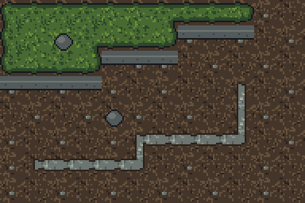

The map editor's fill tool (a click fills the layer's empty cells, a drag a box) and the walkable
box beside the terrain layer being painted; the hover line says `(walkable)`:

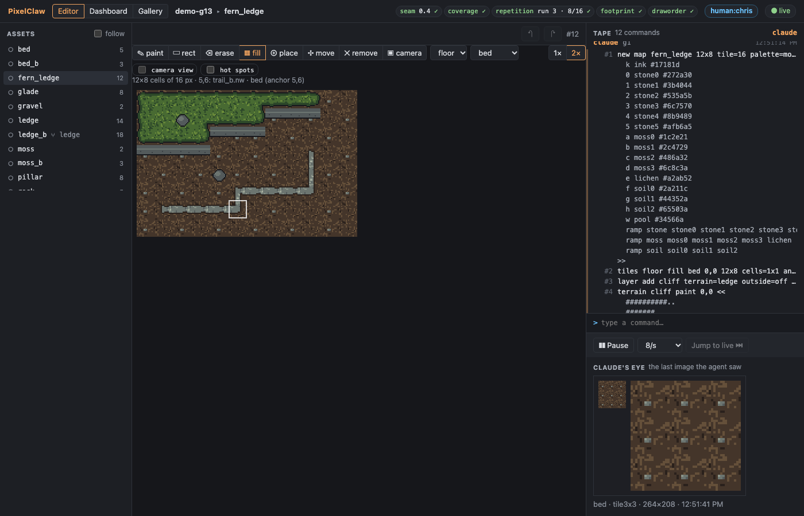

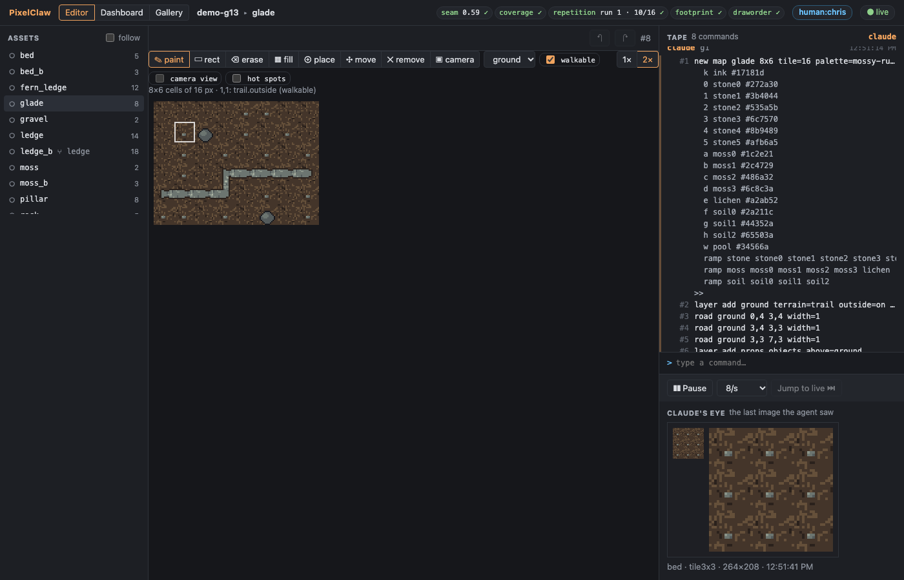

The ledge on a sample island (`view map`), and the stream bed tiled 3x3 with its pebble:

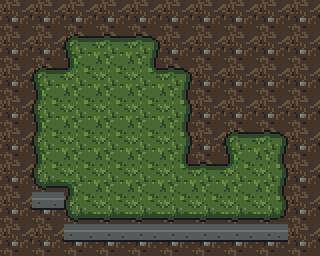 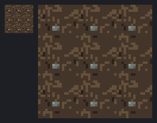

Five images as the `ledge-engine` profile wrote them (enlarged): `ledge_nesw_nw_ne_se_sw`,
`ledge_face_ew`, `trail_end_n`, `trail_run_ns`, `rock`, every colour mapped to one of five tones:

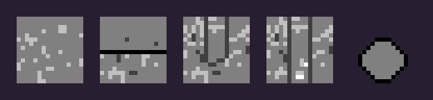

## Part 2: map-scale variety and 48 px<a id="part-2"></a>

Part 1 leaves a problem that shows at once: Fern Ledge's floor is a stream-bed
tile with one pebble, and every tile passes its checks, but the map shows an even lattice of
pebbles. This part shows a check that sees it, a fill that cures it, a smaller tape for inheriting
variants, and the groundwork for 48 px sets. A stand-in agent drives `pixelclaw serve` over stdio
(MCP), as Claude would.

| # | Feature | Where in the walkthrough |
|---|---|---|
| 1 | The map-scale **`lattice`** check: a mark at the same spot of the cell in too many cells of one ground (an asset and its variants), with the cells, where in the cell, and what to do; sizes in px scale with the tile | Fern Ledge's floor fails (47%), then passes (23%); the glade too |
| 2 | **`tiles <layer> fill mix=<tile>:<weight>,…`**: a seeded scatter, no two equal neighbours where it can help it; the map editor's fill tool picks a mix | the floor laid again as `mix=bed:1,bed_b:2,bed_c:1,bed_d:1` |
| 3 | Inheriting variants record **only the pieces and detached cells** | not in the log: a sync on a 24 px blob47 sheet went from 33,110 to 4,348 bytes of tape (`server/test/variants-sync.test.ts`); the glade's new trail variants inherit the band this way |
| 4 | The **48 px audit**: the project's grid, and what assumed 16 or 24 px | Ember Moor: grid 48, camera 768x432, draw scale 1x |
| 5 | **`examples/ember-moor.pclaw`** and the skill's per-size defaults | Ember Moor's checks, its map and a screen of it |

### Run it

```sh
pnpm build
node examples/variety-agent.ts      # rebuilds Fern Ledge with examples/ledge-agent.ts, then fixes it
node scripts/screenshots-variety.ts      # docs/screenshots/g14-*.png from those projects
```

The projects land in `out/variety.pclaw` (Fern Ledge, fixed), `out/variety-before.pclaw` (as part 1 left it) and `out/variety-moor.pclaw` (a copy of the example). Open one with `pixelclaw serve
--project <dir>` and the link it prints (stop it when done).

### The log

```
Map-scale variety and 48 px. Projects: out/variety.pclaw (Fern Ledge), out/variety-moor.pclaw (Ember Moor)

1. Fern Ledge as part 1 left it: every tile passes, the map shows a lattice of pebbles
    bed: all 7 checks pass
    ✓  repetition  run 3 · 8/16 run ≤ 4, ≤ 10/16 longest straight run of one edge tile: 3; most of one textured tile in a 4x4 window: 8 of 16
    ✗  lattice     47%    ≤ 30%   a mark at 6,9 3x2 of the cell (bed ×25) comes back on the tile pitch: 25 of the 53 cells of bed's ground show it at the same spot; give bed texture variants that move or leave out the mark (variant of=bed) and fill with a mix of them (tiles <layer> fill mix=bed:1,<variant>:2,...), or soften the mark
    the cells it flags (view map marks="failing" outlines them): 25, 10,0 11,1 8,2 10,2 4,3 6,3 11,3 1,4 …

   Two more looks of the stream bed, forked from it (its border stays the bed's):
   bed_c with the pebble moved, bed_d with none; then the floor laid again as a mix
     bed_c: palette 0 ✓ · orphans 0% ✓ · jaggies 0 ✓ · seam 0.51 ✓ · coverage 0 ✓ · repetition 2.7 ✓ · variant 0 · ΔL* 0 ✓ · consistency 0 ✓
     bed_d: palette 0 ✓ · orphans 0% ✓ · jaggies 0 ✓ · seam 0.37 ✓ · coverage 0 ✓ · repetition 3.8 ✓ · variant 0.05 · ΔL* 0.6 ✓ · consistency 0 ✓
     tiles floor fill mix=bed:1,bed_b:2,bed_c:1,bed_d:1 0,0 12x8 cells=1x1 anchor=0,0 replace variants=named seed=1149479272
     ✓  lattice     23%    ≤ 30%   the mark most often at one spot: at 6,9 3x2 of the cell (bed ×12): 12 of the 53 cells of bed's ground show it at the same spot
     fern_ledge: all 6 checks pass
   The glade: its ground is the trail's outside (the bed's look); two more trail variants
   (band=inherit, outside from bed_c and bed_d) and the map mixes them cell by cell
     ✗  lattice     46%    ≤ 30%   a mark at 6,9 3x2 of the cell (trail ×18) comes back on the tile pitch: 18 of the 39 cells of trail's ground show it at the same spot
     ✓  lattice     28%    ≤ 30%   the mark most often at one spot: at 6,9 3x2 of the cell (trail ×11): 11 of the 39 cells of trail's ground show it at the same spot
     glade: all 6 checks pass

2. Ember Moor, 48 px (examples/ember-moor.pclaw): the project's grid and what follows from it
    grid 48 px (new maps' tile; camera 768x432; draw scale 1x)
    bog: palette 0 ✓ · orphans 0% ✓ · jaggies 3 ✓ · seam 0.18 ✓ · coverage 0 ✓ · repetition 1.9 ✓ · consistency 0 ✓
    moor: palette 0 ✓ · orphans 0.2% ✓ · jaggies 5 ✓ · seam 0.56 ✓ · coverage 0 ✓ · repetition 2.2 ✓ · consistency 0 ✓
    moor_b: palette 0 ✓ · orphans 0.3% ✓ · jaggies 5 ✓ · seam 0.5 ✓ · coverage 0 ✓ · repetition 2.4 ✓ · variant 0.01 · ΔL* 0.1 ✓ · consistency 0 ✓
    moor_c: palette 0 ✓ · orphans 0.3% ✓ · jaggies 3 ✓ · seam 0.63 ✓ · coverage 0 ✓ · repetition 2.2 ✓ · variant 0.03 · ΔL* 0.1 ✓ · consistency 0 ✓
    moor_map: seam 0.35 ✓ · coverage 0 ✓ · repetition run 2 · 10/16 ✓ · lattice 0% ✓ · footprint 0 ✓ · draworder 0 ✓
    pool: palette 0 ✓ · orphans 0.1% ✓ · seam 0.35 ✓ · coverage 0 ✓
    waystone: palette 0 ✓ · orphans 0% ✓ · jaggies 0 ✓ · banding 0.32 ✓ · outline 1 ✓ · coverage 0 ✓ · readability 1 ✓ · fit 0 ✓
    moor_map: a map of 20x12 cells of 48 px (960x576 px); seam over the ground 0.35 (about 1 or less reads as no seam)
    showing the whole map at 1x
    showing the camera at 10,6: a 768x432 px screen, cells 2,2 16x9 at 1x
    game: 80x128 px (the scene once: the draw scale is 1)

(the projects are in out/variety.pclaw and out/variety-moor.pclaw)
```

Notes on the log:

- **Why the per-tile checks pass and the map fails.** Half the floor's cells show `bed` (the
  other half its variant `bed_b`, without a pebble): `repetition`'s motif count sees two tiles
  alternating (8 of 16 in a window, a pass). But every `bed` cell has its pebble at 6,9, so the
  pebbles sit on the tile pitch whichever cells have them: 25 of the 53 cells of the stream bed's
  ground. The `lattice` check counts, at each spot of the cell, the cells of one ground (an asset
  and its texture variants) that show a mark there; a mark is a group of pixels at least 18 ΔL* off
  its cell's median lightness. 30% is the limit.
- **The cure.** Two more looks forked from the bed (so their border is the bed's and no seam shows
  where they meet): `bed_c` with the pebble at 12,12, `bed_d` with none. `fill mix=` lays them by
  weight, avoiding equal neighbours, and writes the seed and the weights into the line; each cell
  shows exactly the tile drawn for it. The pebble at 6,9 is now on 12 of 53 cells (23%).
- **The glade**'s ground is the trail family's outside texture (the bed, pebble and all), so its
  lattice is fixed by more variants of the trail (each inheriting the trail's band, its outside from
  `bed_c` or `bed_d`); the map picks among a family's variants cell by cell.
- **Ember Moor** is `examples/ember-moor.pclaw`, built by its scripts through the CLI. Its
  project's grid is 48, so `new map moor_map 20x12` took 48 px cells, the camera is 16x9 cells
  (768x432) and the draw scale is 1x; the game view shows the scene once.

### Screenshots

Fern Ledge before (the lattice's cells outlined by `view map marks="failing"`) and after the mix:

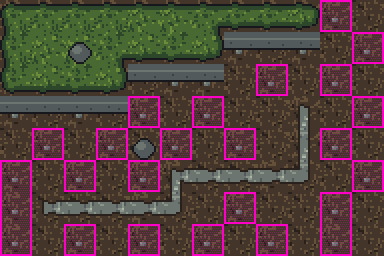 

The map editor: the lattice's hot spots on Fern Ledge as part 1 left it, and the fill tool with a mix
(*mix…* in the tile list; a weight per one-cell tile, 0 leaves one out):

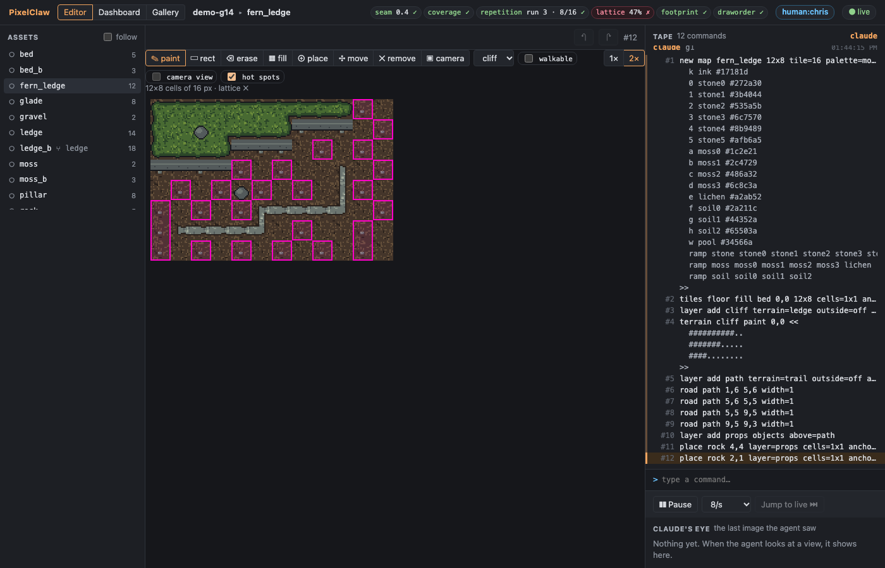
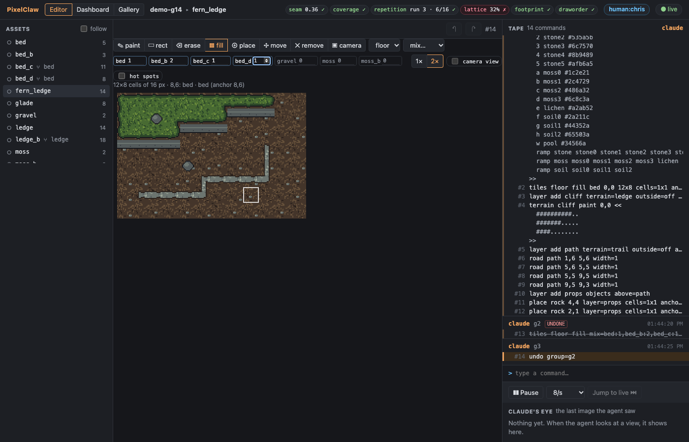

Ember Moor at 48 px: the map at 1x, a screen of it (16x9 cells), the bog pool on an island, and in
the browser the gallery at the game's scale (1x), the pool's sample map and the map editor:

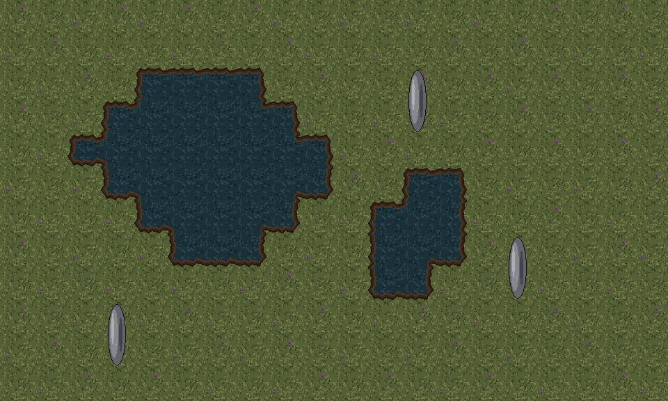
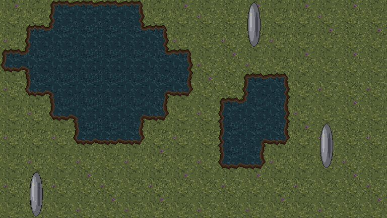
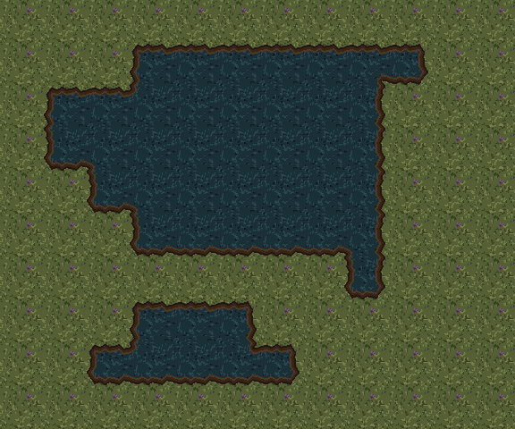
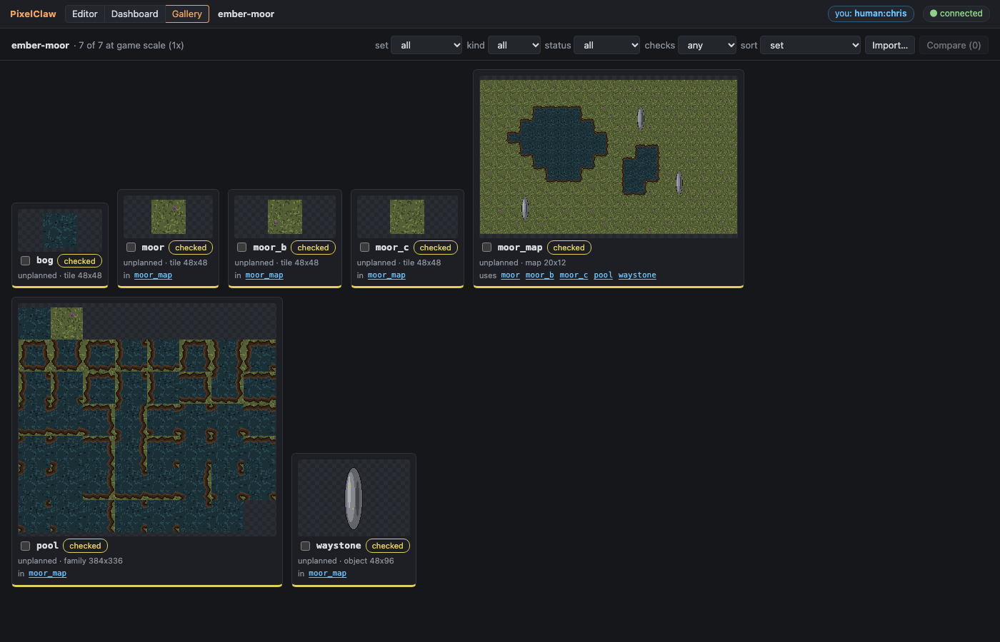
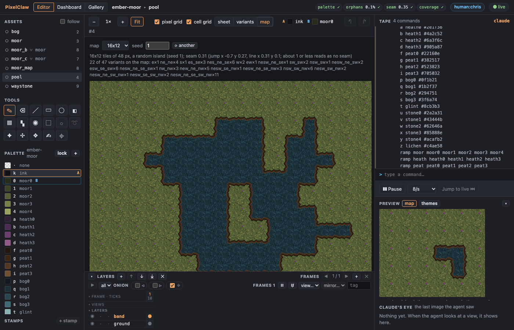
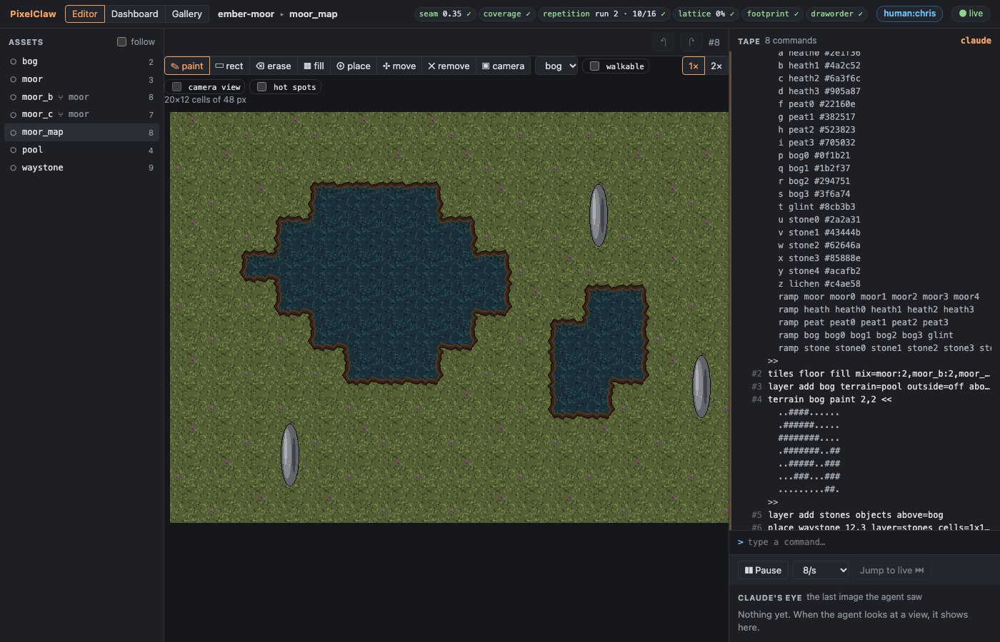

## Part 3: art help<a id="part-3"></a>

Structured textures (pebbles, tufts), cliff sides, filled lanes and shadows are hard to draw
well by hand. This part shows generators for structure, faces round a cliff, a lane scheme,
shadows, and the margin, pieces and reserved-colour checks. A stand-in agent
drives `pixelclaw serve` over stdio (MCP), as Claude would, on a new 48 px project, Shingle Heath
(Ember Moor's palette), whose style guide says: light from the north-west, objects' shadows a step
darker than the ground, and the glint colour reserved for the beacon.

| # | Feature | Where in the walkthrough |
|---|---|---|
| 1 | **`pebbles`** and **`tufts`**: stones with a shadow side and a lit pixel, grass tufts lit by side, from the style's light; never overlapping; placed so rows and columns stay even (the repetition and seam measures); `edges=<seed>` shares what crosses a tile's edges between looks; ranked by `seeds` | the shingle and grass floors, each a base and two looks (`seeds` chose every seed) |
| 2 | The **face** scheme's side faces, inner corners, corners and alternate looks; the **lane** scheme (a filled path with a plain middle; diagonal turns) | the plateau; the lane, three cells wide by the stones and diagonal elsewhere |
| 3 | The **`shadow`** helper; maps' **objects layers cast shadows** (`style.shadow`) | `layer add stones objects` writes `shadow=darker shadowdir=se`; the stones and the beacon |
| 4 | Sprite **jaggies** by size; **consistency**'s ramp steps; new **`margin`** and **`pieces`**; palette **reservations** (`style.reserved`) | the floating lamp room, the cut crab, the misused glint |

### Run it

```sh
pnpm build
node examples/heath-agent.ts      # out/heath.pclaw, views in out/heath.pclaw/views
node scripts/screenshots-heath.ts      # docs/screenshots/g16-*.png from that project
```

Open the project with `pixelclaw serve --project out/heath.pclaw` and the link it prints (stop it
when done).

### The log

```
Art help. Project: out/heath.pclaw (48 px, Ember Moor's palette; style: light nw, shadow darker, glint reserved for the beacon)

1. A shingle and a grass floor from the generators, each a base and two looks
    shingle: pebbles 0,0 48x48 ramp=stone weights=1,1,1 size=5..11 density=0.3 light=nw cast=none gap=1 wrap=on edges=1 seed=1
      shingle: all 6 checks pass
    shingle_b: … edges=1 seed=16 · shingle_b: all 8 checks pass
    shingle_c: … edges=1 seed=24 · shingle_c: all 8 checks pass
    grass: tufts 0,0 48x48 ramp=moor0,moor1,moor3,moor4 size=8..12 blades=3..5 density=0.2 light=nw foot=moor0 gap=1 wrap=on edges=6 seed=6
      grass: all 7 checks pass
    grass_b: … edges=6 seed=11 · grass_b: all 8 checks pass
    grass_c: … edges=6 seed=26 · grass_c: all 8 checks pass

2. A cliff plateau (scheme=face): south faces, side faces, inner corners, corners; grass on top, shingle below
    cliff: palette 0 ✓ · orphans 0.4% ✓ · seam 0.6 ✓ · coverage 0 ✓

3. A lane (scheme=lane): three cells wide by the stones, diagonal turns elsewhere
    dirt: all 7 checks pass (the lane's inside)
    lane: palette 0 ✓ · orphans 0.3% ✓ · seam 0.32 ✓ · coverage 0 ✓

4. Objects with shadows (style.shadow darker: an objects layer casts them on the ground)
    stone: all 9 checks pass

5. The new checks, each on a planted fault
    beacon: palette 0 ✓ · orphans 0% ✓ · jaggies 0 ✓ · banding 0 ✓ · outline 1 ✓ · coverage 0 ✓ · readability 0.99 ✓ · fit 0 ✓ · consistency 0 ✓ · pieces 1 ✗  (1 failing: `check` gives coordinates)
      ✗  pieces      1      ≤ 0     1 part not touching the rest (678 px at 11,7 26x30): join it, or turn pieces off for this asset if it is meant to float
      the tower carried up to the lamp room (rows 36-39): palette 0 ✓ · orphans 0% ✓ · jaggies 0 ✓ · banding 0 ✓ · outline 0.97 ✓ · coverage 0 ✓ · readability 0.97 ✓ · fit 0 ✓ · consistency 0 ✓ · pieces 0 ✓
    crab: palette 0 ✓ · orphans 0% ✓ · jaggies 0 ✓ · banding 0 ✓ · outline 0.92 ✓ · coverage 0 ✓ · readability 0.92 ✓ · consistency 0 ✓ · margin 5 ✗ · pieces 0 ✓  (1 failing: `check` gives coordinates)
      ✗  margin      5      ≤ 0     5 px on the edge (left 5): move it in, or make the canvas bigger
      drawn again 5 px to the right (undo, then the same lines from x=5): palette 0 ✓ · orphans 0% ✓ · jaggies 0 ✓ · banding 0 ✓ · outline 1 ✓ · coverage 0 ✓ · readability 0.97 ✓ · consistency 0 ✓ · margin 0 ✓ · pieces 0 ✓
    pile: palette 1 ✗ · orphans 0.6% ✓ · jaggies 1 ✗ · banding 0 ✓ · outline 1 ✓ · coverage 0 ✓ · readability 1 ✓ · consistency 0 ✓ · margin 0 ✓ · pieces 0 ✓  (2 failing: `check` gives coordinates)
      ✗  palette     1      ≤ 0     1 px outside palette 'ember-moor': glint is reserved for beacon (style.reserved) (1)
      the glint taken out (stone4): palette 0 ✓ · orphans 0.6% ✓ · jaggies 0 ✓ · banding 0 ✓ · outline 1 ✓ · coverage 0 ✓ · readability 1 ✓ · consistency 0 ✓ · margin 0 ✓ · pieces 0 ✓

6. The heath: 20x12 cells of 48 px
    layer add stones objects shadow=darker shadowdir=se above=road
    ✓  seam  0.79  ≤ 1  the tile grid over the whole ground: jump x 0.42 y 0.79, line x 0.22 y 0.1
    ✓  repetition  run 3 · 7/16 run ≤ 4, ≤ 10/16 longest straight run of one edge tile: 3; most of one textured tile in a 4x4 window: 7 of 16
    ✓  lattice  19%  ≤ 30%  the mark most often at one spot: at 25,3 6x10 of the cell (grass_c ×15, grass_b ×18, grass ×28): 61 of the 61 cells of grass's ground show it at the same spot (as 19% of their marking, on average)
    ✓  footprint  0  0  4 objects, every footprint on plain ground
    ✓  draworder  0  0  objects in order of their base row; overhangs are roofs; no roof hides what stands in front
    ✓  coverage  0  0  every tile and object the map names exists and is drawn

7. Every asset
    beacon: palette 0 ✓ · orphans 0% ✓ · jaggies 0 ✓ · banding 0 ✓ · outline 0.97 ✓ · coverage 0 ✓ · readability 0.97 ✓ · fit 0 ✓ · consistency 0 ✓ · pieces 0 ✓
    cliff: palette 0 ✓ · orphans 0.4% ✓ · seam 0.6 ✓ · coverage 0 ✓
    crab: palette 0 ✓ · orphans 0% ✓ · jaggies 0 ✓ · banding 0 ✓ · outline 1 ✓ · coverage 0 ✓ · readability 0.97 ✓ · consistency 0 ✓ · margin 0 ✓ · pieces 0 ✓
    dirt: palette 0 ✓ · orphans 0.1% ✓ · jaggies 2 ✓ · seam 0.49 ✓ · coverage 0 ✓ · repetition 2.1 ✓ · consistency 0 ✓
    grass: palette 0 ✓ · orphans 0.4% ✓ · jaggies 5 ✓ · seam 0.46 ✓ · coverage 0 ✓ · repetition 2.4 ✓ · consistency 0 ✓
    grass_b: palette 0 ✓ · orphans 0.2% ✓ · jaggies 3 ✓ · seam 0.37 ✓ · coverage 0 ✓ · repetition 3.6 ✓ · variant 0.02 · ΔL* 0.2 ✓ · consistency 0 ✓
    grass_c: palette 0 ✓ · orphans 0.3% ✓ · jaggies 3 ✓ · seam 0.51 ✓ · coverage 0 ✓ · repetition 2.5 ✓ · variant 0.02 · ΔL* 0.1 ✓ · consistency 0 ✓
    heath: seam 0.79 ✓ · coverage 0 ✓ · repetition run 3 · 7/16 ✓ · lattice 19% ✓ · footprint 0 ✓ · draworder 0 ✓
    lane: palette 0 ✓ · orphans 0.3% ✓ · seam 0.32 ✓ · coverage 0 ✓
    pile: palette 0 ✓ · orphans 0.6% ✓ · jaggies 0 ✓ · banding 0 ✓ · outline 1 ✓ · coverage 0 ✓ · readability 1 ✓ · consistency 0 ✓ · margin 0 ✓ · pieces 0 ✓
    shingle: palette 0 ✓ · orphans 0% ✓ · jaggies 1 ✓ · seam 0.63 ✓ · coverage 0 ✓ · repetition 2.4 ✓ · consistency 0 ✓
    shingle_b: palette 0 ✓ · orphans 0% ✓ · jaggies 0 ✓ · seam 0.55 ✓ · coverage 0 ✓ · repetition 2.3 ✓ · variant 0.07 · ΔL* 0 ✓ · consistency 0 ✓
    shingle_c: palette 0 ✓ · orphans 0% ✓ · jaggies 0 ✓ · seam 0.61 ✓ · coverage 0 ✓ · repetition 2.2 ✓ · variant 0.05 · ΔL* 0 ✓ · consistency 0 ✓
    stone: palette 0 ✓ · orphans 0% ✓ · jaggies 0 ✓ · banding 0.2 ✓ · outline 1 ✓ · coverage 0 ✓ · readability 0.97 ✓ · fit 0 ✓ · consistency 0 ✓ · pieces 0 ✓

(the project is in out/heath.pclaw; views in out/heath.pclaw/views)
```

Notes on the log:

- **The floors.** Each look is a fork of the base with the ground laid again and the generator run
  with the base's `edges=` and its own seed (chosen by `seeds`, which ranks by the checks): the
  stones and tufts that cross a tile's edges are the same in every look, so the looks join each
  other in any order, and their insides differ, so the map's `lattice` stays low (19% on the
  grass, where a tuft carried by all three looks' edges is the commonest mark).
- **The plateau** is grass over shingle: south faces below it, side faces beside its east and west
  edges, corners where they meet, an inner corner where the notch in its north edge and the bend
  in its south edge make a face meet the terrain beside it (`face_e_iw`, `face_ie_w`). The faces
  are drawn by hand on nine pieces' band layer; the long middles have other looks (`face_ew_b`,
  `face_ew_c`) that stay copies of the middle until detached and drawn. The family's seam is
  measured with its faces as the ground under them (they meet the terrain at the cell's edge by
  design): 0.6.
- **The lane**: the three-wide block has a plain middle (`path` would show the grass at every inside
  corner); the diagonal runs are one strip, the cells beside each step carrying its edge, and every
  row of a diagonal crosses the same run of colours (clean 45° steps).
- **Shadows**: the style guide's `shadow: {"c": "darker"}` made the objects layer cast them; each is
  a flat ellipse under the object's foot, moved south-east, each ground pixel a step down its ramp,
  drawn before any object. The map checks read the ground without them.
- **The planted faults**: the beacon's lamp room drawn two rows above its tower (`pieces`); the crab
  drawn against the canvas's left edge (`margin`; the bottom, where a sprite stands, is allowed); a
  pebble pile with one glint pixel (`palette`: the glint is reserved for the beacon). The pile's
  glint also made a `jaggies` defect, gone with it. Each fix is the drawing it calls for, and every
  asset then passes.

### Screenshots

The heath at 1x; the plateau, the lane and the stones' shadows; the shingle and grass tiles 3x3:

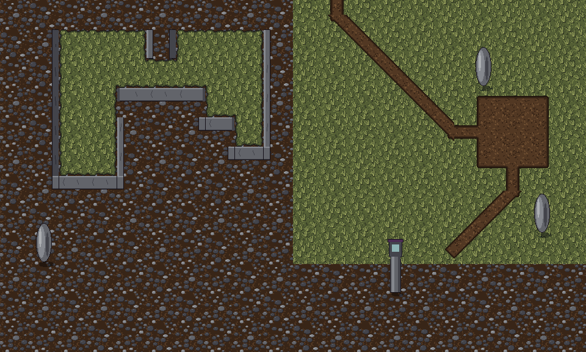
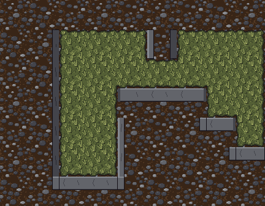 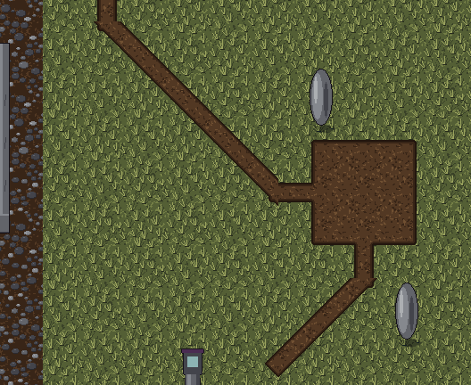 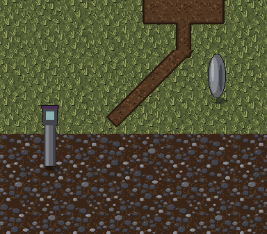
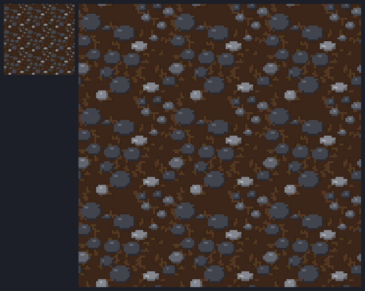 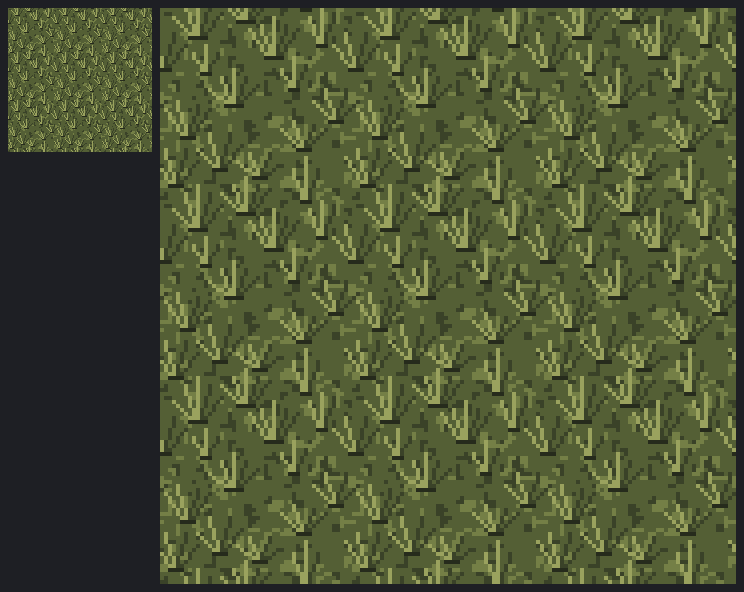

In the browser: the heath in the map editor, the cliff's and the lane's sample islands, and each
new check's chip pressed on its planted fault (on a copy with the fixes undone):

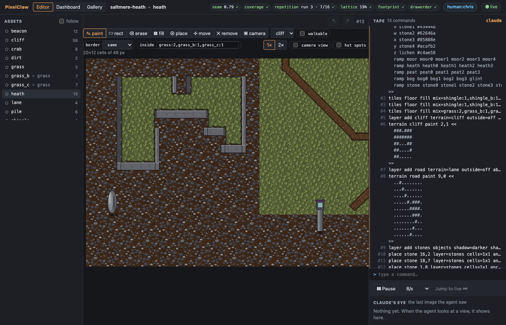
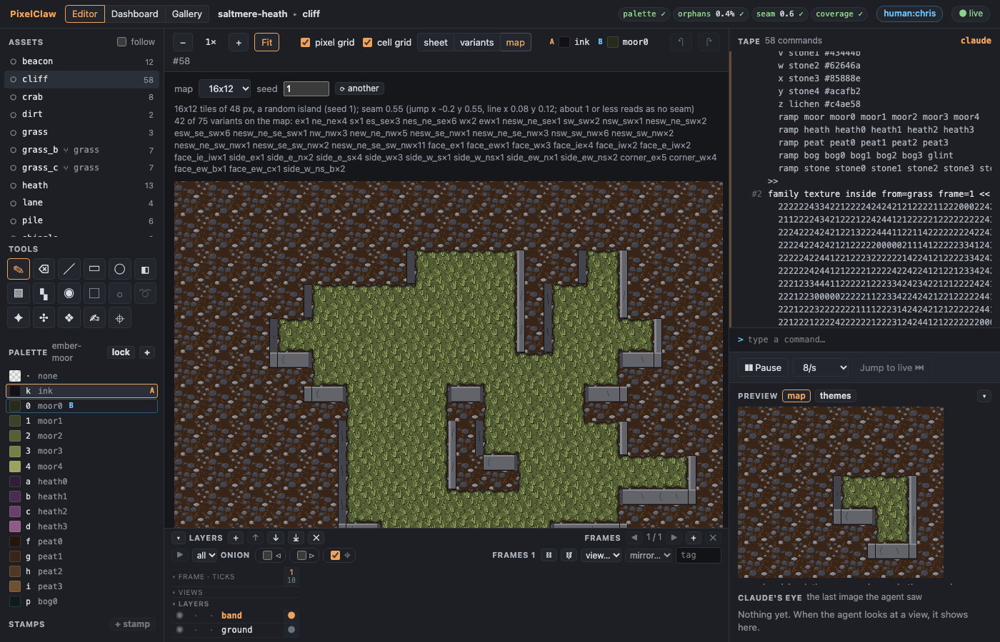
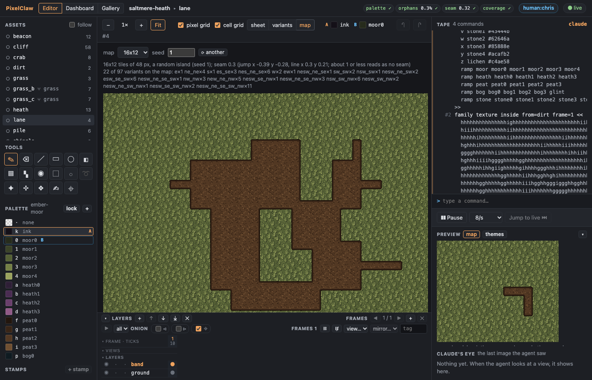
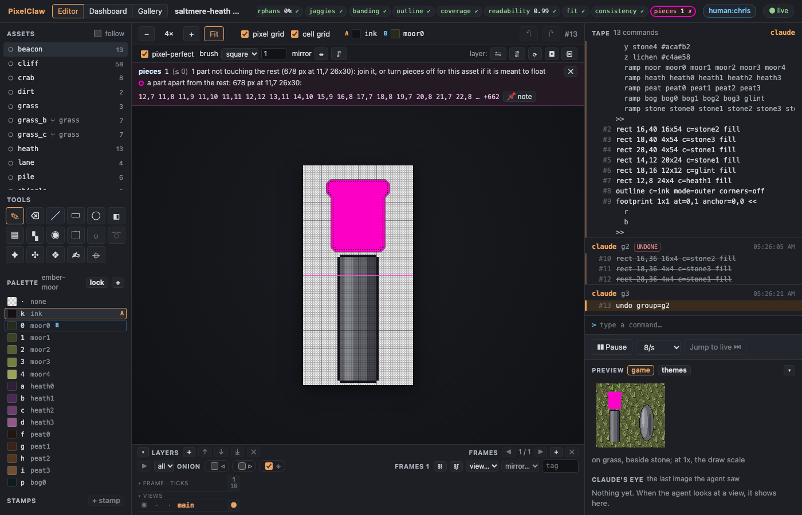
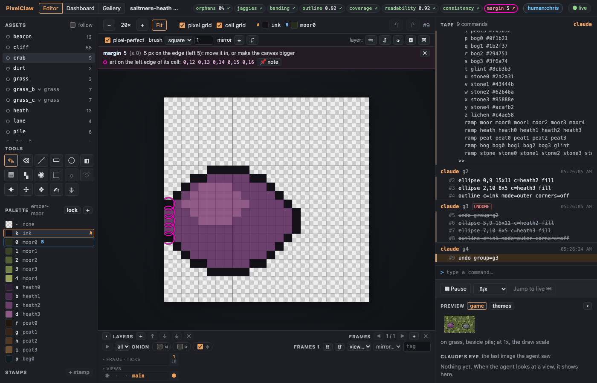
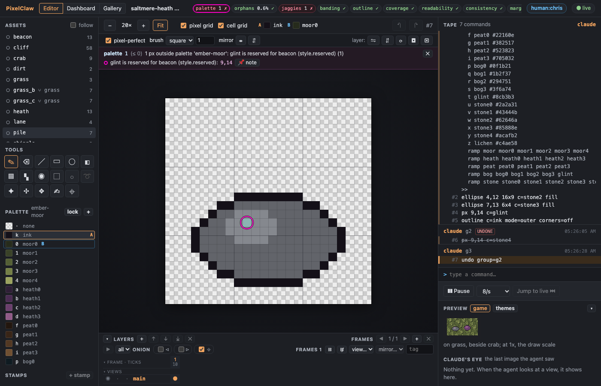
