# From a theme to a whole set

This walkthrough has 2 parts:

1. [from a theme to a planned set, three assets end to end](#part-1)
2. [underlays and snap, a pixel font, an icon set](#part-2)

## Part 1: from a theme to a planned set, three assets end to end<a id="part-1"></a>

The agent starts a new game's art from one paragraph. It writes a palette, a style guide and a
manifest of 20 assets in five sets; the tool checks the manifest against its schema, draws flat
templates from it (a mockup screen and a coverage map per family, the stream's rounded
`blob47-round` bank included), and the dashboard shows the 20 planned assets. Then the agent takes
three of them end to end: the clay ground tile, a terracotta urn and a 24x48 bottle kiln are
drawn (their `new` lines leave the size to the manifest), checked, reviewed by a fresh-context
agent that sees only the review bundle, fixed by coordinates, marked reviewed, approved by a
person in the dashboard and exported through the manifest's profile.

The theme, *Kiln Hollow*, and all its art are original, made for this demo.

You need Node 22.18 or later and pnpm. Build once, from the repo:

```sh
pnpm install
pnpm build
```

### With Claude Code

Install the skill and register the server on a new project, then open the watch link as in
[watch-and-edit.md](watch-and-edit.md):

```sh
node cli/dist/pixelclaw.js skill install
claude mcp add pixelclaw -- node "$PWD/cli/dist/pixelclaw.js" serve --project ~/art/kiln-hollow.pclaw --port 7417
```

Then give Claude the paragraph in [kiln-hollow/theme.md](kiln-hollow/theme.md) and ask, for
example: *Plan the art for this game: a palette, a style guide and a manifest of about twenty
assets in sets. Draw the flat templates and show me the mockup. Then take the clay tile, an urn
and a bottle kiln all the way: draw them, get every check green, have them reviewed blind, and
when I have approved them in the dashboard, export them.* The skill tells Claude the workflow; the
dashboard (`…&tab=dashboard`) shows where everything stands, and its **✓ Approve** and **Ask for
changes…** buttons write `mark` commands on the asset's tape that Claude reads with `changes`.

### With the stand-in agent

```sh
node examples/theme-agent.ts            # --pause <ms>, --person no (approve them yourself), --linger <s>
```

It starts `pixelclaw serve` over stdio on `out/theme.pclaw` (ignored by git) as Claude Code
would, and does what the skill describes, from the files in [kiln-hollow/](kiln-hollow/): the
theme, the palette, the style guide, the manifest, and the scripts for the three assets and their
review round. The blind review was run once for real (a fresh agent given only the bundle); its
report is [findings.md](kiln-hollow.pclaw/reviews/2026-10-28-first-three/findings.md), and the stand-in hands it back in
place of starting an agent. A headless browser plays the person who approves. The result is
checked in as [kiln-hollow.pclaw](kiln-hollow.pclaw) (`--keep` writes it; the example also holds part 2's work, so run underlays-agent.ts with `--keep` after it). Below is what it
printed.

### 1. The theme

```
1. The theme (examples/kiln-hollow/theme.md):

  Kiln Hollow is a potters' hamlet in a narrow valley of red clay. The ground is packed clay worn
  into terraces, with sage scrub on the banks and a slow, silty stream along the valley floor. Bottle
  kilns of fired brick stand against the hillside with their fire-mouths glowing; drying racks,
  stacked urns and a glaze-seller's stall line the lanes between them, and a potter and her goat
  work the yard. The morning sun comes over the eastern rim from the top left, warm and dusty; smoke
  drifts from the kilns. Colours are earthen (clay, sage, silt-green water, smoke-grey stone) with
  one bright accent: the blue glaze, used sparingly.

   Watch the agent work, and the plan: http://127.0.0.1:7417/?token=…&tab=dashboard
```

### 2. The style guide and the palette

```
2. The style guide (style.md, and its settings in project.json) and the palette (kiln-hollow: 29 colours, 7 ramps)
  Palette · Light · Outline · Clusters · Sizes · Ground tiles · Readability · Round pots

```

### 3. The manifest

```
3. The manifest: 20 assets in five sets, written through the plan tool (checked against its schema first)
  the manifest was not written; 2 problems:
    assets[20].name: 'kiln' is already assets[12]
    assets[20].size: pixels like "24x24"
  wrote manifest.json: 20 assets
  20 planned: 20 planned · 0 drafted · 0 checked · 0 reviewed · 0 approved · 0 exported

```

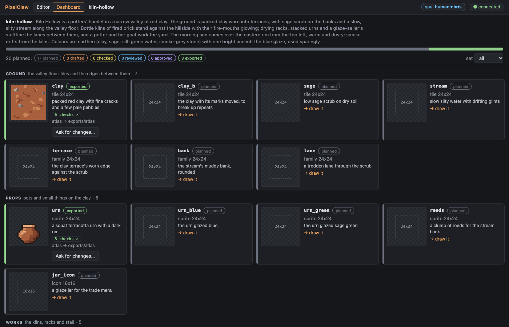

The manifest is [kiln-hollow/manifest.json](kiln-hollow/manifest.json); its fields are in [docs/pipeline.md](../docs/pipeline.md#the-manifest). The broken one (a second `kiln` with a size of `24`) is refused whole.

### 4. The flat templates

```
4. The flat templates: a mockup screen and a coverage map per family (templates/)
  templates in out/theme.pclaw/templates: mockup.png, mockup@2x.png, mockup.txt, terrace.coverage.png, terrace.coverage.txt, bank.coverage.png, bank.coverage.txt, lane.coverage.png, lane.coverage.txt
  A mockup screen, 16x9 cells of 24 px, laid out from the manifest (sets: ground, props, works, folk, scenes).
  
    0: aaaaaaaaaaKaaaaa
    1: aFFaabbaDaaaaaaa
    2: aaabbbbcaaacccaa
    3: bbbbbbbbcaacccaH
    4: aaabbbbbcaacccaa
    5: aaabbbbbaaacccaG
    6: aaaEEaJbaaaIaaaa
    7: aaaaaaabbbbbbbbb
    8: aaaaaaaaaaaaaaaa
  
    a  sage
    b  clay
    c  stream
    D  kiln stands here
    E  rack stands here
    F  stall stands here
    G  cistern stands here
    H  urn stands here
    I  reeds stands here
    J  potter stands here
    K  goat stands here
  blob47-round: 25x19 tiles of 24 px, 176 of 176 variants

```

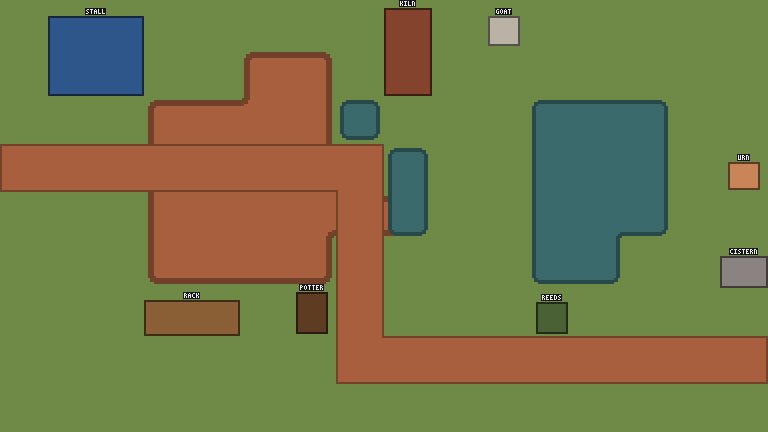

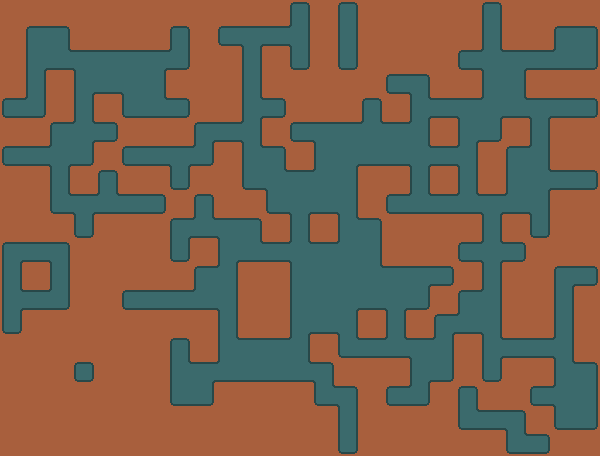

### 5. Three assets drawn

```
5. Three assets drawn; their `new` lines leave the size to the manifest
  clay: checks: palette 0 ✓ · orphans 1.7% ✓ · jaggies 1 ✓ · seam 0.72 ✓ · coverage 0 ✓ · repetition 2.7 ✓
  urn: checks: palette 0 ✓ · orphans 0% ✓ · jaggies 0 ✓ · banding 0 ✓ · outline 1 ✓ · coverage 0 ✓ · readability 1 ✓ · consistency 0 ✓
  kiln: checks: palette 0 ✓ · orphans 0% ✓ · jaggies 0 ✓ · banding 0 ✓ · outline 1 ✓ · coverage 0 ✓ · readability 1 ✓ · fit 0 ✓ · consistency 0 ✓
  new object kiln 24x48 palette=kiln-hollow wrap=off cell=24x24 bg=none <<
    ✓  consistency 0      ≤ 0     no outliers against the plan
    ✓  readability 1      ≥ 0.8   edge contrast: 114 of 114 edge px differ from 'clay' by ΔL* ≥ 15; lightness spread: L* 8..61 inside the sprite
    ✓  fit         0      ≤ 0     1x2 cells, footprint 1x1 at 0,1 drawn, overhangs are roofs

```

### 6. The blind review

```
6. A blind review bundle, handed to a fresh agent with no other context
  out/theme.pclaw/reviews/2026-10-28-first-three: assets/clay.png, assets/clay.game.png, assets/urn.png, assets/urn.game.png, assets/kiln.png, assets/kiln.game.png, tiles/clay.3x3.png, scenes/urn.png, scenes/kiln.png, palette.md, brief.md, style.md, rubric.md
  The reviewer's report (a real one, kept in examples/kiln-hollow/findings.md) goes in the bundle as findings.md:
  1. Readability: 4. The kiln reads at a glance as a bottle kiln: a tall bottle shape with a glowing mouth that …
  2. Cohesion: 4. They look like one set: the same palette, the same 1-px ink outline, light from the top left, …
  3. Seams and repetition: 3. There are no hard seam lines. But the bottom five rows of the tile are much busier…
  4. Style-guide fit: 4. Only palette colours are used, the outline rule is followed, the light comes from the t…
  5. Defects: 3. There are doubled ink corners on the urn, a false second outline on the kiln's shadow side, a h…
  6. Animation: does not apply (no animated assets). 7. Autotiling: does not apply (no autotile sets). 8. Scenes…

```

The whole report, every finding pinned to pixels, and what was done about each: [findings.md](kiln-hollow.pclaw/reviews/2026-10-28-first-three/findings.md). The bundle: [reviews/2026-10-28-first-three/](kiln-hollow.pclaw/reviews/2026-10-28-first-three/) (with `brief.md`: the theme and what each piece is meant to be).

### 7. The review round

```
7. The findings pinned on their pixels, fixed by coordinates, the notes closed, then `mark reviewed`
  clay: applied 5 commands (notes); after the fixes checks: palette 0 ✓ · orphans 1.4% ✓ · jaggies 2 ✓ · seam 0.33 ✓ · coverage 0 ✓ · repetition 2.6 ✓
  urn: applied 7 commands (notes); after the fixes checks: palette 0 ✓ · orphans 0% ✓ · jaggies 2 ✓ · banding 0 ✓ · outline 1 ✓ · coverage 0 ✓ · readability 1 ✓ · consistency 0 ✓
  kiln: applied 5 commands (notes); after the fixes checks: palette 0 ✓ · orphans 0.3% ✓ · jaggies 0 ✓ · banding 0 ✓ · outline 1 ✓ · coverage 0 ✓ · readability 1 ✓ · fit 0 ✓ · consistency 0 ✓
    reviewed urn (sprite 24x24) → a person approves it in the dashboard
    planned  urn_blue (sprite 24x24) → draw it

```

After the review: the clay calmer, its pebbles varied and off their diagonal; the urn shaded two
to three pixels deep and standing on the cell's bottom; the kiln in darker brick with lighter
mortar up the cone, a solid far side and a rounded shoulder.

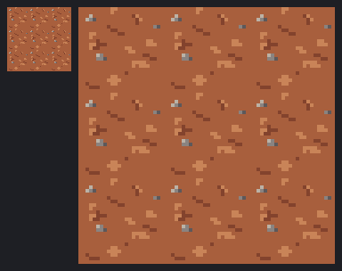 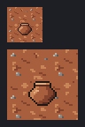 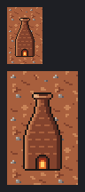

The urn's round belly steps its shading bands with its curve, and `jaggies` counts two of those
steps as doubled corners; the style guide allows two on the urns (its outline stays clean), with
the reason in [style.md](kiln-hollow/style.md). (`jaggies` now leaves steps between neighbouring
entries of one ramp alone.)

### 8. A person approves

```
8. A person approves the three in the dashboard (each approval is `mark approved` on the tape, by them)
  (human:chris pressed Approve on clay, urn and kiln)
  clay: 1 command (1 by human:chris) since #30; now at #31
  #31 human:chris h1  mark approved
  kiln: 1 command (1 by human:chris) since #30; now at #31
  #31 human:chris h1  mark approved
  urn: 1 command (1 by human:chris) since #30; now at #31
  #31 human:chris h1  mark approved

```

The dashboard after a person asked for changes on the urn (`mark rejected "…"`: the urn goes back
to *reviewed* and says why), and with the form open on the kiln:

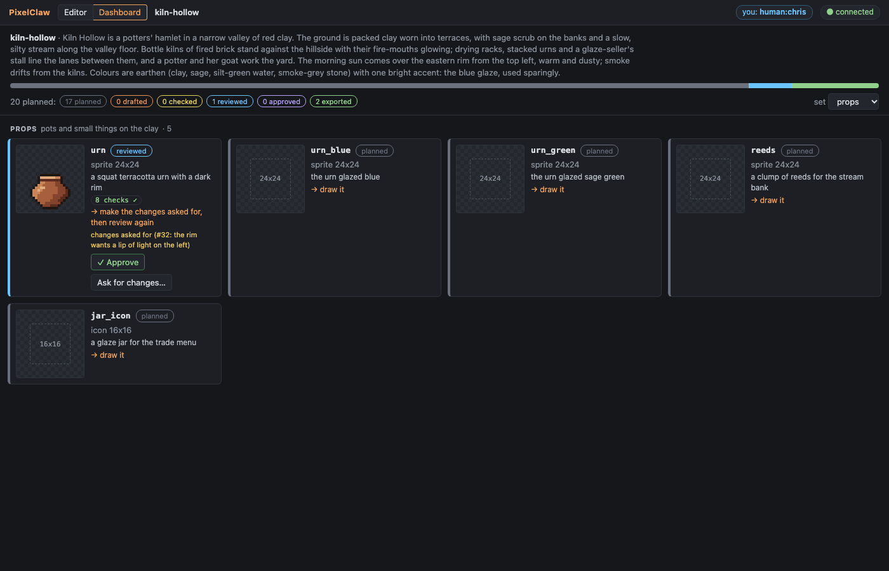

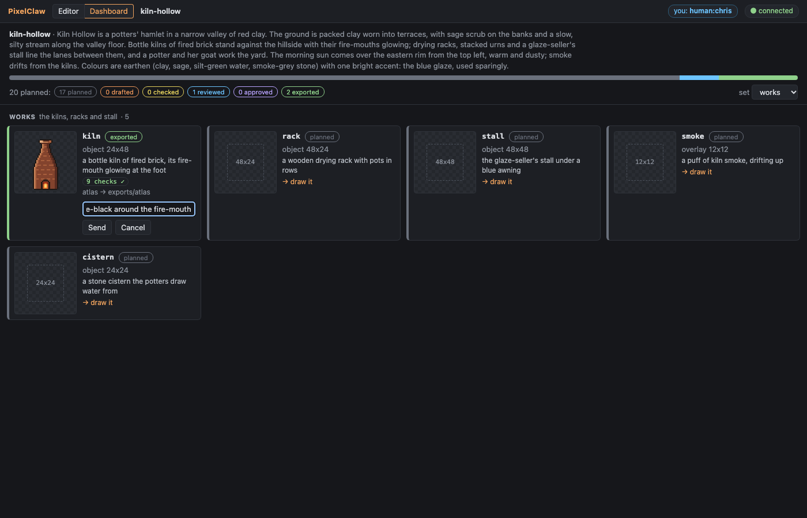

The kiln in the editor: its tape ends with the notes closed, `mark reviewed` and `mark approved`.

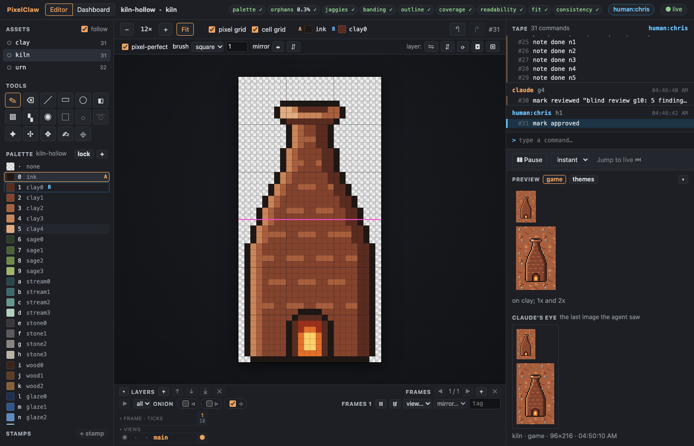

### 9. Exported

```
9. Exported through the manifest's profile (atlas), recorded in exported.json
  atlas: 3 images, wrote 2 files into exports/atlas

```

### 10. The plan now

```
10. The plan now
  20 planned: 17 planned · 0 drafted · 0 checked · 0 reviewed · 0 approved · 3 exported
    exported clay (tile 24x24) → atlas in exports/atlas
    exported urn (sprite 24x24) → atlas in exports/atlas
    exported kiln (object 24x48) → atlas in exports/atlas
  17 of 20 still to finish.

```

### The tests

- [cli/test/kiln-hollow.test.ts](../cli/test/kiln-hollow.test.ts): every tape replays; the
  scripts rebuild the same tape commands and states (sizes from the manifest included); the plan
  is 17 planned and 3 exported; every check passes.
- [server/test/plan-skill.test.ts](../server/test/plan-skill.test.ts): the plan tool, statuses up and down the
  ladder, consistency against the plan and a recolour, the review bundle of a set (no author or
  method names), templates, the dashboard's endpoints, the skill install.
- [e2e/dashboard.spec.ts](../e2e/dashboard.spec.ts): the dashboard's controls and their logged
  marks.
- [core/test/pipeline.test.ts](../core/test/pipeline.test.ts): the manifest schema, marks and statuses,
  defaults, consistency fixtures, the templates.
- [server/test/cache.test.ts](../server/test/cache.test.ts): the state cache against a full replay.

## Part 2: underlays and snap, a pixel font, an icon set<a id="part-2"></a>

Kiln Hollow carries on from [part 1](#part-1). The agent plans a HUD set (four icons and a 5x7
font) and two tiles more, then:

- puts a **mockup underlay** under a 6x4-tile scene of the yard (144x96) and **snaps** it into a
  draft layer: the grid fitted, each block quantised to the palette, with block R² and the
  material match against the flat layout it was made from;
- **cuts three tiles** out of the draft (`import … asset=yard region=… layer=draft`) and cleans
  them by coordinates until every check passes and they sit with the set (`consistency`);
- draws a **5x7 font** (44 glyphs) and exports it as a **glyph strip** and as **BMFont**;
- draws **four HUD icons** and lets the **icon-set check** (stroke weight, box fill, optical centre)
  hold them to each other; three are fixed after it and the other checks flag them.

So that it runs without an image API key, the walkthrough's mockup was made offline:
[kiln-hollow/make-yard-mockup.ts](kiln-hollow/make-yard-mockup.ts) draws the yard's flat layout
([yard-layout.png](kiln-hollow/yard-layout.png): clay, a sage bank, the stream) as a rough
pixel-art draft in the palette's colours, enlarges it to 768x512 with a sub-pixel offset, blurs it
and adds noise ([yard-mockup.png](kiln-hollow/yard-mockup.png)), with the same code as the offline
`fake` provider. [How to run a live underlay with your own key](#a-live-underlay-with-your-own-key)
is at the end.

### With the stand-in agent

```sh
pnpm install && pnpm build
node examples/underlays-agent.ts            # --pause <ms>, --linger <s> (keep the server up to watch), --keep
```

It copies [kiln-hollow.pclaw](kiln-hollow.pclaw) as part 1 left it to `out/underlays.pclaw` (ignored
by git), starts `pixelclaw serve` over stdio as Claude Code would, and runs the scripts in
[kiln-hollow/scripts/](kiln-hollow/scripts/) (`yard`, `sage`, `yard_clay`, `shallows` and their
`_clean`, `hollow_type`, the icons and their `_fix`). The cleaning scripts are what an agent writes
from `check`'s coordinates: the repetition check's stripe, every other flagged pixel moved a ramp
step toward the rest, after merging one- and two-pixel specks (`clean orphans size=2`; the
snapped texture was finer-grained than the hand-drawn clay, and `consistency` said so). The result
is checked in as [kiln-hollow.pclaw](kiln-hollow.pclaw) (`--keep` writes it; the stand-in's
`--keep` writes only the work, so run this one after it). `cli/test/kiln-hollow.test.ts`
rebuilds it from the scripts and the mockup. What it printed:

```
Kiln Hollow, carried on from the theme. Watch: http://127.0.0.1:7417/?token=…

1. The plan grows: a HUD set (four icons and a 5x7 font) and two tiles from a mockup of the yard
  wrote manifest.json: 26 assets
  26 planned: 23 planned · 0 drafted · 0 checked · 0 reviewed · 0 approved · 3 exported

2. A mockup underlay for the 6x4-tile yard (offline: made by examples/kiln-hollow/make-yard-mockup.ts, no key needed)
  underlay underlay blob=a101a7d8184e4826afa3f08f52a062f7a6900ca0b9dbc7f6fce943bc50c59d00 image=768x512 at=0,0 size=144x96 layout=1bcad0dd79768675fae3faf6c1863e13b8ec637fd1b8bedfabb174878bbdf306 from="y…
  the render view shows it faded under the (empty) art: out/underlays.pclaw/views/yard.render.png

3. snap: the grid fitted, each block quantised to the palette on a new draft layer
  snap from=underlay into=draft at=0,0 grid=144x96 pitch=5.333x5.334 offset=0.66,0.65 r2=0.97 material=0.98
  warnings: none

4. Three tiles cut from the draft (import … asset=yard region=… layer=draft), cleaned by coordinates
  sage: cut: palette 0 ✓ · orphans 0% ✓ · jaggies 0 ✓ · seam 0.46 ✓ · coverage 0 ✓ · repetition 8.1 ✗ · consistency 0 ✓  (1 failing: `check` gives coordinates)
    ✓ seam 0.46 ≤ 1 jump x -0.97 y 0.46; line x 0.17 y 0.3 (about 1 or less reads as no seam) ✗ repetition 8.1 ≤ 3 most visible stripe: columns 16-18, lighter by ΔL…
    after 8 commands: palette 0 ✓ · orphans 0% ✓ · jaggies 0 ✓ · seam 0.25 ✓ · coverage 0 ✓ · repetition 2.6 ✓ · consistency 0 ✓
  yard_clay: cut: palette 0 ✓ · orphans 0% ✓ · jaggies 1 ✓ · seam 0.81 ✓ · coverage 0 ✓ · repetition 4.7 ✗ · consistency 1 ✗  (2 failing: `check` gives coordinates)
    ✓ seam 0.81 ≤ 1 jump x 0.81 y -0.28; line x 0.62 y 0.18 (about 1 or less reads as no seam) ✗ repetition 4.7 ≤ 3 most visible stripe: columns 0-3, lighter by ΔL*…
    after 5 commands: palette 0 ✓ · orphans 0% ✓ · jaggies 0 ✓ · seam 0.47 ✓ · coverage 0 ✓ · repetition 2.9 ✓ · consistency 0 ✓
  shallows: cut: palette 0 ✓ · orphans 0.5% ✓ · jaggies 0 ✓ · seam 1.56 ✗ · coverage 0 ✓ · repetition 6.5 ✗ · consistency 0 ✓  (2 failing: `check` gives coordinates)
    ✗ seam 1.56 ≤ 1 jump x 1.56 y -0.48; line x 0.01 y 0.86 (about 1 or less reads as no seam) ✗ repetition 6.5 ≤ 3 most visible stripe: rows 16-17, darker by ΔL* 4…
    after 9 commands: palette 0 ✓ · orphans 0% ✓ · jaggies 0 ✓ · seam 0.7 ✓ · coverage 0 ✓ · repetition 2.6 ✓ · consistency 0 ✓

5. A 5x7 font (hollow_type): 44 glyphs, the size and characters from the manifest
  checks: palette 0 ✓ · font 0 ✓
  ✓ font 0 ≤ 0 metrics agree (43 of 44 glyphs drawn, 1 empty; cap height 7, x-height —, baseline row 6, line 9)
  strip: exports/strip/hollow_type.png, exports/strip/hollow_type.txt
  bmfont: exports/bmfont/hollow_type.fnt, exports/bmfont/hollow_type_0.png

6. Four HUD icons (icon mode=full), then the icon-set check (stroke weight, box fill, optical centre)
  jar_icon: palette 0 ✓ · orphans 1.7% ✗ · jaggies 4 ✗ · banding 0 ✓ · outline 1 ✓ · coverage 0 ✓ · readability 1 ✓ · consistency 0 ✓  (2 failing: `check` gives coordinates)
  hearth_icon: palette 0 ✓ · orphans 0.9% ✓ · jaggies 0 ✓ · banding 0 ✓ · outline 1 ✓ · coverage 0 ✓ · readability 1 ✓ · consistency 0 ✓
  drop_icon: palette 0 ✓ · orphans 0% ✓ · jaggies 0 ✓ · banding 0 ✓ · outline 1 ✓ · coverage 0 ✓ · readability 1 ✓ · consistency 1 ✗  (1 failing: `check` gives coordinates)
  bowl_icon: palette 0 ✓ · orphans 1.3% ✗ · jaggies 0 ✓ · banding 0 ✓ · outline 0.9 ✓ · coverage 0 ✓ · readability 1 ✓ · consistency 2 ✗  (2 failing: `check` gives coordinates)
  box fill: 0.38 against the set's median 0.61 (3 others) (needs ± 0.2 of the set's 0.61)
         optical centre: the drawn pixels' centre is at 7.5,5.9, 1.6 px from the canvas centre 7.5,7.5 (needs ≤ 1.5 px from the canvas centre)
  Fixed: the jar's rim by coordinates; the drop drawn wider; the bowl larger and lower
  jar_icon: palette 0 ✓ · orphans 0% ✓ · jaggies 0 ✓ · banding 0 ✓ · outline 1 ✓ · coverage 0 ✓ · readability 1 ✓ · consistency 0 ✓
  drop_icon: palette 0 ✓ · orphans 0% ✓ · jaggies 0 ✓ · banding 0 ✓ · outline 1 ✓ · coverage 0 ✓ · readability 1 ✓ · consistency 0 ✓
  bowl_icon: palette 0 ✓ · orphans 0% ✓ · jaggies 0 ✓ · banding 0 ✓ · outline 1 ✓ · coverage 0 ✓ · readability 1 ✓ · consistency 0 ✓

7. The plan now
  5 planned: 0 planned · 0 drafted · 5 checked · 0 reviewed · 0 approved · 0 exported
    checked  jar_icon (icon 16x16) → a blind review, then `mark reviewed`
    checked  hearth_icon (icon 16x16) → a blind review, then `mark reviewed`
    checked  drop_icon (icon 16x16) → a blind review, then `mark reviewed`
    checked  bowl_icon (icon 16x16) → a blind review, then `mark reviewed`
    checked  hollow_type (font 5x7) → a blind review, then `mark reviewed`
  26 planned: 15 planned · 0 drafted · 8 checked · 0 reviewed · 0 approved · 3 exported
```

What it looks like ([scripts/screenshots-underlays.ts](../scripts/screenshots-underlays.ts)):

| | |
|---|---|
| 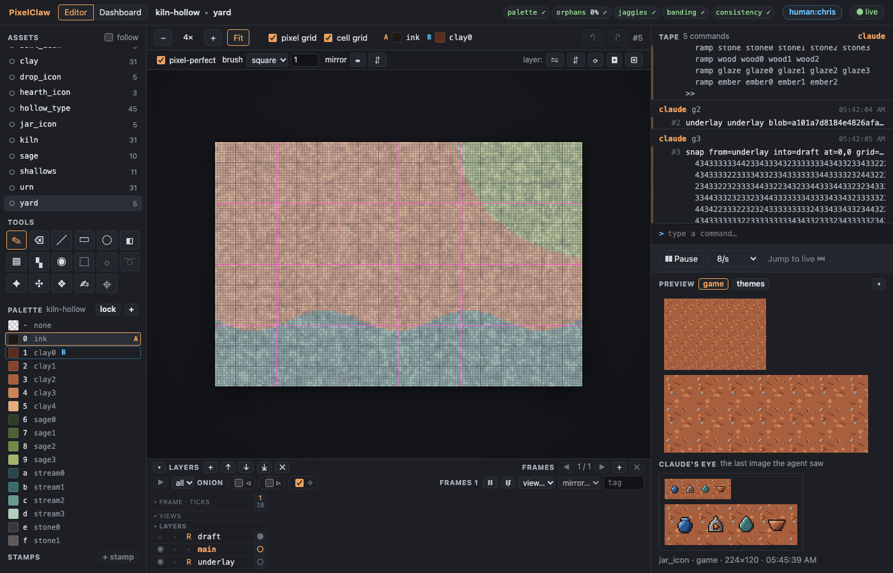 | 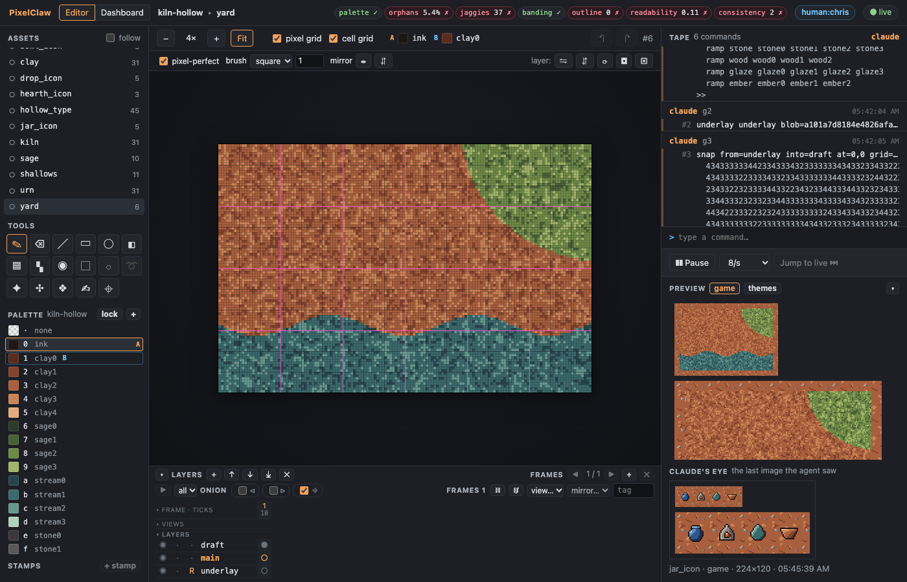 |
| the underlay ([underlays-yard-underlay.png](../docs/screenshots/underlays-yard-underlay.png)) | the snapped draft ([underlays-yard-draft.png](../docs/screenshots/underlays-yard-draft.png)) |
| 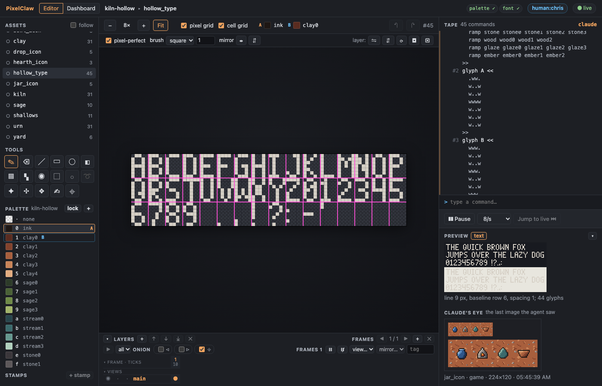 | 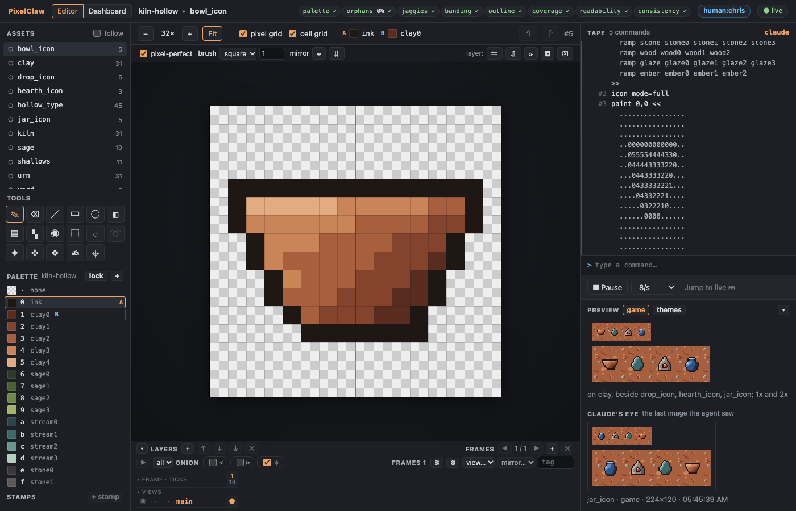 |
| the font and its text preview ([font-editor.png](../docs/screenshots/font-editor.png)) | the bowl icon and the set ([icon-editor.png](../docs/screenshots/icon-editor.png)) |

The tiles cut from the draft, 3x3: [sage](../docs/screenshots/underlays-sage-tile3x3.png),
[yard_clay](../docs/screenshots/underlays-yard_clay-tile3x3.png),
[shallows](../docs/screenshots/underlays-shallows-tile3x3.png). The font's
[glyph strip](../docs/screenshots/font-strip.png) (red separator columns, at 4x) and
[BMFont page](../docs/screenshots/font-bmfont.png) (at 6x); the exported files are in
[kiln-hollow.pclaw/exports/strip/](kiln-hollow.pclaw/exports/strip/) and
[exports/bmfont/](kiln-hollow.pclaw/exports/bmfont/). The icons at 1x and 2x:
[icons-game.png](../docs/screenshots/icons-game.png).

### With Claude Code

As in [theme-to-set.md](theme-to-set.md), on a copy of the example project. Ask, for example: *Put the
mockup in examples/kiln-hollow/yard-mockup.png under a 6x4-tile sheet called yard, with
yard-layout.png as its layout, snap it, and cut tiles for sage and the stream out of the draft;
clean them until every check passes. Then draw a 5x7 font for the HUD and export it as a strip and
as BMFont, and four 16x16 icons that the icon-set check is happy with.* The skill's workflows
("A mockup underlay, snapped", "A font", "Icons") tell Claude the steps.

### A live underlay with your own key

The tool calls OpenAI's Images API only for `underlay generate` with `provider=openai` (the
default), and only with a key in the environment of the process that runs the command. Nothing
else in PixelClaw needs a key.

1. **Pick the scene and its layout.** A sheet the size of the scene in art pixels, and a flat
   layout to follow: the yard's ([kiln-hollow/yard-layout.png](kiln-hollow/yard-layout.png), 6x4
   tiles of 24 px), or the project's flat mockup screen (`pixelclaw plan <project> --templates`
   writes `templates/mockup.png`, a camera-sized screen; use a sheet of the same size).

   ```sh
   cp -r examples/kiln-hollow.pclaw ~/art/kiln-live.pclaw
   node cli/dist/pixelclaw.js run ~/art/kiln-live.pclaw -e 'new sheet yard_live 144x96 cell=24x24'
   ```

2. **Generate the underlay.** Set the key for this one command (it is read from
   `OPENAI_API_KEY`, sent only in the request's `Authorization` header, and never written to the
   project, the tape, the cost log or any output):

   ```sh
   OPENAI_API_KEY=sk-… node cli/dist/pixelclaw.js run ~/art/kiln-live.pclaw --asset yard_live -e \
     'underlay generate "Kiln Hollow, a potters hamlet in red clay: packed clay ground, a sage bank top right, a slow silty stream along the bottom. Top-down pixel art for a game, 24 px tiles, crisp square pixels, an earthen palette, light from the top left" layout='"$PWD"'/examples/kiln-hollow/yard-layout.png'
   ```

   The doc is 3:2, so it asks for 1536x1024 from `gpt-image-1.5` at `medium` quality, an edit of
   the layout: about **$0.05** by the price table (OpenAI also bills the layout's input tokens, a
   cent or two). The cap is **$0.25 a call**: `cap=0.10` on the line, `PIXELCLAW_UNDERLAY_CAP`, or
   project.json `"underlay": { "cap": 0.1 }` changes it, and a call over it is refused before
   anything is sent. `quality=low` (about $0.013) is enough to judge a layout; `model=` and
   project.json `underlay.prices` cover other models (check https://openai.com/api/pricing/; the
   table in the server holds the prices published when this was written). Every call, refused or
   made, is a line in `~/art/kiln-live.pclaw/logs/underlay-costs.jsonl` (estimate, usage, blob,
   prompt; no key).

3. **Look, then snap.**

   ```sh
   node cli/dist/pixelclaw.js view ~/art/kiln-live.pclaw yard_live render --scale 4
   node cli/dist/pixelclaw.js run ~/art/kiln-live.pclaw --asset yard_live -e snap
   ```

   The `snap` line on the tape says `r2=` and `material=`; under 0.8 or 0.85 the run warns. A
   generated image rarely keeps an exact pixel grid, so expect to reroll (another prompt, a
   lower-detail one) or to trace over the underlay at 24 px instead of snapping.

The same works through the watch view's command line (start `OPENAI_API_KEY=sk-… node
cli/dist/pixelclaw.js serve --project ~/art/kiln-live.pclaw --no-mcp`) or through Claude Code: the
server reads the key from its own environment, so give it to the server process, for example with
`claude mcp add pixelclaw -e OPENAI_API_KEY=sk-… -- node "$PWD/cli/dist/pixelclaw.js" serve --project
~/art/kiln-live.pclaw` (Claude Code keeps that in its own configuration, in plain text; remove it
with `claude mcp remove pixelclaw` when you are done). `provider=fake` gives the offline draft
instead, free.
