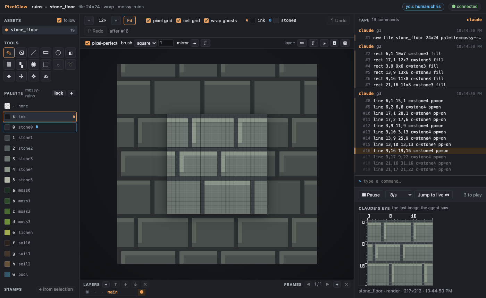
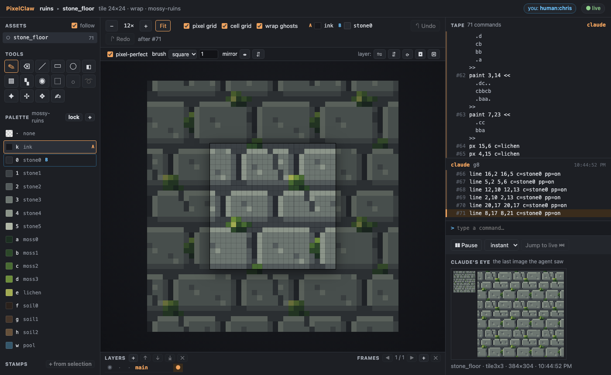
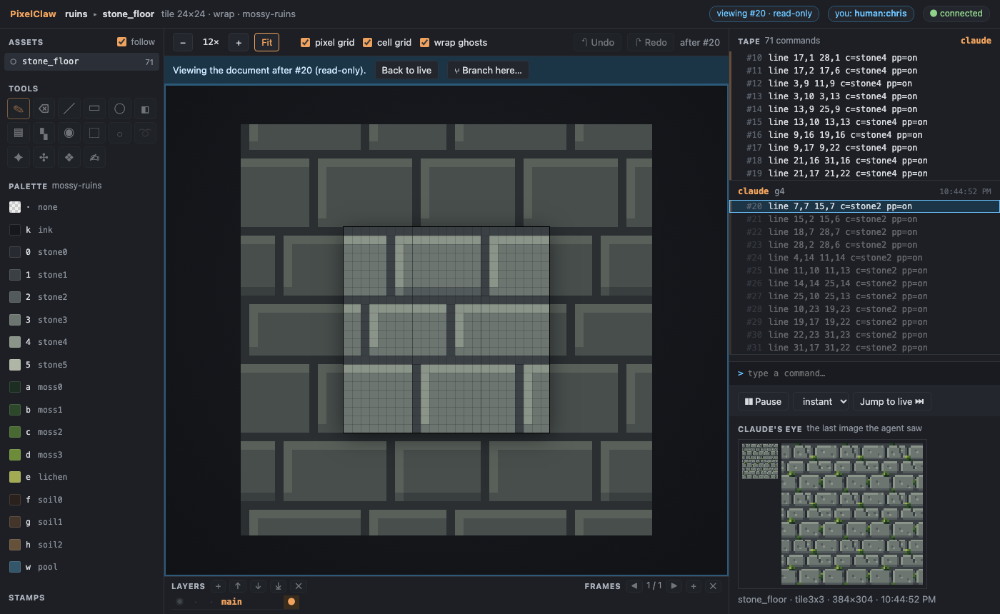
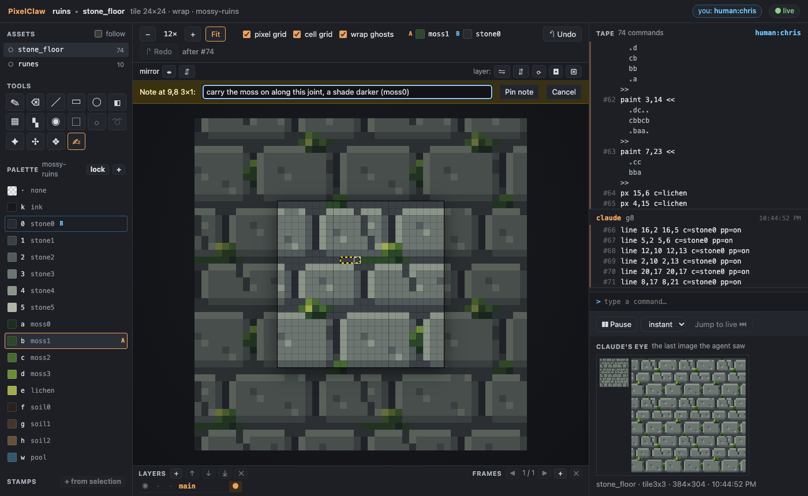
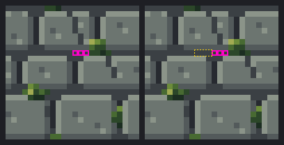
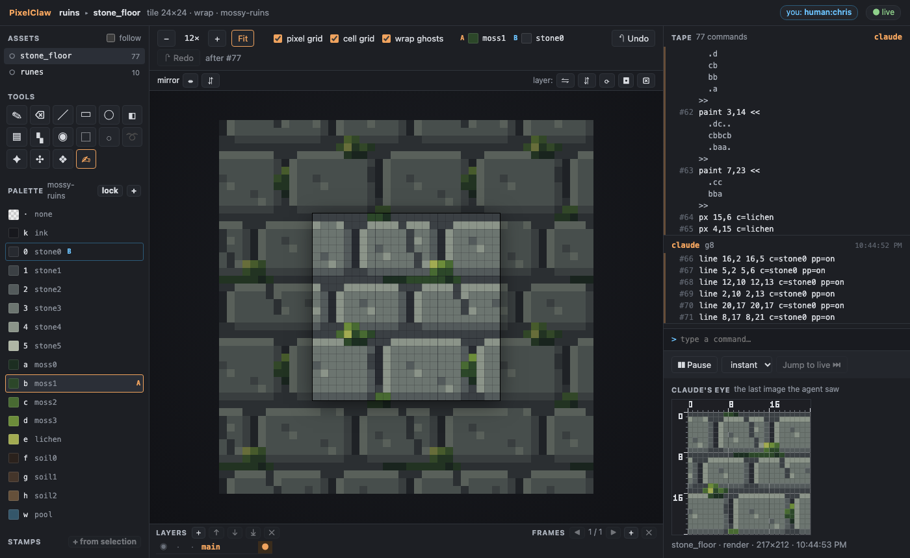

# Watch and edit

This walkthrough has 2 parts:

1. [watch the agent draw a tile](#part-1)
2. [you edit, and the agent reads your edits](#part-2)

## Part 1: watch the agent draw a tile<a id="part-1"></a>

The agent draws a 24x24 tile through MCP while you watch it form on the canvas and the commands
scroll past on the tape.

You need Node 22.18 or later and pnpm. Build once, from the repo:

```sh
pnpm install
pnpm build
```

### With Claude Code

1. **Start the server.** Register it with Claude Code (once), pointing at a project folder. The
   folder is created if it doesn't exist:

   ```sh
   claude mcp add pixelclaw -- node "$PWD/cli/dist/pixelclaw.js" serve --project ~/art/mossy-ruins.pclaw --port 7417
   ```

   Then start Claude Code (`claude`) in the same folder (`claude mcp add` registers servers for the
   current folder unless you add `--scope user`). It starts the PixelClaw server with the
   session; `/mcp` shows it as connected.

2. **Open the URL.** Ask Claude:

   > Open the PixelClaw project, add the palette `<repo>/examples/src/mossy-ruins.json`, and give
   > me the watch link.

   Claude calls the `project` tool and replies with a link like
   `http://127.0.0.1:7417/?token=3f9c…`. Open it in your browser. You see an empty canvas, the
   mossy-ruins palette on the left and an empty tape on the right.

3. **The agent draws.** Ask:

   > Draw a seamless 24x24 mossy stone floor tile, a few batches at a time. Look at the 3x3
   > preview at the end.

   Each `run` call appears on the tape as a group of commands, in orange (the agent's colour). The
   canvas plays each batch command by command: the line being drawn is highlighted, and the lines
   still to come are dimmed. When Claude looks at its work, the image it saw appears under
   **Claude's eye**.

While it draws, try:

- the **speed** menu (1 to 60 commands a second, or instant), **Pause** and **Jump to live**;
- clicking any tape line to see the tile as it was then (read-only), then **Back to live**;
- zooming (−/+, Fit, or Ctrl/⌘ + scroll) and the pixel grid;
- opening the link in a second window: both receive the same stream.

When you quit Claude Code, the server stops.

### Without Claude Code

A small script stands in for the agent. It starts the server over stdio, exactly as Claude Code
does, and draws the stone floor in eight batches (its sections), looking at the result as it
goes:

```sh
node examples/watch-agent.ts
```

It prints the link and waits. Open the link, press Enter in the terminal, and watch. Options:
`--pause <seconds>` between batches (default 2), `--project <dir>` (default `out/watch.pclaw`,
recreated each run), `--linger <seconds>` before the server stops (default 120).

### What it looks like







## Part 2: you edit, and the agent reads your edits<a id="part-2"></a>

The agent draws a tile. You fix three pixels in the browser and pin a note. The agent's `changes`
tool returns exactly those lines, the note and a diff image, and the agent carries on from them.

You need Node 22.18 or later and pnpm. Build once, from the repo:

```sh
pnpm install
pnpm build
```

### With Claude Code

1. Register the server and open the watch link as in [watch-and-edit.md](watch-and-edit.md) (steps 1 and 2),
   and ask Claude to draw the stone floor tile.

2. **Set your name.** Click **you: human:guest** in the page's header and type your name (or add
   `&name=<you>` to the link). Your edits are written to the tape as `human:<you>`.

3. **Fix three pixels.** Pick a colour in the palette (say `moss1`), press **B** for the pencil and
   click three pixels: one joint between two stones, for instance 12,8, 13,8 and 14,8 (the
   hovered pixel is outlined; the rulers in Claude's eye help). Each click is a line on the tape,
   in blue: `stroke pencil c=moss1 pp=on 12,8`.

4. **Leave a note.** Press **N**, drag across 9,8 to 11,8, write *carry the moss on along this
   joint, a shade darker (moss0)* and press **Pin note**. The note shows on the canvas and in the
   Notes panel.

5. **Tell Claude.** For example: *I fixed a few pixels and left you a note.* Claude calls
   `changes` and gets back:

   ```
   stone_floor: 4 commands (4 by human:you) since #71; now at #75
   #72 human:you h1  stroke pencil c=moss1 pp=on 12,8
   #73 human:you h2  stroke pencil c=moss1 pp=on 13,8
   #74 human:you h3  stroke pencil c=moss1 pp=on 14,8
   #75 human:you h4  note 9,8 3x1 "carry the moss on along this joint, a shade darker (moss0)" id=n1
   open notes (1):
     n1 at 9,8 3x1: "carry the moss on along this joint, a shade darker (moss0)"  (new)
   diff #71 → #75: 3 px changed:
     12,8 stone1→moss1
     …
   ```

   with the diff image (before and after, your pixels outlined in magenta, the note in yellow),
   saved as `views/stone_floor.diff.png`. The page shows that image under **Claude's eye**.
   Calling `changes` again returns `No changes since you last looked.`

6. **Claude carries on**: it draws what the note asks and closes it (`note done n1`); the note
   disappears from the canvas.

Then try the rest:

- the other tools (E eraser, L line, U rectangle, Shift+U ellipse, F filled, G fill, I or
  Alt+click picker, M select and drag inside to move, V move, arrows to nudge), all with their
  shortcut in the tooltip;
- double-click a palette swatch to change its colour, or **+** to add one;
- **Undo** / **Redo** (Ctrl/⌘+Z, Ctrl/⌘+Shift+Z): they take back only your edits, never the
  agent's or another person's;
- click a tape line to time travel, then **Branch here** to start a new asset from that point;
- open the link in a second browser with another name and draw in both at once.

### Without Claude Code

A script stands in for the agent: it starts the server over stdio as Claude Code would, draws the
stone floor, prints the link and waits while you do steps 3 and 4. Press Enter, and it calls
`changes`, prints what came back, fills the note's region with `moss0`, closes the note and looks
at the tile again.

```sh
node examples/edit-agent.ts
```

`--simulate` plays the person too, over the page's WebSocket as `human:demo`, so the whole demo
runs with no browser. Other options: `--project <dir>` (default `out/edit.pclaw`, recreated
each run) and `--linger <seconds>` before the server stops (default 120, or 0 with `--simulate`).

### What it looks like








More: [a pencil stroke in progress](../docs/screenshots/edit-pencil.png),
[a selection moved](../docs/screenshots/edit-select-move.png),
[changing a palette colour](../docs/screenshots/edit-palette.png),
[branch here](../docs/screenshots/edit-branch.png) and [the branch](../docs/screenshots/edit-branched.png),
[a second person undoing their own stroke](../docs/screenshots/edit-two-people.png),
[a 10,000-line tape](../docs/screenshots/edit-long-tape.png).
