# The work queue: requests, the gallery and the worker

This walkthrough has 2 parts:

1. [the work queue, the gallery and import](#part-1)
2. [the worker, requests and maps](#part-2)

## Part 1: the work queue, the gallery and import<a id="part-1"></a>

Kiln Hollow ([`kiln-hollow.pclaw`](kiln-hollow.pclaw)) carried on from [the theme-to-set walkthrough](theme-to-set.md). A person, in the
browser, brings in art they already have and asks Claude for work from the dashboard; Claude
hears through `plan` and takes the requests with `work`. Nobody types in a chat.

The stand-in ([`queue-agent.ts`](queue-agent.ts)) plays both parts: the person is a
Playwright browser (as `human:chris`), the agent drives `pixelclaw serve` over MCP as Claude
does. It works on a copy (`out/queue.pclaw`), without the assets, requests and scenes:

```sh
node examples/queue-agent.ts            # add --shots for docs/screenshots/g12-*.png, --keep to write the example back
```

### 1. Scenes

The agent adds a `clutter` set and three scenes to the manifest: the yard below the kilns (built
by the `hollow` map), the stream bank, and the glaze-seller's trade screen. `plan(order="scene")`
says what each still needs:

```
scene kiln_yard (the yard below the kilns), built by the map hollow: missing rack, urn_blue, cistern, potter, terrace, bank, lane, stall, hollow
scene stream_bank (where the goat grazes by the water): missing stream, reeds, goat
scene trade_menu (the glaze-seller's screen): everything it needs is drawn and checked
```

### 2. The person imports a sheet

The person has a sheet of pot shards, three 24x24 cells and one empty
([`kiln-hollow/shards.png`](kiln-hollow/shards.png), made by
[`make-shards-sheet.ts`](kiln-hollow/make-shards-sheet.ts), so it is original). They drop it on the
gallery (here: **Import…**). The slice dialog draws the 24x24 grid over it, skips the empty cell
and names the rest by the pattern `shards_{n}`; kind sprite, set clutter, quantised to the
project's palette.

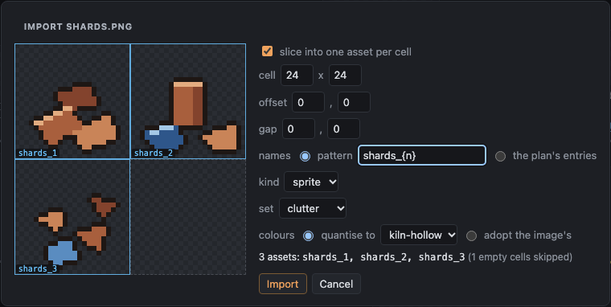

The server makes three assets whose tapes start with `import` (the sheet kept under `blobs/`),
adds three manifest entries (`"description": "imported from shards.png cell 1,0"`) and runs every
check. They come in **drafted**: the sheet's outlines have spikes and notches, and `jaggies` says
where. That is the art as it was drawn; fixing it is the next request.

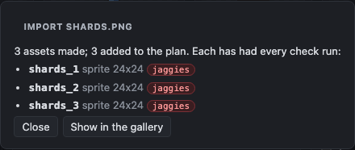

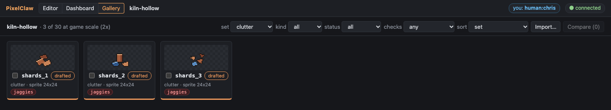

(The shards first went into `props`: the consistency check then held the urn to a set median of
three ramp steps, and the urn fell from exported to drafted. A set of its own is right for ground
clutter, and the import said so at once.)

### 3. The person asks

On the dashboard: **Draw this…** on two planned cards, with a note each (`urn_blue`: "the deep
blue glaze; keep the rim dark"; `goat`: "she grazes by the stream"), and **Ask for changes…** on
the drawn `jar_icon` ("a wider mouth, so it reads as a jar at 1x"). Each is a record in
[`requests.jsonl`](kiln-hollow.pclaw/requests.jsonl); the change is also the `mark rejected "…"`
on the jar's tape, by `human:chris`.

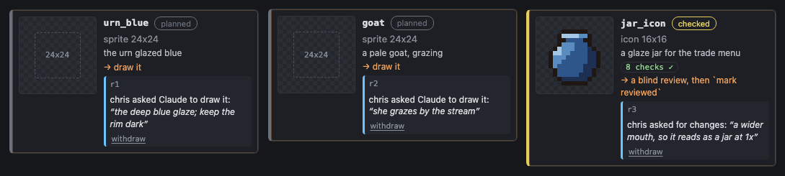

### 4. The agent hears

`plan` puts the requests first:

```
Requests from people (3): take these before planned work, with `work` (it claims the next open one):
  r1 draw urn_blue: "the deep blue glaze; keep the rim dark" (from human:chris; open)
  r2 draw goat: "she grazes by the stream" (from human:chris; open)
  r3 change jar_icon: "a wider mouth, so it reads as a jar at 1x" (from human:chris; open)
```

**r1, urn_blue: done.** `work` claims it and gives the plan entry (a 24x24 sprite in props, the
urn glazed blue, 14 px tall, a recolour of the urn). The agent posts progress and draws it as a
palette swap ([`urn_blue.pclaw`](kiln-hollow/scripts/urn_blue.pclaw)): the urn's pixels
(`import … asset=urn`), clay0-3 swapped for glaze0-3 and the clay4 highlight for smoke, and a ramp
`glazed` so the highlight's steps count as shading. Every check passes (consistency sees a
recolour, not a copy). `work(action="done", text=…)`.

**r2, the goat: blocked.** Whether she has horns, and her colour, is the person's call:

```
work(action="blocked", text="Horns or none? A nanny with short horns reads best at 24 px; a billy needs a beard too. And white, or the pale stone grey of the plan?")
```

**r3, the jar: in progress.** Claimed, a progress note ("widening the rim by a pixel each side"),
and a first batch, a note pinned where the rim will widen
([`jar_icon_g12.pclaw`](kiln-hollow/scripts/jar_icon_g12.pclaw)). The stand-in stops here, so the
example keeps a request in this state.

### 5. The dashboard shows each state

The urn_blue card: ✓ done with what changed. The goat: Claude's question and an answer box (the
answer opens the request again, and `work` hands it back with the answer). The jar: **Claude is
working on this** with its latest progress note, because the claim's author wrote the asset's
latest batch.

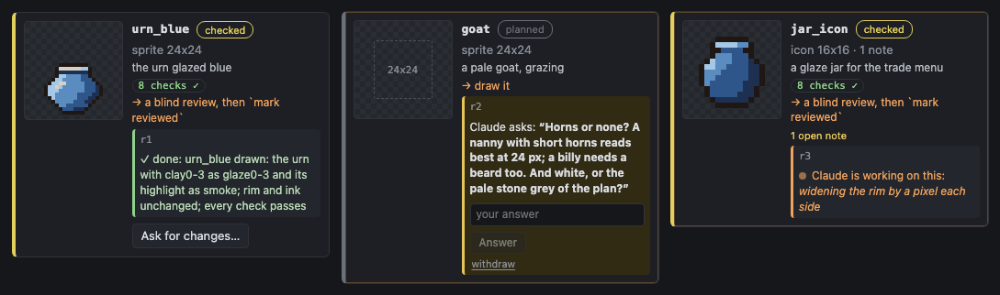

The scenes at the top of the dashboard follow: urn_blue is no longer missing from the yard.

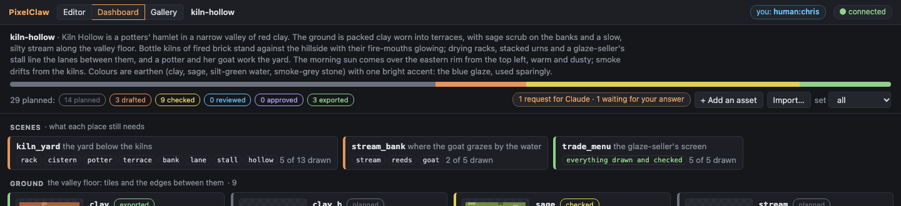

### 6. The gallery

Every asset at game scale (2x), planned ones as dashed boxes, the map listing what it uses and
each asset the maps that use it. Ticking urn, urn_blue and a shard and pressing **Compare** puts
them side by side at the same scale (here ×2):

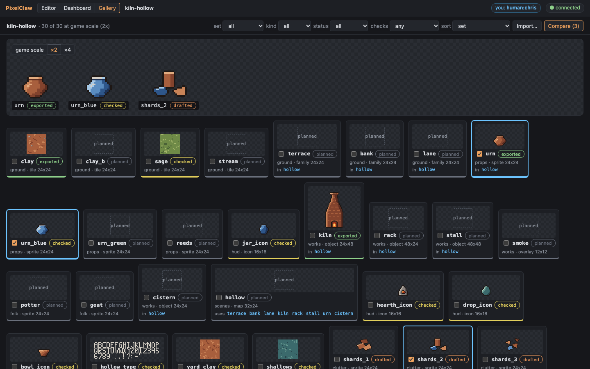

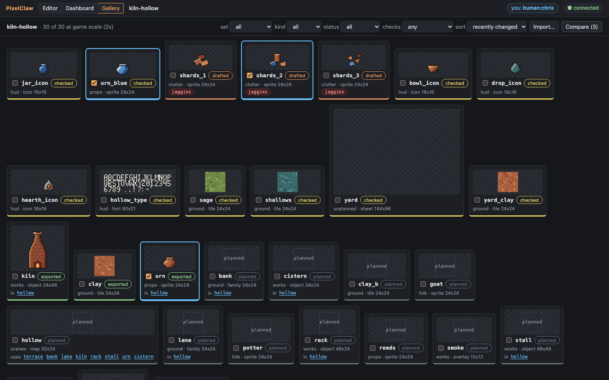

The plan now: 29 planned, 14 planned · 3 drafted · 9 checked · 3 exported; requests r3 (claimed)
and r2 (blocked, waiting for an answer).

### Claude without a session: the worker

If nobody has Claude Code open on the project, the dashboard's **▶ Start Claude** (or
`pixelclaw work <project>`) runs Claude Code headless on the queue, up to a budget cap. It is off
unless the project turns it on, because it spends money. To turn it on, put this in
`kiln-hollow.pclaw/project.json`:

```json
"worker": { "enabled": true, "cap": 5 }
```

and reload the dashboard. What it runs, the cap, the log and the single-worker rule:
[docs/worker.md](../docs/worker.md). The tests and this screenshot use a fake `claude` that works the queue through the
same MCP endpoint and reports a made-up cost:

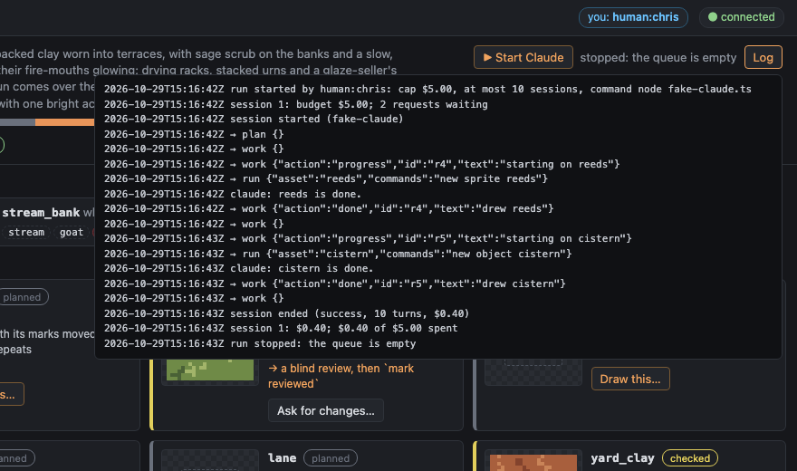

## Part 2: the worker, requests and maps<a id="part-2"></a>

This part fences the worker in, lets an agent or a script file requests, and shows terrain
maps that run off the map edge with a mixed inside.

| # | Feature | Where in the walkthrough |
|---|---|---|
| 1 | **The worker's sandbox and discipline**: no built-in Claude Code tool at all (no shell, no files, no web, no subagents), only PixelClaw's, over a connection fenced to the project; the command reference in its system prompt; `work done` refused while a check fails; a stall watchdog; a spend ledger, so the cap is a total | part 2: the stand-in model's done refused while the outline check fails, then finished; its `Bash` and `Read` refused; the ledger; a setting that would hand it a shell refused |
| 2 | **Requests from the CLI and MCP**: `pixelclaw request draw\|change\|add`, `reply`, `cancel`; MCP `request` | part 1 |
| 3 | **Lattice**: ΔE, not lightness alone; marks matched by their centres and weighed by their share of the cell's marking | part 3: the meadow's lattice before (47%) and after (26%) |
| 4 | **Terrain on maps**: past the map's edge a cell counts as its own (no band along the border; `border=` to choose); a terrain's inside takes `mix=`; families follow the tiles their textures came from; `blob47-round` built in | part 3 |
| 5 | **Mixes**: a two-tile mix is not a strict checkerboard | not in the log (`core/test/map-terrain.test.ts`) |
| 6 | **Smaller**: `plan \| head` ends quietly; `view render` takes a region and `tile3x3` a scale on tiles too; one region format; the orphans 2 px rule documented | not in the log (`cli/test/view-options.test.ts`) |

### Run it

```sh
pnpm build
node examples/worker-agent.ts      # out/worker.pclaw
node scripts/screenshots-worker.ts      # docs/screenshots/g15-*.png from it
```

The worker part runs **the real Claude Code** (`claude` on the PATH) with the worker's own command
line, but its model is a stand-in: a small local server that answers the model API
(`server/test/fake-model-api.ts`), with a throwaway `HOME` and a dummy key, so no account is used and
nothing is spent (the ledger's $0.002 is what Claude Code computes from the stand-in's made-up token
counts). The stand-in plays a careless agent: it draws each request without an outline, tries to
finish, outlines it when `done` is refused, finishes, and then asks for a shell and a file. Without
`claude` installed, the tests' fake `claude` (in its `fix` mode) stands in for both.

### The log

```
The worker, requests and maps. Project: out/worker.pclaw

1. Requests filed from the CLI, checked as the dashboard checks them
    $ pixelclaw request out/worker.pclaw draw urn --note "squat, with a lip" --by human:chris
      r1 draw urn: "squat, with a lip" (from human:chris at 2026-10-29T23:27:09Z; open)
    $ pixelclaw request out/worker.pclaw add lantern --kind sprite --size 16x16 --set props --description "an iron lantern on a hook" --height 12 --by human:chris
      r2 new asset lantern (from human:chris at 2026-10-29T23:27:10Z; open)
    $ pixelclaw request out/worker.pclaw draw well --by human:chris
      error: 'well' is not planned in manifest.json
    $ pixelclaw request out/worker.pclaw
      r1 draw urn: "squat, with a lip" (from human:chris at 2026-10-29T23:27:09Z; open)
      r2 new asset lantern (from human:chris at 2026-10-29T23:27:10Z; open)

2. The worker (`pixelclaw work`), with a stand-in model
    (the real Claude Code, its model a local stand-in; worker: { "enabled": true, "cap": 2 })
    $ pixelclaw work out/worker.pclaw
      pixelclaw: worker stopped: the queue is empty
    logs/worker.log:
      run started by cli: cap $2.00 ($0.00 spent before), at most 10 sessions, stall 10 min, command claude
      session 1: budget $2.00; 2 requests waiting
      session started (claude-opus-5-5); tools: 12 PixelClaw, nothing else
      → work {}
      → run {"asset":"urn","commands":"new sprite urn\nellipse 3,3 10x10 c=stone3 fill"}
      → work {"action":"done","text":"drew urn"}
      ← error: "error: r1 is not done: urn fails 2 checks:\n  outline 0 (limit ≥ 0.85): 0 of 24 silhouette edge px are ink; 24 gaps\n  readability: edge contrast: no ground tile to judge against;…
      → run {"asset":"urn","commands":"outline c=ink"}
      → work {"action":"done","text":"drew urn"}
      → work {}
      → run {"asset":"lantern","commands":"new sprite lantern\nellipse 4,2 8x12 c=stone3 fill"}
      → work {"action":"done","text":"drew lantern"}
      ← error: "error: r2 is not done: lantern fails 2 checks:\n  outline 0 (limit ≥ 0.85): 0 of 24 silhouette edge px are ink; 24 gaps\n  readability: edge contrast: no ground tile to judge agai…
      → run {"asset":"lantern","commands":"outline c=ink"}
      → work {"action":"done","text":"drew lantern"}
      → work {}
      → Bash {"command":"find / -maxdepth 1","description":"look around"}
      ← error: "<tool_use_error>Error: No such tool available: Bash. Bash is disabled for this session, in subagents as well as here.</tool_use_error>"
      → Read {"file_path":"<repo>/package.json"}
      ← error: "<tool_use_error>Error: No such tool available: Read. Read is disabled for this session, in subagents as well as here.</tool_use_error>"
      session 1: $0.00; $0.00 of $2.00 spent
      run stopped: the queue is empty
    worker-spend.jsonl:
      {"at":"2026-10-29T23:27:15Z","run":"2026-10-29T23:27:14Z","session":1,"cost":0.00196}
    $ pixelclaw request out/worker.pclaw
      no open requests
    $ pixelclaw check out/worker.pclaw urn lantern --checks outline
      urn: all 1 checks pass
        ✓  outline     1      ≥ 0.85  28 of 28 silhouette edge px are ink
      lantern: all 1 checks pass
        ✓  outline     1      ≥ 0.85  28 of 28 silhouette edge px are ink
    $ pixelclaw work out/worker.pclaw
      pixelclaw: serving <repo>/out/worker.pclaw
      pixelclaw: watch at http://127.0.0.1:<port>/?token=…
      error: worker.args may hold only --model, --fallback-model, --effort with a value (not '--allowedTools'): the worker's tools and reach are fixed (docs/worker.md)

3. A terrain map through MCP: a meadow running off every edge round a pond
   With the old rules (`border=not`, the family's own inside): a bank runs round the map's edge, and one meadow tile fills the land
    ✓  seam        0.32   ≤ 1     the tile grid over the whole ground: jump x -0.25 y 0, line x 0.32 y 0.24
    ✗  repetition  run 14 · 16/16 run ≤ 4, ≤ 10/16 longest straight run of one edge tile: 14 (bank.esw_se_sw ×14 at 1,0 14x1; bank.new_ne_nw ×14 at 1,9 14x1; bank.nes_ne_se ×8 at 0,1 1x8; bank.nsw_sw_nw ×8 at 15,1 1x8); most of one textured tile in a 4x4 window: 16 of 16 (hot spots: bank.nesw_ne_se_sw_nw on 84 cells); texture variants (an asset with variant of=<base>) break the pattern: the map picks among them cell by cell
    ✗  lattice     47%    ≤ 30%   a mark at 0,7 13x11 of the cell (bank ×86) comes back on the tile pitch: 86 of the 86 cells of bank's ground show it at the same spot (as 47% of their marking, on average); give bank texture variants that move or leave out the mark (variant of=bank) and fill with a mix of them (tiles <layer> fill mix=bank:1,<variant>:2,...; a terrain's inside: layer set <layer> mix=…), or soften the mark
   Now past the map's edge the land goes on (border=same, the default now), and the inside is a mix of meadow, its fork and clover
    #5 claude g2  layer set land border=same mix=meadow:1,meadow_b:1,clover:1 variants=named seed=3
    ✓  seam        0.53   ≤ 1     the tile grid over the whole ground: jump x -0.63 y -0.01, line x 0.28 y 0.53
    ✓  repetition  run 2 · 8/16 run ≤ 4, ≤ 10/16 longest straight run of one edge tile: 2; most of one textured tile in a 4x4 window: 8 of 16
    ✓  lattice     26%    ≤ 30%   the mark most often at one spot: at 6,12 13x7 of the cell (clover ×40): 40 of the 40 cells of clover's ground show it at the same spot (as 26% of their marking, on average)
    layer land: terrain of bank, 152 cells; its outside ground fills the rest; inside: mix=meadow:1,meadow_b:1,clover:1 seed=3
   The meadow gains a tuft; the bank, whose inside was copied from it, follows:
    brought up to date: bank (variants that inherit the band, families whose textures came from=meadow)
    #5 claude g2  family texture inside from=meadow frame=1
```

### What it shows

- **Requests from a shell** are checked exactly as the dashboard checks them (`well` is not planned,
  so nothing is written); the person's name is on each, and `request` without a kind lists what is
  open.
- **The worker had only PixelClaw's twelve tools.** Its first log line says so (`tools: 12
  PixelClaw, nothing else`). Asked for `Bash` and `Read`, Claude Code answered that no such tool
  exists. Its connection is fenced too: another project, files outside this one and the image
  provider are refused (`server/test/worker-fence.test.ts` probes each). A setting that would add a tool is
  refused before anything runs.
- **Done means the checks pass.** The stand-in tried to finish the urn and the lantern with no
  outline; the reply named the failing checks, it fixed them, and only then was the request done.
  `check` confirms both.
- **The spend is the project's**, in `worker-spend.jsonl`: the next run starts from it.
- **The border and the inside.** With the old rules (`border=not`) the bank's band runs round the
  map's edge as if the land stopped there (a run of 14 edge tiles along the top), and the family's
  one inside tile fills the land (16 of 16 in a 4x4 window, and a 47% lattice of its tuft). With
  the default the land runs off the map, and `layer set land mix=meadow:2,clover:1` scatters the
  meadow, its fork and clover over the inside: every map check passes.
- **The family follows its tile.** The bank's inside was copied `from=meadow`; when the meadow gains
  a tuft, the server copies it into the bank again (one undo group, by the same author).

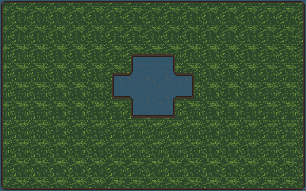
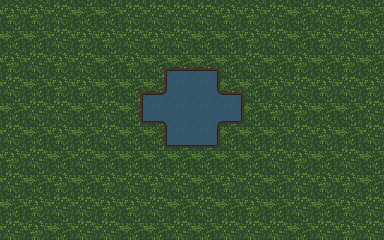

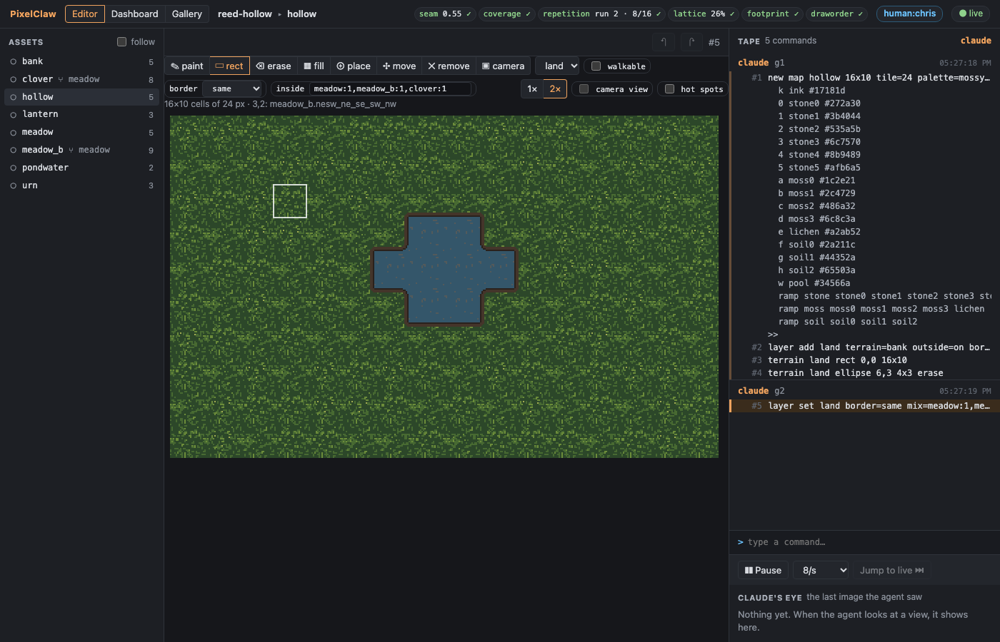

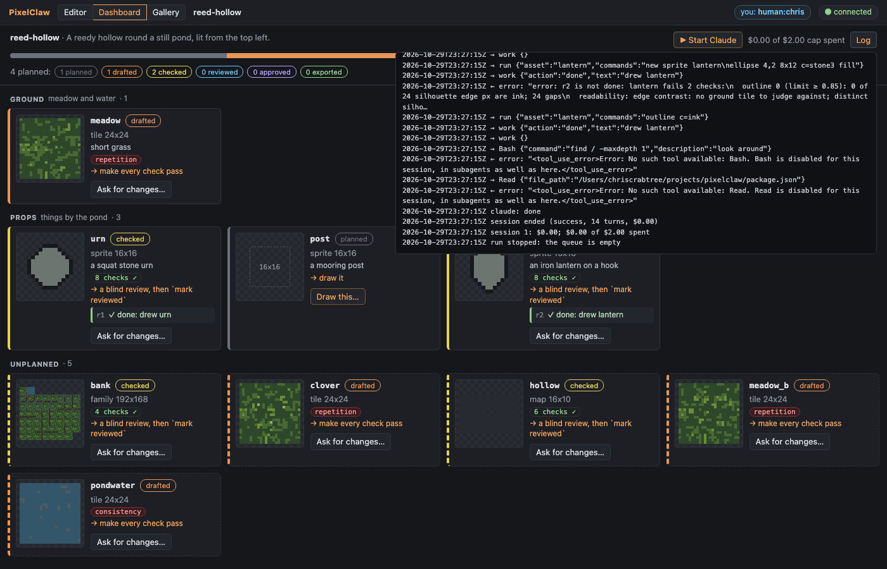
